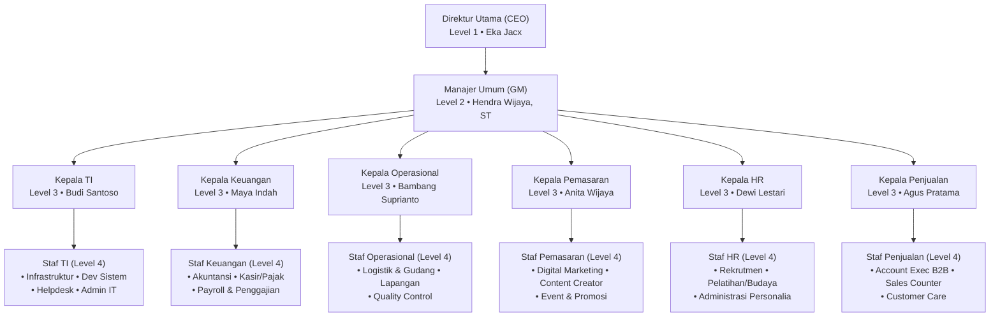
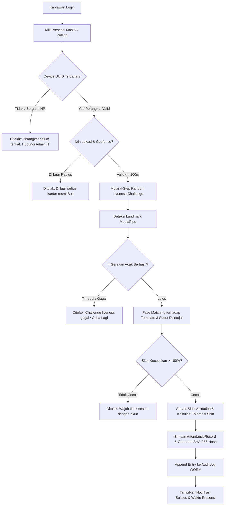
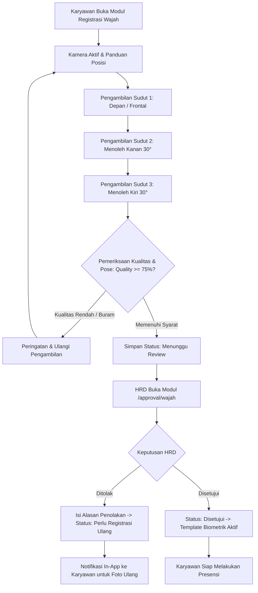
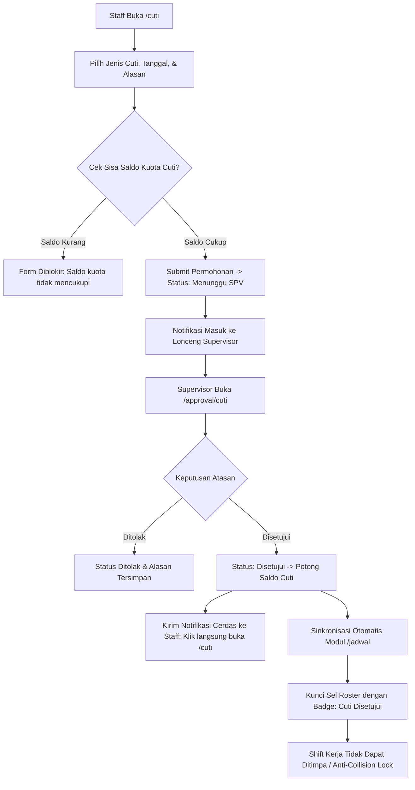

# PRODUCT REQUIREMENTS DOCUMENT (PRD)
## Sistem Absensi Karyawan Berbasis Verifikasi Wajah dan Geolokasi
**Dokumen:** PRD Final v2.0 (As-Built Production Specification)  
**Status:** Produksi / As-Built Aktif (100% Selaras Implementasi Kode)  
**Tanggal Rilis:** 20 November 2026  
**Platform:** Web Application Responsif (Mobile & Desktop)  
**Database:** PostgreSQL 17 via Prisma ORM  

---

## 1. Ringkasan Produk

**Nama aplikasi:** J-Absen  
**Pengembang:** EKA JACX  
**Versi Sistem:** v2.0 (Full-Stack Production Release)  

J-Absen adalah sistem absensi karyawan enterprise modern berbasis web application untuk mengelola data karyawan, akun dan hak akses berjenjang (Configurable RBAC), jadwal kerja & roster mingguan, absensi masuk dan pulang biometrik, pengajuan dan persetujuan cuti bertingkat, koreksi absensi dua tahap, monitoring kehadiran real-time, pencatatan audit trail WORM (Write Once Read Many), serta ekspor laporan resmi terintegrasi Kop Surat perusahaan.

Aplikasi telah beroperasi penuh di atas arsitektur **PostgreSQL 17** dan **Prisma ORM** dengan seluruh data tersimpan secara persisten (28 Karyawan, 6 Departemen Operasional, 27 Jabatan Hierarkis, 4 Pola Shift Kerja, 196 Penugasan Roster Mingguan, dan 41 Aturan Hak Akses RBAC). Absensi mobile dilengkapi verifikasi wajah 3 sudut (Frontal, Kiri, Kanan) + deteksi liveness 4 gerakan acak, validasi geofence GPS kantor radius meter, serta kontrol pengikatan perangkat (Device Binding 1 Akun 1 HP).

Fungsi administrasi sistem desktop dilengkapi modul terisolasi: **Konfigurasi Master Pola Shift** dipusatkan secara aman di menu Pengaturan (`/pengaturan?tab=shift`) yang dilindungi otorisasi manajerial (Staff diblokir total), sedangkan modul `/jadwal` didedikasikan secara bersih untuk pembuatan dan pemantauan **Roster Kerja Mingguan Tim** yang bebas bentrok dengan cuti resmi karyawan.

## 2. Tujuan

1. **Akuntabilitas & Audit Trail Kriptografis:** Menyediakan pencatatan kehadiran yang terstruktur, anti-manipulasi, dan terverifikasi secara kriptografis menggunakan rantai hash SHA-256 (WORM Ledger).
2. **Keamanan Absensi Multi-Lapis:** Mengeliminasi kecurangan absensi (*titip absen* atau *fake GPS*) melalui verifikasi wajah biometrik, challenge liveness dinamis, validasi radius geofence OpenStreetMap, dan hardware fingerprinting / device binding.
3. **Fleksibilitas Operasional & Shift Lintas Hari:** Mendukung pola kerja fleksibel (Office Reguler dan Operasional Shift) termasuk shift malam lintas pergantian hari (*overnight shift*), jam istirahat, serta toleransi keterlambatan presensi.
4. **Otorisasi Manajerial & Kepatuhan RBAC:** Memisahkan wewenang antara Staff, Supervisor, HRD, GM, CEO, dan Admin IT secara server-side dan client-side, menjamin konfigurasi master kerja tidak dapat diintervensi oleh level staf.
5. **Efisiensi Kolaborasi & Bebas Bentrok Jadwal:** Mengintegrasikan kalender roster tim dengan workflow cuti disetujui, mengunci otomatis hari libur cuti agar tidak tertimpa jam shift kerja.
6. **Standarisasi Dokumen Resmi:** Menyediakan profil legalitas perusahaan (Kop Surat otomatis) pada setiap pencetakan lembar kehadiran dan ekspor laporan Excel (`.xlsx`).

## 3. Pengguna dan Peran

Hak akses diterapkan secara ketat baik di tingkat server (Next.js API Routes & database validation) maupun antarmuka pengguna (Route Guard & conditional rendering).

| Peran | Level | Tanggung Jawab dan Cakupan Akses Aktual |
|---|---|---|
| **CEO** (Direktur Utama) | 1 | Pengawasan strategis perusahaan, dashboard analitik eksekutif, rekapitulasi audit log WORM, serta wewenang penjadwalan global seluruh organisasi. |
| **GM** (General Manager) | 2 | Monitoring operasional lintas departemen, pembuatan jadwal bagi Kepala Departemen & staf, peninjauan eskalasi cuti/koreksi, dan konfigurasi master sistem. |
| **HRD** (Kepala HR) | 3 | Pengelolaan siklus hidup karyawan (rekrutmen hingga nonaktif), manajemen akun pengguna, review & approval pendaftaran wajah biometrik, approval final cuti & koreksi absensi, konfigurasi master shift & geofence, serta ekspor laporan payroll. |
| **Supervisor** (Kepala Departemen) | 3 | Monitoring presensi tim divisi, pembuatan & penerbitan roster jadwal mingguan bawahan langsung di departemennya, dan persetujuan tahap pertama cuti / koreksi absensi. Tidak memiliki akses ke konfigurasi sistem. |
| **Staff** (Karyawan) | 4 | Absensi masuk/pulang mobile, pendaftaran sampel wajah biometrik mandiri, pemantauan riwayat kehadiran pribadi, dan pengajuan cuti mandiri melalui portal `/cuti`. Dilarang dan diblokir total dari halaman `/pengaturan` dan `/approval/*`. |
| **Admin IT** (Administrator) | 4 | Pemeliharaan teknis sistem, manajemen perangkat (reset device binding), konfigurasi parameter teknis & titik geofence, pemantauan log audit WORM. Tidak memiliki hak approval bisnis secara default. |

## 4. Platform dan Batas Antarmuka

### 4.1 Mobile
Mobile ditujukan terutama untuk pengalaman karyawan di lapangan dan mendukung:
- Login akun dan autentikasi perangkat (Device Binding).
- Registrasi/enrollment sampel biometrik wajah 3 sudut (Frontal, Kiri, Kanan).
- Absensi masuk dan pulang biometrik + 4 challenge liveness acak.
- Validasi geofence GPS real-time (radius 100m dari Kantor Pusat Bali).
- Melihat kalender roster penugasan shift pribadi.
- Pengajuan cuti mandiri dan pemantauan riwayat status di portal `/cuti`.
- Notifikasi in-app untuk persetujuan cuti dan jadwal baru.

### 4.2 Desktop/PC
Desktop ditujukan untuk operasional manajerial, monitoring, dan tata kelola:
- Dashboard monitoring kehadiran real-time dan statistik ringkasan.
- Manajemen Karyawan, Departemen, dan Struktur Jabatan Hierarkis.
- Portal Khusus Approval: `/approval/cuti`, `/approval/koreksi`, dan `/approval/wajah`.
- Modul Roster Kerja Mingguan Tim (`/jadwal`): Pembuatan, pengeditan, dan ekspor jadwal mingguan terintegrasi cuti.
- Modul Pengaturan Sistem (`/pengaturan`):
  - **Tab 1: Data Perusahaan & Kop Surat** (identitas legalitas, NPWP, NIB, kontak).
  - **Tab 2: Koordinat & Peta Geofence** (titik koordinat GPS dan radius meter kantor).
  - **Tab 3: Pola Jam Kerja & Shift** (master jam shift, toleransi, jam istirahat, overnight).
- Manajemen Akun Pengguna, Keamanan Kredensial & Reset Device Binding HP (`/pengaturan/users`).
- Matriks Hak Akses Dinamis 41 Baseline Permissions (`/pengaturan/rbac`).
- Ledger Audit Log Integritas WORM dengan Rantai Hash SHA-256 (`/audit-log`).
- Laporan Kehadiran Karyawan & Ekspor Excel ber-Kop Surat (`/laporan`).

### 4.3 Hirarki Organisasi dan Departemen Aktual

Struktur organisasi J-Absen mengadopsi hierarki 4 tingkat (Level 1 s.d. Level 4) dengan **Direksi & Eksekutif** sebagai pucuk pimpinan strategis dan **6 Unit Departemen Operasional Riil**:



#### 4.3.1 Daftar 6 Departemen Operasional Riil

| ID Dept | Kode | Nama Departemen | Kepala Departemen (SPV) | Ruang Lingkup Operasional |
|---|---|---|---|---|
| `dept-ti` | TI | Departemen Teknologi Informasi | Budi Santoso | Infrastruktur server, jaringan kantor, helpdesk, dan keamanan data. |
| `dept-fin` | KEU | Departemen Keuangan | Maya Indah | Akuntansi, rekonsiliasi kas, perpajakan, dan payroll karyawan. |
| `dept-ops` | OPS | Departemen Operasional | Bambang Suprianto | Logistik gudang kacamata/lensa, QC, dan operasional lapangan. |
| `dept-mkt` | MKT | Departemen Pemasaran | Anita Wijaya | Strategi digital marketing, content creation medsos, dan kampanye event. |
| `dept-hrd` | HR | Departemen HR | Dewi Lestari | Rekrutmen, verifikasi enrollment wajah, pelatihan, dan administrasi HR. |
| `dept-sales` | SALES | Departemen Penjualan | Agus Pratama | Penjualan B2B instansi, sales counter ritel, dan layanan customer care. |

*Catatan Khusus Direksi:* Pimpinan puncak (CEO & GM) dikelompokkan ke dalam unit `dept-exec` (Direksi & Eksekutif). Unit ini diproteksi secara khusus pada bagan organisasi visual agar tampil di puncak struktur pohon (tanpa memunculkan kotak kosong *"Belum ada kepala departemen"*).

#### 4.3.2 Matriks 27 Jabatan Hierarkis (Database `positions`)

Sistem menerapkan 27 jabatan terstruktur yang terikat pada hierarki pelaporan vertikal (`parentId`):
1. **Level 1 (Pucuk):** Direktur Utama (`pos-dirut`).
2. **Level 2 (Eksekutif):** Manajer Umum / General Manager (`pos-gm`).
3. **Level 3 (Kepala Departemen):** Kepala TI, Kepala Keuangan, Kepala Operasional, Kepala Pemasaran, Kepala HR, Kepala Penjualan.
4. **Level 4 (Staf Pelaksana):** 19 posisi spesifik terdistribusi pada masing-masing unit kerja (misal: Staf Pengembangan Sistem, Staf Payroll, Staf Quality Control, Staf Rekrutmen, Account Executive B2B, dll).

## 5. Ruang Lingkup Fungsional

### 5.1 Manajemen Karyawan
Administrator/HR yang berwenang dapat:
- Membuat, melihat, mengubah, menonaktifkan, dan mengarsipkan data karyawan.
- Mengelola identitas karyawan, nomor/ID karyawan, nama, departemen, jabatan, status, supervisor, dan data relevan lainnya.
- Menetapkan karyawan ke departemen, tim, lokasi, dan aturan jadwal.
- Melihat status akun dan status enrollment wajah.
- Menonaktifkan akses saat karyawan tidak lagi aktif.

Data wajib dan formatnya ditentukan oleh konfigurasi sistem dan kebijakan organisasi.

### 5.2 Manajemen Akun dan Hak Akses
- HR/Admin yang memiliki permission dapat membuat data karyawan sekaligus akun login atau membuat akun untuk karyawan yang telah terdaftar.
- Sistem menyediakan pengaturan role dan permission yang dinamis dan dapat dikonfigurasi (lihat 5.15).
- Aktivasi, penonaktifan, reset/penanganan kredensial, serta pembatasan akses dilakukan dengan prosedur aman.
- Perubahan permission dicatat pada audit log.
- Otorisasi harus diperiksa di server pada setiap endpoint/aksi sensitif.

### 5.3 Login dan Sesi
- Login harus menggunakan mekanisme autentikasi yang aman.
- Sistem menyediakan penanganan sesi, logout, dan pembatasan akses sesuai role.
- Akun tidak aktif atau dinonaktifkan tidak dapat mengakses sistem.
- Role switcher atau simulasi role hanya boleh digunakan pada development/testing; tidak boleh menjadi mekanisme otorisasi production.

### 5.4 Enrollment/Registrasi Wajah (3-Angle Biometric Engine)
Alur enrollment produksi:
1. HR/Admin membuat data karyawan dan akun di sistem.
2. Karyawan login menggunakan akun yang diberikan.
3. Karyawan membuka modul registrasi biometrik wajah melalui kamera perangkat (desktop/laptop webcam atau smartphone mobile).
4. **Engine 3 Sudut Biometrik (Multi-Angle Biometrics):**
   - Sistem memandu karyawan mengambil 3 sudut foto biometrik berurutan:
     - **Sudut 1 - Wajah Depan (Frontal):** Pengambilan tegak lurus dengan pandangan lurus ke kamera.
     - **Sudut 2 - Menoleh ke Kanan (30° Yaw Right):** Memastikan kontur rahang dan pipi kanan terpetakan.
     - **Sudut 3 - Menoleh ke Kiri (30° Yaw Left):** Memastikan kontur rahang dan pipi kiri terpetakan.
   - Deteksi postur sudut (pose estimation) dan pengecekan liveness berlangsung secara real-time via MediaPipe Vision.
   - Sistem memverifikasi kualitas gambar (pencahayaan cukup, wajah tidak buram, bounding box proporsional) dengan indikator Quality Score (minimal ambang batas 75%).
5. Sistem mengompresi representasi vektor wajah dan membuat thumbnail foto avatar secara otomatis.
6. Data biometrik dikirim ke server dan masuk ke status **Menunggu Review** (`PENDING_REVIEW`).
7. HRD / Admin yang berwenang meninjau permohonan biometrik pada modul `/approval/wajah`.
8. Peninjau membandingkan ketiga foto sudut wajah dengan profil karyawan:
   - **Disetujui (`APPROVED`):** Template biometrik aktif dan karyawan langsung diizinkan melakukan presensi masuk/pulang.
   - **Ditolak (`REJECTED`):** Peninjau wajib menyertakan alasan penolakan (misal: pencahayaan gelap, memakai kacamata hitam/masker, wajah buram) dan status karyawan berubah menjadi **Perlu Registrasi Ulang** (`NEEDS_REENROLLMENT`). Karyawan menerima notifikasi in-app untuk melakukan foto ulang.

Status enrollment resmi:
- `NOT_ENROLLED` (Belum terdaftar)
- `PENDING_REVIEW` (Menunggu Review HRD)
- `APPROVED` (Disetujui & Aktif)
- `REJECTED` (Ditolak)
- `NEEDS_REENROLLMENT` (Perlu Registrasi Ulang)
- `DEACTIVATED` (Dinonaktifkan)

Persetujuan HRD wajib sebelum enrollment dapat dipakai untuk absensi masuk maupun pulang.

### 5.5 Verifikasi Wajah dan Challenge Liveness
Verifikasi wajah biometrik diwajibkan pada setiap transaksi absensi masuk dan absensi pulang.

Challenge menggunakan **4 gerakan acak (4-Step Random Liveness Challenge)** yang dipilih secara real-time dari pool instruksi:
- Senyum natural (Smile).
- Menoleh ke arah kiri (Turn Left).
- Menoleh ke arah kanan (Turn Right).
- Mengangkat arah wajah ke atas (Pitch Up) / Menunduk ke bawah (Pitch Down).

Ketentuan operasional:
- Generator acak sisi client memilih 4 gerakan yang tidak dapat diprediksi sebelumnya oleh pengguna guna menangkal serangan replay video, foto cetak, atau topeng 3D (anti-spoofing).
- Setiap instruksi gerakan ditampilkan step-by-step dengan panduan visual dan indikator waktu (timeout 10 detik per gerakan).
- Komponen MediaPipe Vision mengevaluasi orientasi landmark wajah dan threshold ekspresi secara real-time.
- Setelah 4 tantangan liveness tervalidasi, sistem membandingkan geometri wajah aktual dengan template 3 sudut enrollment yang telah disetujui HRD (Face Matching Engine).
- Ambang batas pencocokan (matching confidence score) minimal 80%. Jika tidak memenuhi syarat, absensi ditolak seketika.

### 5.6 Geofence dan Validasi Lokasi (Kantor Pusat Bali & Leaflet Engine)
- Absensi hanya valid jika perangkat karyawan berada dalam radius geofence resmi kantor penempatan aktif.
- **Lokasi Default Kantor Pusat Bali:**
  - Latitude: `-8.409518`
  - Longitude: `115.188916`
  - Radius Default: `100 Meter`
- **Engine Peta Interaktif & GPS 1-Klik:**
  - Terintegrasi modul Leaflet dan OpenStreetMap pada `/pengaturan?tab=lokasi`.
  - Dilengkapi tombol **"Gunakan Koordinat GPS Saat Ini"** (1-Klik GPS Autofill) yang memanfaatkan Browser Geolocation API berakurasi tinggi untuk mengisi otomatis latitude, longitude, dan menampilkan lingkaran radius geofence secara visual pada peta.
- **Validasi Server-Side (Haversine Formula):**
  - Koordinat GPS yang dikirimkan perangkat karyawan dihitung jarak jarak lengkung buminya (*great-circle distance*) menggunakan rumus Haversine di server API Next.js.
  - Jika jarak aktual > radius kantor, transaksi ditolak seketika dengan pesan: *"Anda berada di luar radius kantor resmi (Jarak: X meter dari batas)"*.

### 5.7 Pengaturan Pola Jam Kerja, Shift, dan Keterlambatan
- **Lokasi Modul Produksi:** Seluruh konfigurasi pola shift terpusat di `/pengaturan?tab=shift` (Pengaturan Pola Jam Kerja & Shift).
- **Proteksi Hak Akses (Role-Based Restriction):**
  - Akses modul pengaturan pola shift dibatasi ketat via RBAC.
  - Hanya dapat diakses oleh Super Admin / Admin IT, HRD, dan GM.
  - Karyawan ber-role **Staff diblokir penuh** dari konfigurasi shift (tampilan dialihkan atau menampilkan banner proteksi akses jika mencoba mengakses URL langsung).
- **Konfigurasi Shift Produksi:**
  - **Reguler Office (Pusat Bali):** 08:00 - 17:00 WITA, Istirahat: 12:00 - 13:00 WITA, Toleransi: 15 menit. Berlaku untuk: HRD, Keuangan, TI, Direksi, Eksekutif.
  - **Shift 1 - Pagi Operasional:** 06:00 - 14:00 WITA, Istirahat: 11:30 - 12:30 WITA, Toleransi: 15 menit. Berlaku untuk: Operasional, Pemasaran, Penjualan.
  - **Shift 2 - Siang Operasional:** 14:00 - 22:00 WITA, Istirahat: 18:00 - 19:00 WITA, Toleransi: 15 menit. Berlaku untuk: Operasional, Penjualan.
  - **Shift 3 - Malam (Lintas Tengah Malam):** 22:00 - 06:00 WITA (keesokan harinya), Istirahat: 02:00 - 03:00 WITA, Toleransi: 15 menit, flag `isOvernight = true`. Berlaku untuk: Operasional, TI.
- Sistem secara otomatis menghitung status kehadiran: **Tepat Waktu** (`ON_TIME`) atau **Terlambat** (`LATE`) berdasarkan jam masuk aktual dikurangi toleransi shift.

### 5.8 Absensi Masuk dan Pulang (1-Device Binding & Security Lock)
Alur transaksi presensi:
1. Karyawan login pada smartphone / laptop.
2. **Validasi 1-Device Binding (Pengikatan Smartphone):**
   - Sistem mendeteksi Hardware/Browser Fingerprint (Device UUID).
   - Akun karyawan dikunci hanya dapat presensi dari 1 perangkat terdaftar (`device_bindings`).
   - Jika karyawan berganti perangkat tanpa izin, sistem memblokir presensi dengan pesan: *"Perangkat belum terikat pada akun Anda. Hubungi Admin IT untuk reset pengikatan perangkat"*.
   - Admin IT dapat melepas ikatan perangkat melalui modul manajemen karyawan dengan pencatatan audit log otomatis.
3. Sistem memeriksa izin lokasi dan menghitung posisi perangkat dalam Geofence kantor.
4. Karyawan menjalankan 4-Step Random Liveness Challenge.
5. Sistem mencocokkan wajah dengan template 3 sudut yang telah disetujui.
6. Server memvalidasi seluruh parameter secara terenkripsi:
   - Check-In: Mencatat waktu masuk, foto snapshot, status keterlambatan, koordinat, dan deviasi radius.
   - Check-Out: Mencatat waktu pulang, durasi jam kerja efektif, dan status kepulangan lebih awal (*early departure*).
7. Transaksi dicatat ke database dan dikunci dari duplikasi (*idempotent transaction*).

### 5.9 Roster & Jadwal Mingguan Tim (Matriks Hierarki & Anti-Collision Cuti)
- **Lokasi Modul Produksi:** Dikelola pada modul `/jadwal` (Roster & Jadwal Mingguan Tim).
- **Struktur Matriks Hierarki Atasan-Bawahan:**
  - Jadwal disusun dalam grid mingguan (Senin hingga Minggu) dengan pemilih rentang minggu dinamis.
  - Mengikuti struktur pelaporan hierarki `reports_to`:
    - **Staff:** Hanya dapat melihat jadwal roster pribadi minggu berjalan.
    - **Supervisor / Kepala Departemen:** Menampilkan daftar seluruh anggota tim bawahan langsungnya, dengan fitur penetapan shift kerja harian per staf.
    - **GM & HRD:** Menampilkan matriks roster per departemen dengan kemampuan pengelolaan lintas divisi.
- **Integrasi Cuti Otomatis Anti-Tabrakan (*Anti-Collision Leave Locking*):**
  - Modul jadwal terhubung langsung secara real-time dengan status `leave_requests`.
  - Jika karyawan memiliki cuti berstatus `APPROVED` pada tanggal tertentu, sel jadwal pada hari tersebut otomatis terkunci dan menampilkan badge hijau bertuliskan **"Cuti Disetujui"**.
  - Atasan tidak dapat menimpa (*overwrite*) sel cuti dengan shift kerja operasional, mencegah potensi kesalahan penjadwalan ganda.
- **Ekspor Roster Mingguan:** Fitur unduh format Excel (.xlsx) rapi lengkap dengan Kop Surat Perusahaan dan matriks nama, tanggal, serta nama shift yang ditugaskan.

### 5.10 Pengajuan dan Approval Cuti (Separasi Rute & Smart Notification)
- **Separasi Rute Berdasarkan Role (Role-Based Route Separation):**
  - **Karyawan / Staff -> `/cuti` (Pengajuan & Riwayat Cuti Pribadi):**
    - Berisi formulir pengajuan cuti (Cuti Tahunan, Sakit, Alasan Penting), informasi sisa saldo kuota cuti tahunan (default 12 hari/tahun), serta riwayat pengajuan dan statusnya.
  - **Atasan (Supervisor, GM, HRD, Direksi) -> `/approval/cuti` (Modul Persetujuan Cuti Tim):**
    - Berisi tabel daftar permohonan cuti anggota tim bawahan yang menunggu keputusan, informasi tanggal, alasan, dokumen lampiran, serta tombol **Setujui** dan **Tolak** (disertai isian alasan penolakan).
  - **Proteksi & Navigasi Cerdas:**
    - Jika user ber-role Staff mengakses `/approval/cuti`, sistem tidak menampilkan error fatal melainkan kartu informasi ramah: *"Halaman ini diperuntukkan bagi level Atasan (Supervisor, GM, HRD, Direksi) untuk memeriksa dan memutuskan permohonan cuti anggota tim. Untuk mengajukan cuti pribadi, silakan gunakan menu Pengajuan Cuti"* dilengkapi tombol Call-to-Action langsung menuju `/cuti`.
    - **In-App Notification Click Routing:** Saat karyawan mengklik notifikasi persetujuan cuti (misal: "Permohonan Cuti Tahunan Disetujui"), sistem secara cerdas mengevaluasi role pengguna; jika pengguna adalah Staff, diarahkan langsung ke `/cuti`, sedangkan jika Atasan diarahkan ke `/approval/cuti`.
- **Workflow Baseline Cuti (FINAL P-3 & P-10):**
  - Staff -> 1 Tahap persetujuan oleh Atasan Langsung (`reports_to`). Saat disetujui, saldo cuti tahunan dipotong otomatis dan sel roster jadwal mingguan terkunci.
  - Supervisor -> 1 Tahap oleh General Manager (GM).
  - General Manager -> 1 Tahap oleh CEO.
  - CEO -> Executive Notice.
  - Validasi kuota cuti: Sistem memblokir pengajuan cuti tahunan jika saldo tidak mencukupi (`allow_negative_balance = false`).

### 5.11 Koreksi Absensi
- Pengajuan koreksi absensi dilakukan jika terjadi kendala teknis perangkat atau penugasan luar kantor.
- Karyawan mengisi formulir koreksi di `/koreksi` dengan mencantumkan tanggal, jenis koreksi (jam masuk/jam pulang), jam sebenarnya, alasan logis, dan bukti pendukung.
- **Workflow 2-Tahap Sequential (FINAL P-3):**
  - Tahap 1: Verifikasi dan persetujuan oleh Atasan Langsung (memeriksa kebenaran alasan operasional).
  - Tahap 2: Verifikasi final oleh HRD (validasi data audit, lalu memperbarui data `attendance_records` aktual).
- Data absensi asli tidak dihapus; sistem menyimpan nilai sebelum, nilai sesudah, identitas approver, dan catatan approval di database (`attendance_corrections`).

### 5.12 Dashboard dan Monitoring Real-Time
- **Dashboard Multi-POV:**
  - Tampilan widget dan metrik kehadiran disesuaikan secara real-time dengan role pengguna yang aktif (POV Switcher di header):
    - **Admin IT:** Metrik integritas WORM SHA-256, status device binding, log sistem, dan server health.
    - **HRD:** Metrik kehadiran harian seluruh departemen, rasio ketepatan waktu, antrean verifikasi biometrik wajah baru, dan antrean koreksi.
    - **GM & CEO:** Ringkasan eksekutif kehadiran seluruh divisi, rekapitulasi cuti aktif, dan efisiensi jam kerja.
    - **Supervisor:** Ringkasan kehadiran dan shift anggota unit bawahannya hari ini.
    - **Staff:** Widget status presensi hari ini (jam masuk, jam pulang), jadwal shift minggu berjalan, dan sisa cuti.

### 5.13 Laporan dan Export Excel (Injeksi Kop Surat Resmi Otomatis)
- Seluruh modul laporan dan export tabular menghasilkan dokumen **Microsoft Excel (.xlsx)** berstandar profesional.
- **Fitur Injeksi Kop Surat Resmi Otomatis (*Official Company Letterhead*):**
  - Mengintegrasikan data profil legalitas perusahaan yang dikonfigurasi pada `/pengaturan?tab=perusahaan` (`CompanyProfile`):
    - Baris 1: Nama Resmi Perusahaan (huruf kapital, font tebal ukuran 14pt).
    - Baris 2: Tagline / Slogan Perusahaan (miring / italic).
    - Baris 3: Alamat Kantor Lengkap, Kota, Kode Pos.
    - Baris 4: Kontak Resmi (No. WhatsApp / Telepon) & Legalitas (NPWP, NIB).
    - Baris 5: Garis Pemisah Kop Surat Ganda (Border Double).
    - Baris 7+: Judul Laporan Spesifik, Parameter Periode, Departemen, dan Tabel Data berformat rapi dengan lebar kolom auto-fit.
  - Diterapkan pada seluruh ekspor: Laporan Rekapitulasi Presensi, Roster Jadwal Mingguan Tim, dan Log Audit.

### 5.14 Audit Log Kriptografi WORM (Append-Only SHA-256 Hash Chain)
- **Arsitektur WORM (Write Once, Read Many):**
  - Tabel database `audit_logs` dilindungi secara ketat. Operasi `UPDATE`, `DELETE`, `TRUNCATE`, dan `DROP` dilarang secara permanen pada level basis data.
- **Rantai Hash Kriptografi (SHA-256 Cryptographic Chain):**
  - Setiap rekaman audit memuat atribut `previous_hash` dan `hash`.
  - Nilai hash dihitung secara deterministik menggunakan Web Crypto API / SHA-256 atas gabungan payload: `timestamp + user_id + action + entity + entity_id + details + previous_hash`.
  - Jika terdapat baris log yang dimanipulasi secara ilegal, rantai hash akan terputus dan audit verifier akan mendeteksi pelanggaran integritas data seketika.
- **Indikator Real-Time:**
  - Sistem menampilkan status verifikasi **"Integritas Log WORM (SHA-256 Valid)"** pada panel notifikasi in-app dan modul audit trail untuk pengawasan independen oleh CEO.

### 5.15 Hak Akses Dinamis (Configurable RBAC)

Seluruh hak akses J-Absen dirancang sebagai konfigurasi yang dapat dikelola melalui sistem, bukan aturan yang dikunci di kode program berdasarkan nama role. Role awal (CEO, GM, HR/Admin HR, Supervisor, Staff, Admin Sistem/IT) tetap digunakan sebagai role awal, tetapi permission dan cakupan datanya dapat diubah oleh administrator yang berwenang tanpa mengubah kode program.

**5.15.1 Prinsip**
- Kode program tidak boleh memeriksa nama role (misalnya `if role == "GM"`); pemeriksaan selalu terhadap permission dan cakupan data.
- Otorisasi divalidasi di backend/API pada setiap tindakan yang dilindungi. Menyembunyikan menu atau button tidak cukup.
- Least privilege dan default DENY: permission yang belum dikonfigurasi, belum disetujui, atau masih bertanda ❓ dianggap DENY (tidak diberikan). Tidak ada akses otomatis hanya karena pengguna memiliki jabatan tertentu.
- Tanda ❓ atau permission yang belum diputuskan pada matriks tidak dianggap sebagai permission final dan diperlakukan sebagai DENY.
- Matriks permission awal menggunakan baseline konservatif: permission yang belum ditetapkan tetap DENY. Matriks awal adalah dasar konfigurasi awal (seed konfigurasi), bukan permission yang ditanam di kode, dan bukan aturan permanen; semua permission dapat dikonfigurasi sesuai kemampuan sistem.
- Matriks hak akses pada dokumen pendukung berfungsi sebagai referensi permission awal, template konfigurasi role, dan dasar UI pengelolaan hak akses; bukan aturan permanen.

**5.15.2 Permission dan katalog permission**
- Permission dapat diatur terhadap modul, menu, halaman, data, tindakan, dan button/action.
- Jenis tindakan mencakup antara lain: Create, Read/View, Update/Edit, Delete, Approve, Reject, Export, Import, serta tindakan lain yang relevan.
- Daftar modul, tindakan, dan permission bersifat dapat diperluas bila ada modul atau fitur baru; desain tidak dibatasi pada daftar di atas.
- Setiap permission dapat dikaitkan dengan cakupan data (5.15.4).

**5.15.3 Manajemen role**
- Menyediakan role awal dari PRD.
- Membuat role baru jika diizinkan; mengubah nama dan deskripsi role.
- Mengatur permission dan cakupan data setiap role secara fleksibel.
- Menghubungkan akun karyawan dengan satu atau lebih role.
- Menonaktifkan role yang tidak lagi digunakan, dengan memeriksa akun yang masih terhubung (akun harus dipindahkan atau diputuskan lebih dulu, atau sistem menolak penonaktifan).
- Role sistem yang masih terikat dengan data atau proses bisnis tidak boleh dihapus tanpa mekanisme yang aman; penonaktifan lebih diutamakan daripada penghapusan.
- Perubahan permission berlaku tanpa mengubah kode program.

**5.15.4 Cakupan data (data scope)**
Permission menentukan tindakan sekaligus cakupan data. Cakupan yang didukung:
- Own: data milik sendiri.
- Direct Subordinates: data bawahan langsung.
- Descendants: data seluruh bawahan bertingkat.
- Team: data tim, hanya jika Team digunakan.
- Department: data departemen.
- Selected Departments: data beberapa departemen (daftar departemen dikonfigurasi).
- Organization: data seluruh perusahaan.
- Custom scope: cakupan khusus yang dapat dikembangkan kemudian.

Setiap cakupan dapat dikonfigurasi secara terpisah; cakupan tidak ditentukan permanen berdasarkan nama role.

Cakupan dihitung dari struktur organisasi (hierarki pelaporan, departemen), penempatan karyawan, dan konfigurasi permission, bukan dari nama role. Cakupan divalidasi di backend, termasuk pada daftar, detail, pencarian, dashboard, dan ekspor. Pembatasan "tim" hanya berlaku bila Team digunakan (lihat 4.3.2).

**5.15.5 Pengamanan sistem hak akses**
- Audit log untuk setiap perubahan role, permission, cakupan data, dan hubungan akun-role (aktor, waktu, nilai sebelum dan sesudah).
- Mencegah perubahan yang membuat administrator kehilangan akses sistem secara tidak sengaja (misalnya selalu harus ada minimal satu akun aktif yang berwenang mengelola hak akses).
- Role administratif dan permission kritis ditandai dan dilindungi (misalnya memerlukan konfirmasi tambahan).
- Perubahan permission tidak boleh memberikan akses ke data yang sebelumnya tidak diizinkan tanpa konfigurasi cakupan yang jelas; sistem menampilkan ringkasan dampak sebelum perubahan disimpan.
- Pengelolaan hak akses hanya dapat dilakukan oleh pengguna dengan permission yang sesuai.

**5.15.6 UI pengelolaan hak akses (kebutuhan konseptual)**
Administrator berwenang dapat: melihat seluruh role dan modul; memilih role; mengatur permission melalui checkbox, toggle, atau kontrol yang sesuai; mengatur cakupan data; melihat permission aktif dan tidak aktif; menyimpan perubahan dengan konfirmasi; melihat riwayat perubahan; serta mengatur workflow persetujuan (5.16). Matriks yang besar harus tetap mudah digunakan melalui kategori modul, filter, pencarian, dan pengelompokan permission.

**5.15.7 Pengelolaan, delegasi, dan penerapan perubahan permission**
- Pada tahap awal implementasi, Admin IT adalah pemegang penuh kewenangan pengelolaan role dan permission (keputusan final P-2, lihat 5.15.14). Permission pengelolaan role dan permission tetap dikelola sebagai permission yang dapat dikonfigurasi; pemberiannya kepada pengguna lain hanya dilakukan secara eksplisit oleh Admin IT.
- Batas delegasi: pengelola tidak boleh memberikan permission, cakupan data, atau kewenangan delegasi yang melebihi batas kewenangan yang dimilikinya. Sistem harus mencegah privilege escalation.
- Penerapan perubahan: perubahan permission berlaku secepat mungkin setelah disimpan. Pemberian permission baru memperbarui otorisasi; pencabutan permission berlaku segera atau secepat mungkin secara teknis. Cache permission diperbarui atau diinvalidasi, dan backend/API menggunakan mekanisme otorisasi yang konsisten dengan permission terbaru. Perubahan tidak boleh hanya memengaruhi tampilan menu.
- Perubahan hak akses kritis dapat mensyaratkan re-authentication.

**5.15.8 Pengguna dengan banyak role dan pemetaan jabatan ke role**
- Permission dari beberapa role yang dimiliki pengguna digabungkan dengan mekanisme union of permissions (Allow). Jika tidak ada permission Allow yang berlaku, akses ditolak. Pada tahap awal tidak diterapkan mekanisme Deny override yang kompleks, kecuali diperlukan secara teknis dan telah didokumentasikan.
- Jabatan, departemen, akun, role, dan permission adalah konsep yang terpisah. Jabatan HRD dalam struktur organisasi tidak otomatis menjadi permission.
- Karyawan HRD dapat dipetakan ke role HR/Admin HR sesuai konfigurasi sistem. Pemetaan jabatan ke role tidak boleh dikunci permanen di kode program.
**5.15.9 Scope permission (keputusan final K-11, P-8, P-9)**
- Selain cakupan data berbasis hierarki (5.15.4), permission mendukung scope berdasarkan: global, lokasi, unit/departemen, dan penugasan khusus (custom scope).
- Scope dapat dikonfigurasi dan tidak otomatis memberikan akses; akses tetap memerlukan permission Allow eksplisit.
- **Acuan Scope Lokasi (FINAL P-9):** Scope lokasi mengacu pada kantor penempatan resmi karyawan (`Employee.office_location_id`), bukan koordinat GPS real-time perangkat mobile.
- **Definisi Custom Scope / Penugasan Khusus (FINAL P-8):**
  - Dikelola melalui entitas penugasan khusus (`SPECIAL_ASSIGNMENT_SCOPE`).
  - Memuat atribut: penerima kuasa (`user_id`), target cakupan (`target_employee_ids` atau target departemen), tanggal mulai (`valid_from`), dan tanggal berakhir (`valid_to`).
  - Masa berlaku wajib memiliki batas waktu; hak akses custom scope otomatis gugur saat tanggal melewati `valid_to` tanpa perlu intervensi manual.

**5.15.10 Penghapusan dan penonaktifan role (keputusan final K-15)**
- Role yang sudah memiliki keterikatan data, assignment, atau histori harus dinonaktifkan, bukan dihapus permanen.
- Penghapusan permanen hanya diperbolehkan jika role belum pernah digunakan dan tidak memiliki keterikatan data.

**5.15.11 Permission kritis dan re-authentication (keputusan final P-1, P-7)**
- Permission kritis ditetapkan secara eksplisit dalam katalog dengan flag `is_critical = true`. Eksekusinya wajib meminta validasi ulang kredensial (*re-authentication*).
- **Katalog Permission Kritis Baseline (FINAL P-1):**
  - Manajemen Role: `role.create`, `role.update`, `role.deactivate`, `role.assign_permissions`.
  - Assignment Akun: `user_role.assign`, `user_role.revoke`.
  - Hak Approval Admin IT: `admin_it.grant_approval` (eksklusif oleh CEO).
  - Konfigurasi Keamanan & Geofence: `security_config.update`, `geofence.update`.
  - Tindakan Sensitif Akun: `user_account.deactivate`, `user_account.reset_credential`.
  - Integritas Biometrik: `face_enrollment.reset`.
  - Ekspor Sensitif: `audit_log.export`, `employee.export_full`.
- **Masa Berlaku Sesi Re-Authentication (FINAL P-7):**
  - Menerapkan model Grace Period **10 menit**.
  - Setelah verifikasi kredensial berhasil pada aksi kritis pertama, sesi re-auth aktif selama 10 menit untuk aktivitas konfigurasi kritis berikutnya.
  - Setelah 10 menit idle tanpa aksi kritis, atau saat pengguna logout, sesi re-auth kedaluwarsa seketika.

**5.15.12 Pencabutan dan perubahan akses (keputusan final; melengkapi K-4)**
- Pencabutan atau perubahan permission, role, scope, maupun status akun harus efektif paling lambat 60 detik.
- Sistem mendukung invalidasi cache/session dan otorisasi di sisi server.
- Tindakan kritis memvalidasi akses terbaru (tidak bergantung pada cache atau sesi lama).

**5.15.13 Penetapan pemegang permission (keputusan final)**
- Pada tahap awal, Admin IT menjadi pemegang penuh kewenangan administratif sistem (lihat 5.15.14). HRD tidak otomatis menjadi administrator sistem. CEO tidak otomatis memiliki akses teknis. Jabatan atau nama role tidak otomatis memberikan permission.
- Pemegang permission Role & Permission, Workflow, Audit, Employee Management, Attendance Management, dan permission lainnya ditentukan secara eksplisit oleh Admin IT melalui matriks permission yang dikelola dalam sistem (keputusan final P-2).
- Matriks permission menggunakan prinsip least privilege, deny-by-default, dan scope-based access. Permission diberikan eksplisit dan tidak otomatis berdasarkan nama role atau jabatan. Matriks final harus disetujui sebelum implementasi permission dinyatakan final.

**5.15.14 Kewenangan administratif Admin IT (keputusan final P-2)**
- Pada tahap awal implementasi, Admin IT menjadi pemegang penuh kewenangan administratif sistem, karena bertanggung jawab memahami, mengelola, mengkonfigurasi, memelihara, dan mengamankan sistem.
- Admin IT berwenang penuh untuk:
  - Mengelola Role & Permission.
  - Membuat, mengubah, mengaktifkan, menonaktifkan, dan menetapkan role.
  - Memberikan dan mencabut permission kepada seluruh user.
  - Mengatur scope permission.
  - Mengelola user dan akun.
  - Mengelola konfigurasi workflow dan approver.
  - Mengelola Employee Management, Attendance Management, Leave Management, dan modul lainnya sesuai kebutuhan administratif sistem.
  - Mengelola exception workflow.
  - Mengelola konfigurasi sistem dan keamanan.
  - Mengakses audit log untuk monitoring, investigasi, dan audit sistem.
- Admin IT menentukan permission bagi HRD, CEO, GM, Supervisor, dan Staff melalui matriks permission yang dikelola dalam sistem. Jabatan atau nama role tidak otomatis memberikan permission; permission diberikan dan dikonfigurasi secara eksplisit oleh Admin IT.
- Kewenangan penuh Admin IT tidak menghilangkan kontrol keamanan:
  - Seluruh tindakan administratif (pemberian dan pencabutan permission, perubahan role, konfigurasi workflow, konfigurasi sistem) tercatat di audit log.
  - Tindakan kritis wajib mengikuti aturan re-authentication (5.15.11).
  - Admin IT tidak diperbolehkan menghapus, memanipulasi, atau menghilangkan audit trail aktivitas administratifnya sendiri.
- **Proteksi Akun Admin IT & Anti-Lockout (FINAL P-14):**
  - Sistem mewajibkan minimal **2 Akun Admin IT aktif** terdaftar di sistem.
  - Admin IT dilarang melakukan self-deactivation akun atau self-revocation role miliknya sendiri. Perubahan status/role akun Admin IT hanya dapat dilakukan oleh akun Admin IT aktif lainnya atau CEO.
  - Sistem memblokir penyimpanan perubahan jika mengakibatkan ketiadaan akun Admin IT aktif (*anti-lockout guard*).
- **Integritas Audit Log WORM & Pengawasan (FINAL P-15):**
  - Tabel `AUDIT_LOG` beroperasi secara *Append-Only (WORM - Write Once, Read Many)*; operasi `UPDATE`, `DELETE`, `TRUNCATE`, dan `DROP` diblokir secara permanen di database level.
  - CEO memegang permission khusus membaca audit log (`audit_log.view_all`) untuk fungsi pengawasan independen terhadap seluruh aktivitas administratif yang dijalankan Admin IT.
- Keputusan ini berlaku sebagai model pengelolaan permission pada tahap awal sistem. Perubahan model kewenangan di masa depan harus melalui review dan change request (bagian 16).
- Kewenangan administratif tidak otomatis memberikan hak approval bisnis. Admin IT secara default tidak memiliki permission approval bisnis (keputusan final, lihat 5.16.5).
### 5.16 Workflow Persetujuan yang Dapat Dikonfigurasi

Workflow persetujuan (cuti, koreksi absensi, dan pengajuan lain yang membutuhkan persetujuan) tidak dikunci permanen berdasarkan jabatan.
- Approver, jumlah dan urutan tahapan, serta aturan workflow dapat dikonfigurasi sesuai kebutuhan perusahaan.
- Tidak diasumsikan bahwa CEO selalu menjadi approver terakhir atau GM selalu menjadi approver tertentu.
- Penentuan approver didukung melalui konfigurasi yang dapat dikembangkan, antara lain berdasarkan role, jabatan, struktur organisasi, atasan langsung, atasan bertingkat, pengguna tertentu, dan aturan khusus lain yang nantinya disetujui. Approver tidak dikunci permanen pada jabatan CEO, GM, Supervisor, atau HR.
- Alur persetujuan final belum ditetapkan dan memerlukan persetujuan pemilik proses.
- Hasil keputusan tetap dicatat dan perubahan konfigurasi workflow dicatat pada audit log.
- Perubahan konfigurasi workflow berlaku untuk pengajuan baru. Pengajuan yang sudah berjalan mempertahankan snapshot workflow dan tahapan persetujuan yang berlaku saat pengajuan dibuat, dan tidak diubah otomatis. Perubahan terhadap pengajuan berjalan hanya melalui mekanisme administratif yang jelas, terkontrol, dan tercatat.
- Rancangan konseptual dan daftar keputusan yang tertunda: lihat Rancangan_Configurable_RBAC.md.

**5.16.1 Mode persetujuan (keputusan final K-8, P-11)**
- Workflow mendukung single approval, sequential approval, dan parallel approval.
- Parallel approval mendukung mode `UNANIMOUS` dan `QUORUM` yang dapat dikonfigurasi per workflow:
  - **Mode UNANIMOUS (Default):** 100% approver wajib menyetujui. Satu penolakan langsung menolak permohonan.
  - **Mode QUORUM (FINAL P-11):** Memerlukan ambang batas minimum persetujuan (persentase atau jumlah approver). Jika sisa approver yang belum merespons secara matematis sudah tidak dapat memenuhi kuorum, permohonan langsung ditolak otomatis (*early rejection*).
- Mode dan tahapan persetujuan dapat dikonfigurasi. Workflow final untuk setiap jenis pengajuan belum ditetapkan dan memerlukan persetujuan.

**5.16.2 Kondisi khusus approval (prinsip awal)**
1. Jika approver tidak ditemukan, pengajuan tidak boleh otomatis disetujui.
2. Jika approver tidak tersedia, sistem menggunakan fallback yang telah dikonfigurasi.
3. Self-approval tidak diperbolehkan secara default.
4. Jika pemohon merupakan approver pada tahap yang sama, sistem menggunakan approver berikutnya atau fallback yang dikonfigurasi.
5. Jika tidak ada fallback yang valid, pengajuan ditandai sebagai membutuhkan penanganan administratif.
6. Kondisi khusus yang melibatkan perubahan atau tindakan administratif dicatat dalam audit log.

**5.16.3 Pengelolaan workflow**
- Pada tahap awal implementasi, Admin IT mengelola konfigurasi workflow, approver, dan exception workflow (keputusan final P-2, lihat 5.15.14). Permission pengelolaan workflow tetap dapat dikonfigurasi dan dapat diberikan kepada pengguna lain secara eksplisit oleh Admin IT.

**5.16.4 Fallback dan fail-safe (keputusan final P-4, P-5)**
- Default adalah fail-safe. Pengajuan tidak boleh otomatis disetujui jika approver tidak ditemukan, tidak aktif, tidak merespons, atau terjadi kegagalan teknis.
- **Batas Waktu Approver / Timeout SLA (FINAL P-4):**
  - Batas waktu respon approver ditetapkan default **48 jam kerja (2 hari kerja)** per tahap, dihitung di luar hari libur dan akhir pekan.
  - Jika melebihi batas waktu, status permohonan menjadi `PENDING_ESCALATION` dan masuk ke antrean exception untuk ditangani oleh pengelola workflow / Admin IT.
- **Saluran Notifikasi Exception (FINAL P-5):**
  - Notifikasi exception workflow pada baseline v1.0 menggunakan **In-App Notification** (ikon lonceng dan antrean aksi di dashboard web desktop/mobile) serta **Banner Peringatan** pada dashboard Admin IT dan Approver terkait.
  - Saluran notifikasi eksternal (Email SMTP, WhatsApp) berada di luar scope baseline v1.0.
- Fallback yang dikonfigurasi (5.16.2) tetap berlaku sebagai tujuan penugasan ulang, bukan sebagai persetujuan otomatis.

**5.16.5 Approval bisnis: default DENY dan pembatasan hierarki (keputusan final)**

*a. Default DENY.* Seluruh permission yang berkaitan dengan approval bisnis berstatus DENY secara default, termasuk bagi Admin IT. Approval bisnis mencakup, tetapi tidak terbatas pada: Leave Approval, Attendance Correction Approval, Employee Request Approval, pengajuan perubahan data yang memerlukan approval, dan approval workflow bisnis lainnya. Hak administrasi sistem tidak otomatis memberikan hak approval bisnis. (Daftar ini tidak menambah fitur; berlaku bagi setiap approval yang ada atau ditambahkan kemudian melalui change request.)

*b. Pemberian permission approval.* Permission approval bisnis hanya dapat diberikan secara eksplisit melalui Permission Management dan konfigurasi workflow yang sah.
- CEO dan GM dapat diberikan permission approval bisnis sesuai kebutuhan perusahaan, workflow, scope, dan hierarki.
- Supervisor hanya dapat diberikan permission approval sesuai hierarki dan workflow yang berlaku.
- HRD hanya dapat diberikan permission approval apabila ditentukan secara eksplisit melalui permission dan workflow.
- Tidak ada role yang otomatis mendapatkan seluruh hak approval berdasarkan nama atau jabatan.

*c. Pembatasan berdasarkan hierarki.* Sistem memperhitungkan hubungan hierarki antara pengaju dan approver.
- Self-approval dilarang.
- Supervisor tidak boleh menyetujui permohonan yang diajukan oleh GM atau CEO.
- GM tidak boleh menyetujui permohonan yang diajukan oleh CEO.
- Staff tidak boleh menyetujui permohonan atasannya.
- Approver tidak boleh menyetujui permohonan atasannya apabila aturan hierarki melarang tindakan tersebut.
- Sistem memvalidasi hierarki, permission, scope, dan workflow sebelum setiap approval diproses.

*d. Admin IT.* Admin IT secara default tidak memiliki permission approval bisnis dan tidak boleh otomatis melakukan approval cuti, attendance correction, maupun approval bisnis lainnya, meskipun memiliki kewenangan administratif penuh. CEO dapat secara eksplisit memberikan permission approval bisnis kepada Admin IT jika diperlukan, dengan pembatasan modul, scope, workflow, dan masa berlaku apabila ditentukan. Pemberian, perubahan, dan pencabutan permission approval Admin IT wajib dicatat dalam Audit Trail.

*e. Pengamanan hierarki.* Permission approval tidak boleh mengabaikan hierarki organisasi secara otomatis. Pengecualian hierarki hanya dapat dilakukan apabila mekanisme pengecualian telah dirancang secara eksplisit, memiliki authorization yang sah, dan tercatat dalam Audit Trail. Sistem tidak menganggap Admin IT, HRD, GM, Supervisor, atau role lainnya otomatis berhak melakukan approval di luar workflow dan hierarki yang berlaku. Mekanisme pengecualian hierarki belum dirancang dan tidak termasuk scope saat ini.

*f. Validasi dan Audit Trail.* Setiap tindakan approval wajib memvalidasi: identitas pelaku; permission approval aktif; scope kewenangan; hierarki pengaju dan approver; workflow yang berlaku; status permohonan; larangan self-approval; pembatasan approval terhadap atasan; dan aturan pengecualian apabila ada. Tindakan approval yang tidak memenuhi aturan wajib ditolak dan dicatat dalam Audit Trail. Keputusan ini menjadi dasar implementasi Authorization Engine, Permission Matrix, Approval Workflow, dan Audit Trail.

*g. Keputusan lanjutan (final, sesuai rekomendasi yang disetujui).*
- **Pemberian approval kepada Admin IT:** CEO memegang permission khusus untuk memberikan permission approval bisnis kepada Admin IT. Admin IT tidak dapat memberikan permission approval kepada dirinya sendiri. Tindakan ini adalah tindakan kritis (wajib re-authentication) dan tercatat di Audit Trail. Ketentuan ini merupakan pengecualian khusus atas kewenangan Admin IT memberikan permission (5.15.14): permission approval bisnis bagi Admin IT tidak diberikan oleh Admin IT sendiri.
- **Approver di luar garis pelaporan:** HRD, Admin IT yang diberi permission, atau role lain di luar garis pelaporan dapat menjadi approver apabila permission, scope, dan workflow mengizinkan, dan approver bukan bawahan (descendant) pengaju serta bukan pengaju sendiri. Approver untuk permohonan yang diajukan CEO ditetapkan eksplisit pada workflow.
- **Pengecualian hierarki:** ditunda. Tidak ada pengecualian hierarki sampai ada rancangan dan change request.
- **Review enrollment wajah dan persetujuan serupa:** diperlakukan sebagai approval bisnis; DENY secara default (termasuk Admin IT) dan diberikan secara eksplisit. Aturan hierarki pengaju-atasan tidak berlaku untuk enrollment bila tidak ada relasi pengaju-atasan, sedangkan scope, permission, status, dan Audit Trail tetap divalidasi.
## 6. Aturan Bisnis

1. Absensi masuk/pulang memerlukan akun aktif dan enrollment wajah berstatus Disetujui.
2. Absensi memerlukan challenge liveness empat gerakan acak yang berhasil.
3. Absensi harus memenuhi aturan geofence yang berlaku, kecuali pengecualian melalui workflow resmi.
4. Jadwal dan aturan kerja yang berlaku harus ditentukan sebelum kalkulasi keterlambatan.
5. Toleransi keterlambatan, jam kerja, shift, lokasi, dan kebijakan operasional dapat dikonfigurasi oleh role yang berwenang.
6. Approval enrollment wajah, cuti, dan koreksi harus terotorisasi serta dapat diaudit.
7. Data historis tidak boleh dimodifikasi atau dihapus secara diam-diam.
8. Pengguna hanya dapat melihat atau mengubah data sesuai permission dan cakupan akses.
9. Validasi client-side tidak cukup; keputusan transaksi dan authorization harus divalidasi server-side.
10. Karyawan office dan non-office mengikuti aturan jadwal yang dapat ditentukan administrator.
11. Hak akses ditentukan oleh konfigurasi permission dan cakupan data, bukan oleh nama role yang ditanam di kode.
12. Permission yang belum dikonfigurasi atau belum diputuskan dianggap tidak diberikan (least privilege).
13. Approver dan tahapan persetujuan ditentukan oleh konfigurasi workflow, bukan oleh jabatan yang dikunci.
14. Perubahan role, permission, cakupan data, dan workflow wajib tercatat pada audit log dan tidak boleh membuat administrator kehilangan akses sistem.
15. Self-approval tidak diperbolehkan secara default; pengajuan tanpa approver tidak boleh otomatis disetujui (lihat 5.16.2).
16. Permission beberapa role digabungkan secara union (Allow); tanpa Allow yang berlaku, akses ditolak (lihat 5.15.8).
17. Pengajuan berjalan mempertahankan snapshot workflow saat dibuat (lihat 5.16).
18. Pencabutan atau perubahan permission, role, scope, dan status akun efektif paling lambat 60 detik; tindakan kritis wajib re-authentication (lihat 5.15.11-5.15.12).
19. Role yang memiliki keterikatan data, assignment, atau histori dinonaktifkan, bukan dihapus permanen (lihat 5.15.10).
20. Pengajuan tidak otomatis disetujui jika approver tidak ditemukan, tidak aktif, tidak merespons, atau terjadi kegagalan teknis (lihat 5.16.4).
21. Jabatan atau nama role tidak otomatis memberi permission; permission diberikan dan dikonfigurasi eksplisit oleh Admin IT, pemegang kewenangan administratif penuh pada tahap awal (lihat 5.15.13 dan 5.15.14).
22. Admin IT tidak boleh menghapus, memanipulasi, atau menghilangkan audit trail aktivitas administratifnya sendiri; tindakan administratif tercatat dan tindakan kritis wajib re-authentication.
23. Seluruh permission approval bisnis DENY secara default, termasuk bagi Admin IT; hak administrasi sistem tidak memberi hak approval bisnis (lihat 5.16.5).
24. Self-approval dilarang; approver tidak boleh menyetujui permohonan atasannya sesuai aturan hierarki (Supervisor terhadap GM/CEO, GM terhadap CEO, Staff terhadap atasan).
25. Setiap approval memvalidasi identitas, permission, scope, hierarki, workflow, status permohonan, dan larangan di atas; approval yang tidak memenuhi syarat ditolak dan dicatat di Audit Trail.
26. Pengecualian hierarki hanya melalui mekanisme yang dirancang eksplisit, terotorisasi, dan tercatat di Audit Trail.
27. Permission approval bagi Admin IT hanya diberikan oleh CEO (permission khusus), tidak dapat diberikan Admin IT kepada dirinya sendiri, dan tindakannya kritis serta tercatat.
28. Review enrollment wajah diperlakukan sebagai approval bisnis: DENY secara default dan diberikan eksplisit.
29. Tindakan kritis wajib melalui re-authentication dengan grace period 10 menit; permission kritis ditandai eksplisit di katalog (P-1, P-7).
30. Batas waktu approver adalah 48 jam kerja; keterlambatan respon memicu eskalasi fail-safe tanpa auto-approval (P-4).
31. Validasi saldo cuti memblokir pengajuan jika kuota tidak mencukupi dan jenis cuti tidak mengizinkan saldo negatif (P-10).
32. Minimal 2 akun Admin IT aktif wajib dipertahankan; self-deactivation dan self-revocation akun Admin IT dilarang (P-14).
33. Tabel Audit Log beroperasi WORM (hanya INSERT/SELECT); CEO memegang hak baca pengawasan independen (P-15).
34. Custom scope wajib memiliki rentang waktu (valid_from dan valid_to) dan otomatis gugur setelah tanggal berakhir (P-8).

## 7. Kebutuhan Non-Fungsional

### 7.1 Keamanan
- Autentikasi aman dan manajemen sesi.
- RBAC dan validasi permission server-side.
- Perlindungan endpoint dan data dari akses tidak sah.
- Validasi input dan perlindungan terhadap serangan umum web.
- Data biometrik dan data lokasi diperlakukan sebagai data sensitif; akses, penggunaan, penyimpanan, dan retensinya harus dibatasi.
- Tidak menyimpan gambar wajah mentah secara permanen kecuali diperlukan, disetujui, dan diatur oleh kebijakan yang jelas.
- Enkripsi saat transit dan, jika sesuai, saat penyimpanan.
- Audit log untuk tindakan penting.
- Otorisasi dinamis (RBAC configurable): permission dan cakupan data divalidasi di backend pada setiap tindakan yang dilindungi; penerapan least privilege; perlindungan terhadap lockout administrator dan role/permission kritis (lihat 5.15).

### 7.2 Privasi
- Informasi kepada karyawan mengenai penggunaan data wajah dan lokasi.
- Pengumpulan data seminimal mungkin.
- Kebijakan retensi, penghapusan, akses, dan pemrosesan data biometrik/lokasi.
- Penggunaan data dibatasi untuk tujuan yang telah ditetapkan.
- Peninjauan kepatuhan terhadap peraturan perlindungan data yang berlaku sebelum production.

### 7.3 Performa dan Reliabilitas
- Antarmuka harus responsif dan memberikan indikator proses.
- Proses verifikasi menampilkan status yang jelas.
- Error dan kegagalan jaringan ditangani tanpa membuat rekaman transaksi ganda.
- Operasi penting harus memiliki logging dan mekanisme penanganan kegagalan.
- Target performa terukur (misalnya waktu respons API dan waktu verifikasi) ditetapkan dalam tahap pengujian/deployment.

### 7.4 Usability dan Responsiveness
- Mobile: layar absensi dan pengajuan mudah digunakan, layout tidak bertumpuk.
- Desktop: sidebar kiri, konten utama kanan, layout konsisten.
- Navigasi, modal, tabel, form, dan transisi halaman konsisten.
- Status loading, empty state, success, dan error tersedia.
- Teks dan kontrol dapat diakses pada ukuran layar yang didukung.

## 8. Teknologi dan Arsitektur As-Built (Production Specification)

Sistem J-Absen diimplementasikan secara penuh (*as-built*) menggunakan arsitektur modern berbasis TypeScript dan Next.js App Router:

### 8.1 Komponen Teknologi Utama
- **Framework & Runtime:** Next.js 15.5+ (App Router architecture, React Server Components dan API Routes terisolasi).
- **Frontend & UI Layer:**
  - React 19 (React Hooks, Server Actions, Dynamic Client Components).
  - TypeScript (Strict Mode) untuk keamanan tipe data end-to-end.
  - Tailwind CSS untuk antarmuka responsif (Mobile First & Desktop Sidebar).
  - Headless UI Primitives (`@base-ui/react`), Class Variance Authority (`cva`), dan utilitas `cn` (`clsx` + `tailwind-merge`).
  - Lucide React untuk pustaka ikon sistem terstandarisasi.
- **Database & ORM:**
  - PostgreSQL 17 (Enterprise Relational Database Management System).
  - Prisma ORM 5/6 (Typesafe Database Client, schema migrations, relasi berjenjang).
- **Biometrik & Computer Vision:**
  - Google MediaPipe FaceMesh & Vision Tasks untuk inferensi landmark biometrik di sisi browser.
  - Multi-Angle Capture Engine (Frontal, Kanan 30°, Kiri 30°).
  - Liveness Detection Engine (4 gerakan acak real-time).
- **Geospasial & Pemetaan:**
  - Leaflet & OpenStreetMap (dynamic client loading) pada modul `/pengaturan?tab=lokasi`.
  - Browser Geolocation API berakurasi tinggi (1-Klik GPS Autofill).
  - Server-Side Haversine Great-Circle Distance Calculator pada Next.js API handler.
- **Keamanan & Kriptografi:**
  - Web Crypto API / SHA-256 Engine untuk rantai blok audit log WORM (*Append-Only Hash Chain*).
  - 1-Device Fingerprint Binding (Hardware/Browser UUID lock).
  - Role-Based Access Control (RBAC) dinamis dengan katalog permission granular.
- **Pelaporan & Kantor Digital:**
  - Engine Microsoft Excel (.xlsx) dengan modul penulisan biner dan *Automatic Official Letterhead Injection* (Kop Surat Resmi Perusahaan dinamis).

### 8.2 Pemisahan Lapisan Arsitektur (Separation of Concerns)
- **Presentation Layer (`src/app/`, `src/components/`):** Terbagi atas antarmuka Mobile (Bottom Navigation & Kartu Presensi) dan Desktop (Sidebar Kiri, Header dengan POV Role Switcher & Lonceng Notifikasi Cerdas, Konten Utama).
- **Business Logic & Controller Layer (`src/app/api/`):** API routes terproteksi yang memvalidasi otorisasi server-side, validasi input, kalkulasi jam kerja, dan toleransi keterlambatan.
- **Data Access Layer (`prisma/`):** Akses data terpusat melalui Prisma Client dengan relasi referensial integrity dan proteksi cascade.

---

## 9. Entitas Data Produksi (15 Prisma Models)

Skema basis data produksi terdiri dari 15 model terintegrasi pada PostgreSQL 17:

1. **`Department` (`departments`):** 6 Departemen Operasional resmi (`dept-ti`, `dept-fin`, `dept-ops`, `dept-mkt`, `dept-hrd`, `dept-sales`).
2. **`Position` (`positions`):** 27 Jabatan terstruktur dalam 4 level hierarki (Level 1: CEO, Level 2: GM, Level 3: Kepala Departemen, Level 4: Staff/Pelaksana).
3. **`Employee` (`employees`):** Data identitas karyawan (NIK sebagai Primary Key, nama, email, nomor HP, status kerja, relasi departemen, jabatan, dan avatar).
4. **`User` (`users`):** Akun autentikasi login (username, hash password, status akun, role default, tracking login terakhir).
5. **`DeviceBinding` (`device_bindings`):** Pengikatan smartphone tunggal (1-Device Binding) via hardware/browser UUID dengan status `TERIKAT` atau `BEBAS`.
6. **`OfficeLocation` (`office_locations`):** Lokasi kantor geofence resmi (Kantor Pusat Bali, koordinat latitude, longitude, dan radius 100 meter).
7. **`AttendanceRecord` (`attendance_records`):** Riwayat presensi masuk/pulang, deviasi jarak GPS, snapshot foto biometrik, status kehadiran, dan SHA-256 verification hash.
8. **`LeaveRequest` (`leave_requests`):** Permohonan cuti tahunan, cuti sakit, dan izin khusus dengan catatan persetujuan atasan/HRD.
9. **`AttendanceCorrection` (`attendance_corrections`):** Permohonan koreksi jam absensi melalui alur 2 tahap (Supervisor -> HRD) lengkap dengan alasan dan bukti.
10. **`Shift` (`shifts`):** Master pola shift kerja (Reguler Office, Shift 1 Pagi, Shift 2 Siang, Shift 3 Malam Lintas Tengah Malam).
11. **`ScheduleAssignment` (`schedule_assignments`):** Roster mingguan penugasan shift per karyawan per tanggal dengan proteksi anti-collision cuti.
12. **`AuditLog` (`audit_logs`):** Ledger audit forensik WORM (Write Once, Read Many) dengan atribut `hash` dan `prevHash` (SHA-256 block chain).
13. **`CompanyProfile` (`company_profiles`):** Legalitas resmi entitas perusahaan (Nama PT, Tagline, Alamat, Kota, Kode Pos, WhatsApp, NPWP, NIB) untuk injeksi Kop Surat Excel.
14. **`FaceEnrollment` (`face_enrollments`):** Pendaftaran biometrik wajah 3 sudut (Depan, Kiri, Kanan), skor kualitas (qualityScore), dan alur review HRD.
15. **`RolePermission` (`role_permissions`):** Matriks izin granular yang memetakan role pengguna terhadap kode aksi sistem.

---

## 10. Diagram Flow Sistem Produksi

### 10.1 Workflow Absensi Masuk & Pulang (Biometrik 4-Step + Geofence + 1-Device Binding)



### 10.2 Workflow Enrollment Wajah 3 Sudut (Multi-Angle & HRD Approval)



### 10.3 Workflow Pengajuan Cuti & Sinkronisasi Anti-Tabrakan Roster



---

## 11. Diagram Flow Database Produksi (Prisma As-Built ERD)

Diagram ERD berikut merepresentasikan 100% skema aktual yang berjalan di PostgreSQL 17 via Prisma ORM:

```mermaid
erDiagram
    Department ||--o{ Position : "has_positions"
    Department ||--o{ Employee : "members"
    Position ||--o{ Position : "subordinates"
    Position ||--o{ Employee : "assigned_employees"
    Employee ||--o| User : "account"
    Employee ||--o{ AttendanceRecord : "presensi"
    Employee ||--o{ LeaveRequest : "leaves"
    Employee ||--o{ AttendanceCorrection : "corrections"
    Employee ||--o{ ScheduleAssignment : "rosters"
    Employee ||--o{ FaceEnrollment : "face_templates"
    User ||--o| DeviceBinding : "locked_device"
    User ||--o{ AuditLog : "audit_events"
    OfficeLocation ||--o{ AttendanceRecord : "checkin_location"
    Shift ||--o{ ScheduleAssignment : "shift_pattern"

    Department {
        string id PK "dept-ti, dept-fin, dll"
        string name UK "Nama Departemen"
        string code UK "TI, FIN, OPS, MKT, HRD, SLS"
        string description
        string color
        datetime createdAt
        datetime updatedAt
    }

    Position {
        string id PK "pos-ceo, pos-gm, pos-spv-ti, dll"
        string title "Nama Jabatan"
        string departmentId FK
        string parentId FK "Hierarki Atasan Langsung"
        int level "1:Direksi, 2:GM, 3:DeptHead, 4:Staff"
        datetime createdAt
        datetime updatedAt
    }

    Employee {
        string id PK "NIK: DIR-001, TI-101, dll"
        string name "Nama Lengkap Karyawan"
        string email UK
        string phone
        string positionId FK
        string departmentId FK
        string employmentStatus "Tetap, Kontrak, DW, Magang"
        date joinDate
        string avatarUrl
        datetime createdAt
        datetime updatedAt
    }

    User {
        string id PK "cuid"
        string employeeId UK FK
        string username UK
        string passwordHash
        string role "Staff, Supervisor, HRD, GM, CEO, Admin IT"
        boolean mustChangePassword
        datetime passwordLastChangedAt
        string status "Aktif, Terkunci, Nonaktif"
        datetime lastLoginAt
        datetime createdAt
        datetime updatedAt
    }

    DeviceBinding {
        string id PK "cuid"
        string userId UK FK
        string deviceId "UUID / Hardware Fingerprint HP"
        string deviceName "Model HP Karyawan"
        string deviceBindingStatus "TERIKAT, BEBAS"
        datetime boundAt
        datetime updatedAt
    }

    OfficeLocation {
        string id PK "cuid"
        string name "Kantor Pusat Bali"
        string address
        float latitude "-8.409518"
        float longitude "115.188916"
        int radiusMeters "100 Meter"
        boolean isActive
        datetime createdAt
        datetime updatedAt
    }

    AttendanceRecord {
        string id PK "REC-YYYYMMDD-XXX"
        string employeeId FK
        string officeId FK
        date date
        string type "masuk, pulang"
        datetime timestamp
        string timeFormatted "07:54:12 WIB"
        int distanceMeters "Jarak Geofence"
        float latitude
        float longitude
        boolean isWithinRadius
        string photoUrl "Foto Snapshot Biometrik"
        string verificationHash "SHA-256 Hash"
        string status "Tepat Waktu, Terlambat, Pulang Cepat"
        string notes
        datetime createdAt
        datetime updatedAt
    }

    LeaveRequest {
        string id PK "CUTI-YYYYMM-XXX"
        string employeeId FK
        string leaveType "Cuti Tahunan, Sakit, Izin Khusus"
        date startDate
        date endDate
        int daysCount
        string reason
        string status "Menunggu SPV, Disetujui, Ditolak"
        string approvalNotes
        datetime approvedBySpvAt
        datetime approvedByHrdAt
        datetime createdAt
        datetime updatedAt
    }

    AttendanceCorrection {
        string id PK "KOR-YYYYMM-XXX"
        string employeeId FK
        date targetDate
        string originalClockIn
        string proposedClockIn
        string originalClockOut
        string proposedClockOut
        string reason
        string status "Menunggu SPV, Menunggu HRD, Disetujui Final"
        string supervisorNotes
        datetime supervisorApprovedAt
        string hrdNotes
        datetime hrdApprovedAt
        datetime createdAt
        datetime updatedAt
    }

    Shift {
        string id PK "shift-reguler, shift-1-pagi, dll"
        string name "Nama Pola Shift"
        string startTime "08:00"
        string endTime "17:00"
        string color
        datetime createdAt
        datetime updatedAt
    }

    ScheduleAssignment {
        string id PK "cuid"
        string employeeId FK
        string shiftId FK
        date date
        boolean isOffDay
        datetime createdAt
        datetime updatedAt
    }

    AuditLog {
        string id PK "WORM-YYYYMMDD-XXXX"
        datetime timestamp
        string userId FK
        string actorName
        string actorRole
        string actorEmail
        string ipAddress
        string actionName
        string module
        string targetObject
        string riskLevel "INFO, WARNING, CRITICAL"
        string status "SUCCESS, FAILED, BLOCKED"
        string hash "SHA-256 Hash Blok Ini"
        string prevHash "SHA-256 Hash Blok Sebelumnya"
        json details "Metadata Perubahan Data"
        datetime createdAt
    }

    CompanyProfile {
        string id PK "default-company"
        string name "PT ANTIGRAVITY INOVASI DIGITAL"
        string legalEntity "Perseroan Terbatas (PT)"
        string businessField "Enterprise Workforce Solution"
        string address "Jl. Sunset Road No. 88, Kuta, Bali"
        string phone "(0361) 849-8800"
        string email "corporate@antigravity.co.id"
        string website "https://www.antigravity.co.id"
        datetime updatedAt
    }

    FaceEnrollment {
        string id PK "ENR-YYYYMM-XXX"
        string employeeId FK
        datetime submissionDate
        string sampleFront "Foto Sudut Depan"
        string sampleLeft "Foto Sudut Kiri 30°"
        string sampleRight "Foto Sudut Kanan 30°"
        int qualityScore "95"
        string lightingQuality "Optimal"
        int landmarkCount "68"
        string status "Menunggu Review, Disetujui, Ditolak"
        string hrNotes
        string reviewedBy
        datetime reviewedAt
        datetime createdAt
        datetime updatedAt
    }

    RolePermission {
        string id PK "cuid"
        string role "CEO, GM, HRD, Supervisor, Staff, Admin IT"
        string permission "Kode Permission Granular"
        boolean isAllowed
        datetime updatedAt
    }
```

### 11.1 Karakteristik Skema Database Produksi
- **Integritas Relasional:** Pemetaan Foreign Key penuh antar entitas organisasi (`departments` -> `positions` -> `employees` -> `users`).
- **Pencegahan Redundansi & Duplikasi:** Constraint Unique (`@@unique([employeeId, date])`) pada `schedule_assignments` dan (`@@unique([role, permission])`) pada `role_permissions`.
- **Kriptografi Rantai WORM:** Indeks `hash` pada tabel `audit_logs` memungkinkan verifikasi integritas berkecepatan tinggi tanpa pemindaian tabel menyeluruh (*full table scan*).
- **Format Penyimpanan Tanggal Konsisten:** Menggunakan `@db.Date` untuk tanggal kalender tanpa distorsi zona waktu pada presensi, cuti, dan jadwal.

## 12. Alur Utama Produksi (End-to-End User Journeys)

### 12.1 Pembuatan Karyawan dan Enrollment Biometrik 3-Sudut
HR/Admin membuat profil karyawan (`Employee`) dan akun pengguna (`User`) → Karyawan login pertama kali → Karyawan membuka formulir enrollment wajah → Panduan interaktif mengambil 3 sudut foto biometrik (Frontal, Kanan 30°, Kiri 30°) → Pemeriksaan pose dan liveness real-time (Quality Score >= 75%) → Data biometrik tersimpan dengan status `PENDING_REVIEW` → HRD membuka dashboard `/approval/wajah` → HRD memverifikasi ketiga sudut foto → Jika disetujui, template biometrik berstatus `APPROVED` dan karyawan siap melakukan absensi. Jika ditolak, HRD menyertakan alasan dan karyawan diminta registrasi ulang.

### 12.2 Presensi Masuk & Pulang Terproteksi (1-Device Binding + Geofence + Liveness)
Karyawan membuka aplikasi absensi di smartphone → Sistem memverifikasi kecocokan Hardware UUID dengan `device_bindings` → Sistem menghitung koordinat GPS via rumus Haversine terhadap Kantor Pusat Bali (maksimal 100 meter) → Sistem menyajikan 4-Step Random Liveness Challenge (senyum, toleh kiri, toleh kanan, atas/bawah) → MediaPipe mendeteksi gerakan secara real-time → Sistem mencocokkan wajah dengan template 3-sudut (skor >= 80%) → Transaksi tercatat aman ke `attendance_records` dengan SHA-256 verification hash dan di-append ke `audit_logs` WORM → Status kehadiran (Tepat Waktu / Terlambat) ditampilkan seketika.

### 12.3 Pengajuan Cuti & Penguncian Roster Anti-Tabrakan
Staff membuka rute `/cuti` → Sistem menampilkan kuota sisa cuti tahunan dan form permohonan → Staff mengisi tanggal dan alasan → Validasi kuota cuti server-side → Status permohonan menjadi `Menunggu SPV` → In-App Notification terkirim ke Supervisor → Supervisor membuka `/approval/cuti` → Supervisor menyetujui permohonan → Status permohonan menjadi `APPROVED`, kuota berkurang, dan sel jadwal pada modul `/jadwal` otomatis terkunci dengan badge "Cuti Disetujui" (anti-tabrakan shift) → Notifikasi persetujuan dikirim ke Staff (klik notifikasi langsung membuka `/cuti`).

### 12.4 Koreksi Absensi 2-Tahap
Karyawan mengajukan koreksi jam kehadiran di `/koreksi` beserta bukti → Permohonan masuk ke antrean Supervisor (Tahap 1) → Supervisor memverifikasi keabsahan alasan → Permohonan diteruskan ke HRD (Tahap 2) → HRD memvalidasi log geofence dan menyetujui perubahan → Record absensi pada `attendance_records` diperbarui dengan audit trail nilai sebelum dan sesudah.

---

## 13. Kriteria Keberterimaan Produksi (Production Acceptance Criteria)

### 13.1 Karyawan, Akun, dan 1-Device Binding
- HR/Admin dapat membuat, mengubah, dan menonaktifkan data karyawan dan akun pengguna.
- Sistem mengunci akun karyawan pada 1 smartphone terdaftar via Hardware/Browser UUID (`device_bindings`).
- Pergantian perangkat tanpa otorisasi diblokir; reset pengikatan perangkat hanya dapat dilakukan oleh Admin IT dengan pencatatan audit log lengkap.

### 13.2 Enrollment Wajah 3-Sudut & Review HRD
- Registrasi biometrik memandu pengambilan 3 sudut wajah secara berurutan: Depan (Frontal), Kanan 30°, dan Kiri 30°.
- Evaluasi kualitas otomatis memastikan pencahayaan cukup, wajah tidak terhalang, dan Quality Score minimal 75%.
- Template biometrik tidak dapat digunakan sebelum disetujui HRD di modul `/approval/wajah`.
- Penolakan biometrik wajib disertai catatan alasan yang tampil di notifikasi karyawan.

### 13.3 Challenge Liveness 4-Gerakan Acak & Face Matching
- Sistem menginstruksikan 4 gerakan acak per sesi presensi yang tidak dapat diprediksi sebelumnya.
- Deteksi liveness MediaPipe FaceMesh berjalan halus di browser dengan batas waktu 10 detik per gerakan.
- Face matching terhadap 3 sudut wajah terdaftar harus mencapai ambang batas kecocokan minimal 80%.

### 13.4 Geofence Kantor Pusat Bali & Leaflet GPS 1-Klik
- Geofence Kantor Pusat Bali (Latitude: -8.409518, Longitude: 115.188916, Radius: 100m) ditegakkan secara server-side via formula Haversine.
- Modul `/pengaturan?tab=lokasi` terintegrasi peta interaktif Leaflet + OpenStreetMap dan tombol "Gunakan Koordinat GPS Saat Ini" (1-Klik Autofill).
- Presensi di luar radius kantor ditolak dengan pesan selisih jarak meter aktual.

### 13.5 Pola Jam Kerja Shift di `/pengaturan?tab=shift` & Roster `/jadwal`
- Konfigurasi pola shift dipindahkan penuh ke `/pengaturan?tab=shift` dan diproteksi ketat: hanya dapat diakses Admin IT, HRD, dan GM; peran **Staff diblokir penuh**.
- Mendukung konfigurasi Reguler Office, Shift 1 Pagi, Shift 2 Siang, dan Shift 3 Malam Lintas Tengah Malam (`isOvernight`).
- Modul `/jadwal` menampilkan matriks roster mingguan berbasis hierarki Atasan-Bawahan (`reports_to`).
- Integrasi cuti anti-tabrakan: Jika cuti karyawan telah disetujui, sel roster pada tanggal tersebut otomatis terkunci dengan badge "Cuti Disetujui" dan tidak dapat ditimpa jadwal kerja.

### 13.6 Separasi Rute Cuti Staff (`/cuti`) vs Approval Atasan (`/approval/cuti`)
- Staff diarahkan ke `/cuti` (form pengajuan, kuota, dan riwayat cuti pribadi).
- Atasan diarahkan ke `/approval/cuti` (tabel persetujuan cuti bawahan).
- Jika Staff mengakses `/approval/cuti`, sistem menyajikan banner informatif dengan tombol CTA langsung ke `/cuti`.
- In-App Notification cerdas: klik notifikasi otomatis mengarahkan ke rute yang sesuai berdasarkan role aktif.

### 13.7 Ekspor Excel (.xlsx) dengan Kop Surat Resmi Otomatis
- Seluruh modul laporan (Rekap Presensi, Roster Mingguan, Audit Trail) menghasilkan file Microsoft Excel (.xlsx) yang rapi.
- Ekspor menginjeksi Kop Surat Resmi Perusahaan secara dinamis dari `CompanyProfile` pada baris atas (Nama PT, Tagline, Alamat, Kontak, NPWP, NIB, dan Garis Ganda).

### 13.8 Integritas Audit Log WORM & SHA-256
- Database `audit_logs` beroperasi secara Append-Only (WORM); modifikasi dan penghapusan data diblokir permanen.
- Setiap entri log memuat rantai hash kriptografi `prevHash` dan `hash` (SHA-256).
- Indikator "Integritas Log WORM (SHA-256 Valid)" aktif pada dashboard sistem dan panel notifikasi untuk fungsi pengawasan independen CEO.

---

## 14. Di Luar Scope Produksi v2.0 (Future Roadmaps)

Fitur berikut tidak termasuk dalam cakupan implementasi v2.0 saat ini dan direncanakan untuk fase berikutnya:
- Modul Payroll dan Perhitungan Penggajian Penuh (direncanakan integrasi v3.0).
- Integrasi perangkat keras mesin absensi fisik (fingerprint hardware box / access door lock controller).
- Aplikasi biner native store (Google Play Store APK / Apple App Store IPA); sistem saat ini menggunakan Web App Responsif berbasis PWA-ready.
- Mode Presensi Offline Penuh (karena presensi memerlukan validasi server-side geofence dan rantai WORM real-time).

---

## 15. Risiko, Dependensi, dan Catatan

- Verifikasi wajah dan liveness berbasis browser memiliki keterbatasan dan harus diuji pada perangkat, pencahayaan, jaringan, dan kondisi operasional nyata.
- Geolocation browser dapat dipengaruhi akurasi GPS, izin pengguna, perangkat, dan lingkungan.
- Data biometrik dan lokasi memerlukan kebijakan privasi, keamanan, retensi, dan akses yang jelas.
- PostgreSQL dan layanan deployment/storage harus dipilih dan dikonfigurasi sesuai kebutuhan operasional.
- Kebutuhan final untuk aturan shift, toleransi, approval, cuti, dan koreksi perlu dikonfirmasi oleh pemilik proses organisasi sebelum produksi.
- PRD ini menjadi baseline product scope; detail implementasi, schema, threshold, dan target performa disusun dalam technical design dan test plan.

## 16. Change Control

Perubahan terhadap ruang lingkup, alur bisnis, permission, data yang dikumpulkan, atau arsitektur baseline harus:
1. Dicatat sebagai change request.
2. Menjelaskan alasan dan dampaknya.
3. Dinilai terhadap keamanan, privasi, effort, dan risiko.
4. Disetujui sebelum implementasi.
5. Dicatat dalam versi dokumen atau changelog.

## 17. Persetujuan

Dokumen **PRD Final v2.0 (As-Built Production Specification)** ini merupakan representasi 100% dari sistem perangkat lunak yang telah dibangun dan beroperasi pada lingkungan produksi.

| Pihak | Peran / Jabatan | Tanggal | Status |
|---|---|---|---|
| EKA JACX | Lead Developer & System Architect | 20 November 2026 | Disetujui (As-Built Release) |
| Product Owner | Manajemen & Direksi Perusahaan | 20 November 2026 | Disahkan |
| HR Department | People Operations & Process Owner | 20 November 2026 | Disahkan |
| IT Infrastructure | System Administrator & Security | 20 November 2026 | Disahkan |

---

**Nama aplikasi: J-Absen**  
**Versi: 2.0 (As-Built Production Specification)**  
**Pengembang: EKA JACX**  

## 18. Catatan Perubahan Dokumen

### Revisi 1 - 18 November 2026

- Penomoran bagian dan subbagian dirapikan: Entitas Data (9), Diagram Flow Sistem (10.1-10.3), ERD (11, catatan 11.1), Alur Utama (12.1-12.4), Acceptance Criteria (13.1-13.8), Di Luar Scope (14), Risiko (15), Change Control (16), Persetujuan (17). Level heading 4.3 diseragamkan sebagai subbagian dari bagian 4.
- Koreksi absensi: pemohon ditetapkan (bagian 5.11).
- Pengecualian geofence: dicatat belum ditetapkan dan di luar scope implementasi (bagian 5.6, 14).
- Enrollment wajah: dapat melalui desktop maupun mobile (bagian 4.1, 4.2, 5.4).
- Device Registration dan Team: tidak dibuat sebagai modul khusus saat ini (bagian 4.3.2, 9, 14).
- Draft matriks hak akses disusun pada dokumen terpisah (Draft_Matriks_Hak_Akses.md) dan belum disetujui.

### Revisi 2 - 18 November 2026

- Konsep hak akses diubah menjadi dinamis dan configurable (RBAC configurable): bagian 5.15 (baru), 3, 4.2, 5.2, 5.14, 6 (aturan 11-14), 7.1, 9, 11.1, 13.9 (baru).
- Workflow persetujuan dibuat configurable dan tidak dikunci berdasarkan jabatan: bagian 5.16 (baru), 5.10, 5.11.
- Matriks hak akses dinyatakan sebagai referensi/template konfigurasi, bukan aturan permanen; tanda ❓ bukan permission final.
- Dokumen pendukung baru: Rancangan_Configurable_RBAC.md. Draft_Matriks_Hak_Akses.md diperbarui.
- Tidak ada fitur yang dihapus; tidak ada perubahan pada modul lain.

### Revisi 3 - 18 November 2026

- Keputusan desain K-1 sampai K-10, K-12, K-13, dan K-14 diterapkan: bagian 5.15.1, 5.15.4, 5.15.7 (baru), 5.15.8 (baru), 5.16, 5.16.1-5.16.3 (baru), 6 (aturan 15-17), 13.9.
- K-11 dan K-15 tidak diubah dan tetap menunggu keputusan.
- Dokumen Rancangan_Configurable_RBAC.md dan Draft_Matriks_Hak_Akses.md diperbarui.

### Revisi 4 - 18 November 2026

- Keputusan final dicatat: K-11 (scope permission), K-15 (penghapusan role), parallel approval, permission kritis dan re-authentication, revocation 60 detik, fallback fail-safe, prinsip matriks permission, workflow cuti, workflow koreksi, dan penetapan pemegang permission: bagian 5.10, 5.11, 5.15.9-5.15.13 (baru), 5.16.1, 5.16.4 (baru), 6 (aturan 18-21), 13.9.
- Bagian 19 (baru): register keputusan final dan item pending.
- Keputusan sebelumnya tidak diubah.

### Revisi 5 - 18 November 2026

- Keputusan final P-2: pada tahap awal implementasi, Admin IT menjadi pemegang penuh kewenangan administratif sistem; bagian baru 5.15.14, dan penyesuaian 3, 5.15.7, 5.15.13, 5.16.3, 5.16.4, 6 (aturan 21-22), 13.9, 19.
- Penyesuaian ini menjelaskan pelaksanaan K-2 dan K-13 pada tahap awal (pengelolaan role/permission dan workflow dipegang Admin IT); permission tetap dapat dikonfigurasi, dan jabatan tidak memberi permission otomatis.
- P-6 (pihak penanganan exception) terselesaikan oleh P-2. Item pending baru P-13 sampai P-15.
- Perubahan model kewenangan Admin IT di masa depan melalui review dan change request.

### Revisi 6 - 18 November 2026

- Keputusan final: default DENY untuk seluruh approval bisnis (termasuk Admin IT), pemberian permission approval hanya eksplisit, pembatasan approval berdasarkan hierarki, pembatasan Admin IT, pengamanan hierarki, serta validasi dan Audit Trail: bagian baru 5.16.5, penyesuaian 3, 5.15.14, 6 (aturan 23-26), 13.9, 19.
- P-13 terselesaikan: Admin IT tidak otomatis memiliki hak approval bisnis; hak administratif tidak memberi hak approval.
- Item pending baru P-16 sampai P-19 (pertanyaan lanjutan dari keputusan ini).

### Revisi 7 - 18 November 2026

- P-16 sampai P-19 diputuskan final sesuai rekomendasi: bagian 5.16.5 butir g (baru), aturan bisnis 27-28, 13.9, 19.

### Revisi 8 - 18 November 2026

- Seluruh sisa item pending (P-1, P-3, P-4, P-5, P-7, P-8, P-9, P-10, P-11, P-12, P-14, P-15) disahkan dan dicatat resmi sebagai FINAL.
- Penetapan katalog konkret permission kritis dan re-auth 10 menit (5.15.11, P-1, P-7).
- Workflow baseline cuti dan koreksi absensi (5.10, 5.11, P-3).
- Aturan validasi saldo cuti (5.10, P-10).
- Acuan scope lokasi resmi karyawan dan batas waktu custom scope (5.15.9, P-8, P-9).
- Proteksi akun Admin IT anti-lockout dan audit log WORM / pengawasan CEO (5.15.14, P-14, P-15).
- Aturan kuorum parallel approval, timeout approver 48 jam kerja, notifikasi in-app (5.16.1, 5.16.4, P-4, P-5, P-11).
- Pengesahan Matriks Hak Akses Baseline Final (Draft_Matriks_Hak_Akses.md, P-12).
- Register item pending (Bagian 19.2) kini BERSIH (0 item pending). Seluruh keputusan desain telah berstatus FINAL.

### Revisi 9 - 18 November 2026

- Pencatatan resmi Standar Referensi dan Arsitektur Komponen UI (Bagian 20 baru).
- Mengintegrasikan hasil audit template referensi (`Contoh_Template`), mencakup katalog komponen individual, standar CVA & headless `@base-ui/react`, klasifikasi prioritas adopsi (Priority 1, 2, 3), dan batasan ketat pelarangan penyalinan layout utuh template.

### Revisi 10 - 20 November 2026 (Major Release v2.0 - As-Built Production Specification)

- **Evolusi Dokumen ke PRD Final v2.0:** Dokumen ditingkatkan dari baseline v1.0 menjadi spesifikasi as-built 100% yang mencerminkan kode sumber dan basis data produksi secara nyata.
- **Teknologi & Basis Data Produksi (Bagian 8 & 9):**
  - Mengintegrasikan stack produksi Next.js 15.5+ (App Router), React 19, TypeScript, Tailwind CSS, PostgreSQL 17, dan Prisma ORM.
  - Memetakan 15 model Prisma produksi: `departments`, `positions`, `employees`, `users`, `device_bindings`, `office_locations`, `attendance_records`, `leave_requests`, `attendance_corrections`, `shifts`, `schedule_assignments`, `audit_logs`, `company_profiles`, `face_enrollments`, dan `role_permissions`.
- **Standarisasi Struktur Organisasi & Bagan Departemen (Bagian 4.3):**
  - CEO dan General Manager (GM) ditetapkan di puncak hierarki eksekutif tanpa departemen operasional.
  - Menetapkan 6 Departemen Operasional resmi: Teknologi Informasi (TI), Keuangan & Akuntansi (FIN), Operasional (OPS), Pemasaran (MKT), Human Resources & Umum (HRD), dan Penjualan (SLS).
  - Meresmikan 27 jabatan terstruktur dalam 4 level hierarki (Level 1: Direksi, Level 2: GM, Level 3: Kepala Departemen, Level 4: Staff/Pelaksana).
- **Engine Pendaftaran Biometrik Wajah 3-Sudut (Bagian 5.4, 10.2, 13.2):**
  - Implementasi alur registrasi biometrik 3 sudut terpandu: Depan (Frontal), Kanan 30°, dan Kiri 30°.
  - Validasi kualitas gambar (Quality Score >= 75%) dan liveness berbasis MediaPipe FaceMesh.
  - Modul peninjauan HRD di `/approval/wajah` dengan alur persetujuan dan penolakan berargumen.
- **Presensi, Geofence Bali, & 1-Device Binding (Bagian 5.5, 5.6, 5.8, 10.1, 13.1-13.4):**
  - Penerapan 4-Step Random Liveness Challenge anti-spoofing saat check-in dan check-out.
  - Geofence resmi Kantor Pusat Bali (radius 100m) dengan peta Leaflet interaktif dan tombol 1-Klik GPS Autofill.
  - Validasi 1-Device Binding (penguncian hardware/browser UUID smartphone) guna mencegah kecurangan presensi antar perangkat, dengan wewenang reset perangkat eksklusif oleh Admin IT.
- **Relokasi & Proteksi Shift di `/pengaturan?tab=shift` (Bagian 5.7 & 13.5):**
  - Memindahkan konfigurasi jam kerja dan pola shift ke dalam tab pengaturan terpusat.
  - Penegakan proteksi hak akses: Staff dilarang keras mengakses konfigurasi shift (tampilan diblokir aman).
  - Mendukung konfigurasi Reguler Office, Shift 1 Pagi, Shift 2 Siang, dan Shift 3 Malam Lintas Tengah Malam (`isOvernight`).
- **Roster Jadwal Mingguan & Integrasi Cuti Anti-Tabrakan (Bagian 5.9, 10.3, 13.5):**
  - Modul `/jadwal` berbasis hierarki Atasan-Bawahan (`reports_to`).
  - Sinkronisasi Cuti Anti-Tabrakan (*Anti-Collision Leave Locking*): Sel jadwal karyawan yang memiliki cuti disetujui otomatis terkunci dengan badge "Cuti Disetujui" dan tidak dapat ditimpa shift kerja.
- **Separasi Rute Cuti & Smart In-App Notification (Bagian 5.10 & 13.6):**
  - Pemisahan rute antarmuka: Staff ke `/cuti` (pengajuan pribadi), Atasan ke `/approval/cuti` (tinjauan tim).
  - In-App Notification cerdas: klik notifikasi otomatis mengarahkan ke `/cuti` atau `/approval/cuti` sesuai role pengguna.
- **Injeksi Kop Surat Resmi Excel Otomatis (Bagian 5.13 & 13.7):**
  - Modul ekspor Excel (.xlsx) menginjeksi Kop Surat Resmi Perusahaan secara otomatis dan dinamis dari `CompanyProfile` pada baris atas laporan.
- **Audit Log Kriptografi WORM SHA-256 (Bagian 5.14 & 13.8):**
  - Tabel `audit_logs` beroperasi secara Append-Only (WORM); modifikasi dan penghapusan data diblokir permanen.
  - Rantai hash SHA-256 (`hash` + `prevHash`) untuk audit forensik dengan verifikasi integritas berkesinambungan.
- **Penyelesaian Isu UI & Komponen Input (Stabilitas Sistem):**
  - Penyelesaian hydration error pada header notifikasi dan dropdown POV switcher.
  - Perlindungan terhadap React *Controlled to Uncontrolled Input* di formulir pengaturan perusahaan.

## 19. Register Keputusan Desain dan Item Pending

### 19.1 Keputusan final (Lengkap K-1 s.d. K-15 dan P-1 s.d. P-19)

| ID | Keputusan | Bagian PRD |
|---|---|---|
| K-1 | Default DENY, tanpa akses otomatis dari jabatan | 5.15.1 |
| K-2 | Pengelolaan role/permission lewat permission khusus yang dapat dikonfigurasi | 5.15.7 |
| K-3 | Batas delegasi, pencegahan privilege escalation | 5.15.7 |
| K-4 | Perubahan permission berlaku secepat mungkin; dilengkapi batas 60 detik | 5.15.7, 5.15.12 |
| K-5 | Multi-role: union (Allow) | 5.15.8 |
| K-6 | Data scope terpisah (Own, Direct Subordinates, Descendants, Team, Department, Selected Departments, Organization, Custom) | 5.15.4 |
| K-7 | Penentuan approver configurable, tidak dikunci jabatan | 5.16 |
| K-8 | Single, sequential, parallel approval | 5.16.1 |
| K-9 | Kondisi khusus approval fail-safe | 5.16.2 |
| K-10 | Snapshot workflow pada pengajuan berjalan | 5.16 |
| K-11 | Scope permission: global, lokasi, unit/departemen, penugasan khusus | 5.15.9 |
| K-12 | Matriks awal baseline konservatif, bukan hardcoded | 5.15.1 |
| K-13 | Pengelolaan workflow lewat permission khusus | 5.16.3 |
| K-14 | Pemetaan jabatan ke role adalah konfigurasi | 5.15.8 |
| K-15 | Role terikat data dinonaktifkan; hapus permanen hanya jika belum pernah digunakan | 5.15.10 |
| P-1 | FINAL: Katalog permission kritis konkret (role, assignment, approval admin IT, security, akun, biometrik, ekspor audit/data) | 5.15.11 |
| P-2 | FINAL: Admin IT pemegang penuh kewenangan administratif sistem pada tahap awal; kontrol keamanan dan audit trail aktif | 5.15.14 |
| P-3 | FINAL: Workflow baseline cuti (1 tahap supervisor s.d. GM/CEO) dan koreksi absensi (2 tahap sequential supervisor & HRD) | 5.10, 5.11 |
| P-4 | FINAL: Timeout respon approver 48 jam kerja; status PENDING_ESCALATION tanpa auto-approval | 5.16.4 |
| P-5 | FINAL: Saluran notifikasi exception menggunakan In-App Notification dan dashboard banner pada baseline v1.0 | 5.16.4 |
| P-6 | FINAL: Penanganan exception workflow dikelola oleh Admin IT | 5.16.4 |
| P-7 | FINAL: Masa berlaku sesi re-authentication grace period 10 menit | 5.15.11 |
| P-8 | FINAL: Custom scope wajib memiliki rentang tanggal (valid_from dan valid_to); otomatis kedaluwarsa | 5.15.9 |
| P-9 | FINAL: Scope lokasi mengacu pada kantor penempatan resmi karyawan (Employee.office_location_id) | 5.15.9 |
| P-10 | FINAL: Validasi saldo cuti (requires_quota, allow_negative_balance = false default); form diblokir jika saldo kurang | 5.10 |
| P-11 | FINAL: Mode kuorum persetujuan paralel dengan kalkulasi early rejection bila kuorum tidak tercapai | 5.16.1 |
| P-12 | FINAL: Pengesahan Matriks Hak Akses Baseline Final pada dokumen Draft_Matriks_Hak_Akses.md | Dokumen Matriks |
| P-13 | FINAL: Admin IT berstatus DENY default untuk approval bisnis; hak administratif tidak mencakup approval bisnis | 5.16.5 |
| P-14 | FINAL: Proteksi Admin IT anti-lockout (minimal 2 akun aktif; larangan self-deactivation & self-revocation) | 5.15.14 |
| P-15 | FINAL: Integritas audit log WORM (append-only); CEO memegang hak baca pengawasan independen | 5.15.14 |
| P-16 | FINAL: Pemberian approval bisnis ke Admin IT hanya oleh CEO melalui permission khusus; Admin IT dilarang self-grant | 5.16.5 g |
| P-17 | FINAL: Approver di luar garis pelaporan sah bila diizinkan workflow dan bukan bawahan/diri pengaju | 5.16.5 g |
| P-18 | FINAL: Pengecualian hierarki ditunda sampai ada rancangan terpisah | 5.16.5 g |
| P-19 | FINAL: Review enrollment wajah diperlakukan sebagai approval bisnis (DENY default) | 5.16.5 g |

### 19.2 Register Item Pending

> **Status: BERSIH (0 item pending).**  
> Seluruh keputusan desain, hak akses, workflow, dan arsitektur otorisasi telah ditetapkan secara definitif dan berstatus **FINAL**. Tidak ada item pending yang tersisa untuk fase baseline v1.0.
## 20. Standar Referensi dan Arsitektur Komponen UI

### 20.1 Prinsip Penggunaan Template Referensi
1. **Bukan untuk Menyalin Layout Global:** Dilarang menyalin keseluruhan layout, sidebar navigasi, header, atau struktur halaman dari template referensi (`Contoh_Template`). Desain arsitektur layout J-Absen tetap mengikuti Bagian 4 (Sidebar kiri desktop & Bottom navigation / Mobile view yang responsif).
2. **Fokus pada Komponen Individual (Reusable Primitives):** Template referensi hanya digunakan sebagai standar kualitas visual, proporsi, interaksi micro-interaction, dan struktur kode komponen UI individual.
3. **Pondasi Desain Teknis:** Komponen mengadopsi pola Next.js App Router, Tailwind CSS, *headless primitives* (`@base-ui/react`), `class-variance-authority` (cva), serta helper penggabung class `cn` (`clsx` + `tailwind-merge`).

### 20.2 Lokasi Source Code Referensi
- Katalog Komponen UI: `Contoh_Template/src/components/ui/`
- Utilitas CSS (`cn`): `Contoh_Template/src/utils/index.ts`
- Ikon Standar: `Contoh_Template/src/icons/`
- Contoh Form: `Contoh_Template/src/components/main/forms/`
- Contoh Tabel: `Contoh_Template/src/components/main/tables/basic-tables/`

### 20.3 Klasifikasi dan Prioritas Komponen yang Diadaptasi

#### Priority 1: Komponen Fundamental (Wajib pada Awal Form & Aksi Sistem)
- **Button (`button.tsx`)**:
  - *Varian*: `default` (brand solid), `outline` (border gray-300), `ghost`, `destructive` (red-500), `link`.
  - *Ukuran*: `default` (h-10 / 40px), `xs` (h-8), `sm` (h-9), `lg` (h-11), serta icon variants (`icon-xs` s.d. `icon-lg`).
  - *Interaksi*: Hover transisi warna, aktif `translate-y-px`, focus ring-3 (20% opacity), disabled state, dan spacing ikon otomatis via `:has(>svg)`.
- **Input Field (`input.tsx`)**:
  - Tinggi standar 44px (h-11), radius `rounded-[10px]`, border `gray-300`, placeholder abu-abu netral.
  - *State*: Focus border brand + ring-3, error `aria-invalid:border-red-500` + ring red/20%, success `green-500`, disabled `bg-gray-100/50`.
- **Form Field System (`field.tsx`)**:
  - Menyediakan React Context (`useField`) yang otomatis menghubungkan `id` input dengan `FieldLabel`, `FieldDescription`, dan `FieldError`.
  - Mendukung `FieldGroup` dan `FieldSet` untuk tata letak form bertingkat yang rapi.
- **Textarea (`textarea.tsx`)**:
  - Kompatibel dengan sistem `Field` untuk pengisian alasan cuti, alasan koreksi absensi, dan catatan approval.
- **Select & Combobox (`select.tsx`, `combobox.tsx`)**:
  - Dropdown pilihan terstandarisasi untuk Departemen, Jabatan, Atasan, Shift, dan Tipe Cuti.
- **Switch & Checkbox (`switch.tsx`, `checkbox.tsx`)**:
  - Kontrol toggle untuk pengaturan matriks hak akses, shift kerja, dan status aktif akun.
- **Dialog / Modal (`dialog.tsx`)**:
  - Modal overlay dengan backdrop blur (`bg-black/50 backdrop-blur-xs`), animasi `zoom-in-95` dan `fade-in`.
  - Mendukung varian normal (`sm:max-w-lg`) dan `fullScreen` (untuk antarmuka absensi kamera mobile).
  - Menjadi dasar pembuatan `ConfirmDialog` untuk tindakan kritis dan konfirmasi approval.

#### Priority 2: Komponen Operasional (Monitoring, Manajemen & Laporan)
- **Table Container (`table.tsx`)**:
  - Pembungkus tabel dengan `overflow-x-auto`, border `rounded-xl border-gray-200`, header kecil (`text-xs font-medium text-gray-500`), dan pemisah baris halus `divide-y divide-gray-100`.
  - Dilengkapi kontainer untuk *Empty State* dan *Row Loading Skeleton*.
- **Pagination (`pagination.tsx`)**:
  - Kontrol navigasi halaman data karyawan, log absensi, dan audit trail dengan tombol prev, next, dan indikator nomor aktif.
- **Badge / Status Indicator (`badge.tsx`)**:
  - Pilihan varian `light`, `solid`, dan `ghost` dengan 8 semantic warna:
    - *Success (Hijau)*: Hadir Tepat Waktu, Disetujui, Akun Aktif.
    - *Warning (Kuning/Oranye)*: Terlambat, Menunggu Review, Pending Eskalasi.
    - *Error (Merah)*: Tidak Hadir, Ditolak, Nonaktif.
    - *Info (Biru)*: Izin, Cuti Khusus.
    - *Gray/Dark*: Draft, Archived.
- **Sheet / Drawer (`sheet.tsx`)**:
  - Panel geser samping (slide-over dari kanan) lebar 384px (`max-w-sm`) untuk panel filter data absensi dan peninjauan detail cepat tanpa berpindah halaman.
- **Tabs (`tabs.tsx`)**:
  - Tab navigasi horizontal dan vertikal (`default` pill background atau `line` border-bottom) untuk halaman Pengaturan Kerja dan Detail Karyawan.
- **Date Picker (`date-picker-input.tsx`)**:
  - Input tanggal terintegrasi ikon kalender dengan adaptasi format lokal Indonesia (`DD/MM/YYYY`) dan varian *Date Range Picker* untuk filter laporan periode absensi.

#### Priority 3: Komponen Tambahan (Feedback, UX & Keamanan)
- **Alert Box (`alert.tsx`)**:
  - Banner peringatan status geofence, notifikasi exception workflow, dan peringatan batas re-authentication.
- **Tooltip (`tooltip.tsx`)**:
  - Label bantuan pada ikon ringkas, kode wewenang permission, dan singkatan status.
- **Skeleton & Spinner (`skeleton.tsx`, `spinner.tsx`)**:
  - Indikator pemuatan data (*skeleton baris tabel*) dan pemrosesan verifikasi wajah (*spinner*).
- **Card Container (`card.tsx`)**:
  - Pembungkus kartu ringkasan dashboard (`CardHeader`, `CardTitle`, `CardAction`, `CardContent`, `CardFooter`) untuk metrik kehadiran harian.
- **Dropzone / File Upload (`dropzone/`)**:
  - Area unggah dokumen bukti surat dokter cuti sakit atau berkas pendukung koreksi absensi.

---

**Nama aplikasi: J-Absen**  
**Versi: 2.0 (As-Built Production Specification)**  
**Pengembang: EKA JACX**  
**Tanggal Rilis: 20 November 2026**  

**End of PRD Final v2.0 (As-Built Production Specification)**
