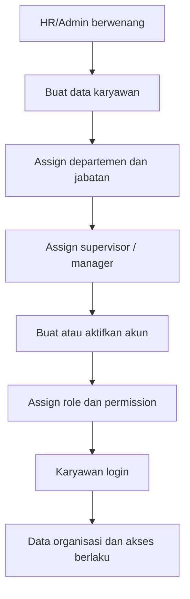
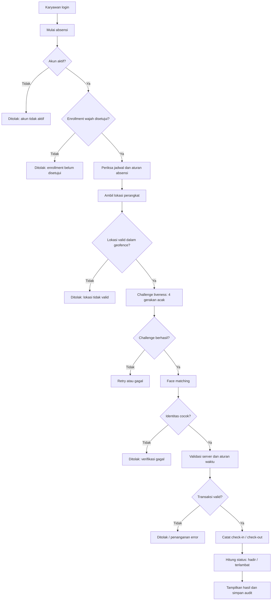
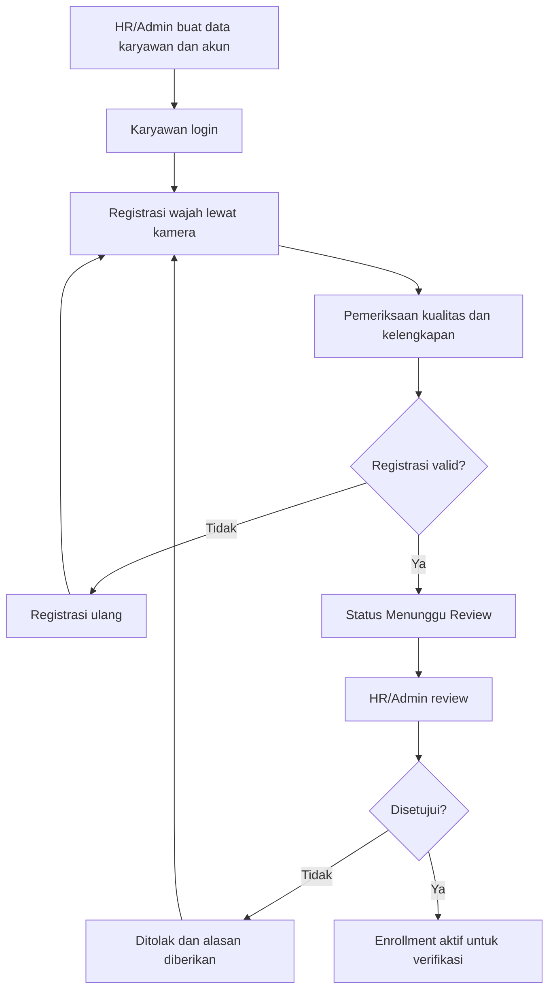
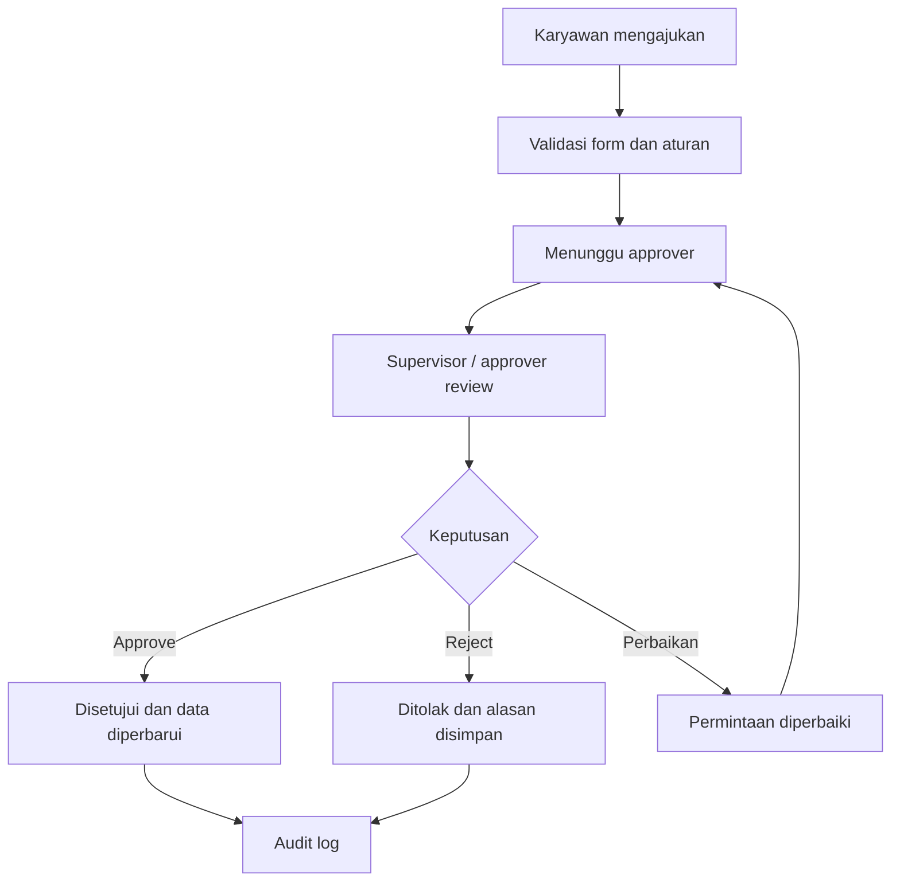
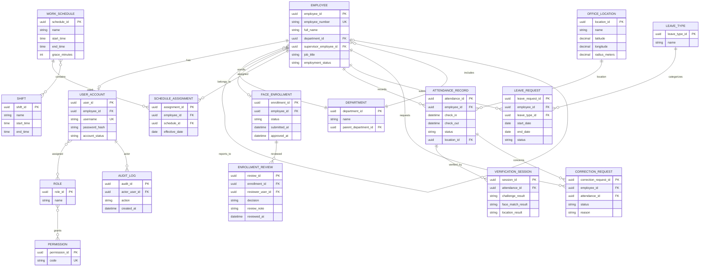

# PRODUCT REQUIREMENTS DOCUMENT (PRD)
## Sistem Absensi Karyawan Berbasis Verifikasi Wajah dan Geolokasi
**Dokumen:** PRD Final v1.0  
**Status:** Baseline pengembangan  
**Tanggal:** 18 November 2026  
**Platform:** Web application responsif (mobile dan desktop)

---

## 1. Ringkasan Produk

**Nama aplikasi:** J-Absen  
**Pengembang:** EKA JACX

J-Absen adalah sistem absensi karyawan merupakan aplikasi web untuk mengelola data karyawan, akun dan hak akses, jadwal kerja, absensi masuk dan pulang, pengajuan cuti, monitoring kehadiran, koreksi absensi, serta laporan.

Absensi melalui perangkat mobile menggunakan verifikasi wajah dengan challenge gerakan acak (liveness challenge) dan validasi lokasi/geofence. Fungsi manajemen dan administrasi utama ditujukan untuk penggunaan desktop/PC. Sistem dirancang agar aturan jam kerja, shift, toleransi keterlambatan, lokasi kantor, dan parameter operasional dapat dikonfigurasi oleh administrator yang berwenang.

## 2. Tujuan

1. Menyediakan pencatatan kehadiran yang terstruktur dan dapat diaudit.
2. Mengurangi risiko absensi yang tidak sah melalui verifikasi wajah, challenge liveness, geofence, dan kontrol perangkat.
3. Mendukung jadwal kerja tetap dan shift.
4. Memudahkan HR/administrator mengelola karyawan, jadwal, cuti, koreksi, serta laporan.
5. Menyediakan data kehadiran yang konsisten untuk kebutuhan operasional dan evaluasi.

## 3. Pengguna dan Peran

Hak akses wajib diterapkan di server (RBAC), bukan sekadar menyembunyikan menu di antarmuka.

| Peran | Tanggung jawab dan akses utama |
|---|---|
| CEO | Akses dashboard dan laporan tingkat perusahaan serta fungsi yang diberikan melalui konfigurasi hak akses. |
| General Manager (GM) | Monitoring dan pengelolaan operasional sesuai unit/otorisasi. |
| HR/Admin HR | Membuat dan mengelola data karyawan, akun, enrollment wajah, jadwal, cuti, koreksi, serta laporan sesuai kewenangan. |
| Supervisor | Monitoring tim, review/approval permintaan yang menjadi kewenangannya, dan akses data tim. |
| Staff/Karyawan | Absensi masuk/pulang, melihat riwayat dan jadwal pribadi, serta mengajukan cuti/permintaan yang disediakan. |
| Admin Sistem/IT | Pemeliharaan sistem, konfigurasi teknis, keamanan, dan pengelolaan akses teknis; tidak otomatis memiliki kewenangan persetujuan HR kecuali diberikan. Pada tahap awal implementasi, Admin IT juga menjadi pemegang kewenangan administratif penuh sistem (keputusan final P-2, lihat 5.15.14). Admin IT tidak memiliki hak approval bisnis secara default (lihat 5.16.5). |

Peran dan permission harus dapat dikonfigurasi. Pembatasan data berdasarkan unit, departemen, lokasi, atau tim dapat diterapkan sesuai kebutuhan organisasi.

Daftar role pada tabel di atas adalah role awal. Permission dan cakupan data setiap role dikelola secara dinamis (lihat 5.15) dan tidak ditanam di kode berdasarkan nama role.

## 4. Platform dan Batas Antarmuka

### 4.1 Mobile
Mobile ditujukan terutama untuk karyawan dan mendukung:
- Login.
- Registrasi/enrollment wajah (dapat dilakukan melalui mobile maupun desktop, selama browser, perangkat, dan kamera mendukung serta memenuhi persyaratan keamanan sistem).
- Absensi masuk dan pulang.
- Verifikasi wajah dan challenge gerakan.
- Validasi lokasi/geofence.
- Melihat jadwal dan riwayat absensi.
- Pengajuan cuti serta melihat status pengajuan.

Antarmuka mobile harus responsif, mudah digunakan, dan menghindari teks, tombol, atau panel yang bertumpuk.

### 4.2 Desktop/PC
Desktop ditujukan terutama untuk fungsi manajemen:
- Dashboard dan monitoring.
- Pengelolaan karyawan dan akun.
- Pengelolaan role, permission, cakupan data, dan konfigurasi workflow persetujuan (5.15, 5.16).
- Registrasi/enrollment wajah (juga dapat dilakukan dari desktop, selama browser, perangkat, dan kamera mendukung serta memenuhi persyaratan keamanan sistem).
- Review enrollment wajah.
- Pengaturan jam kerja, shift, toleransi, lokasi/geofence, dan kebijakan.
- Pengelolaan jadwal.
- Approval cuti dan koreksi absensi.
- Laporan dan ekspor Excel.
- Audit log dan pengaturan sistem.

Desktop menggunakan sidebar kiri dan area konten di sebelah kanan. Navigasi dan transisi antarmuka harus konsisten; perpindahan menu tidak boleh meninggalkan artefak tampilan dari halaman sebelumnya.

### 4.3 Hirarki Organisasi dan Departemen

Struktur organisasi baseline J-Absen:

```mermaid
flowchart TD
    CEO[CEO] --> GM[General Manager (GM)]
    GM --> HR[Supervisor HRD]
    GM --> MKT[Supervisor Marketing]
    GM --> SALES[Supervisor Sales]
    GM --> OPS[Supervisor Operasional]
    HR --> HRSTAFF[Staff HRD]
    MKT --> MKTSTAFF[Staff Marketing]
    SALES --> SALESSTAFF[Staff Sales]
    OPS --> OPSSTAFF[Staff Operasional]
```

#### 4.3.1 Struktur dan tanggung jawab

| Tingkat | Jabatan/Unit | Tanggung jawab ringkas |
|---|---|---|
| 1 | CEO | Pengawasan strategis, ringkasan perusahaan, keputusan tingkat perusahaan. |
| 2 | GM | Mengawasi departemen, koordinasi operasional, laporan dan eskalasi. |
| 3 | Supervisor HRD | Mengelola kegiatan HRD dan supervisi Staff HRD. |
| 3 | Supervisor Marketing | Mengelola kegiatan marketing dan supervisi Staff Marketing. |
| 3 | Supervisor Sales | Mengelola kegiatan sales dan supervisi Staff Sales. |
| 3 | Supervisor Operasional | Mengelola kegiatan operasional dan supervisi Staff Operasional. |
| 4 | Staff HRD | Melaksanakan proses HR sesuai akses yang diberikan. |
| 4 | Staff Marketing | Melaksanakan kegiatan marketing sesuai akses yang diberikan. |
| 4 | Staff Sales | Melaksanakan kegiatan sales sesuai akses yang diberikan. |
| 4 | Staff Operasional | Melaksanakan kegiatan operasional sesuai akses yang diberikan. |

#### 4.3.2 Aturan kewenangan

- CEO berada di tingkat teratas struktur organisasi.
- GM melapor kepada CEO dan mengawasi para supervisor departemen.
- Setiap supervisor bertanggung jawab kepada GM dan mengawasi staff di departemennya.
- Staff berada di bawah supervisor departemen masing-masing.
- Struktur ini adalah struktur baseline. Penambahan departemen, jabatan, atau perubahan hubungan pelaporan harus melalui konfigurasi yang berwenang.
- Struktur organisasi dan permission merupakan dua hal berbeda: jabatan menentukan struktur pelaporan, sedangkan role/permission menentukan tindakan yang diizinkan di sistem.
- Akses lintas departemen tidak diberikan otomatis hanya karena seseorang berada pada tingkat jabatan yang sama.
- **Keputusan (Revisi 1):** Untuk saat ini digunakan struktur departemen dan hierarki organisasi baseline di atas. Modul Team terpisah tidak dibuat kecuali ada kebutuhan yang telah disetujui.

#### 4.3.3 Diagram workflow pengelolaan organisasi dan akun



## 5. Ruang Lingkup Fungsional

### 5.1 Manajemen Karyawan
Administrator/HR yang berwenang dapat:
- Membuat, melihat, mengubah, menonaktifkan, dan mengarsipkan data karyawan.
- Mengelola identitas karyawan, nomor/ID karyawan, nama, departemen, jabatan, status, supervisor, dan data relevan lainnya.
- Menetapkan karyawan ke departemen, tim, lokasi, dan aturan jadwal.
- Melihat status akun dan status enrollment wajah.
- Menonaktifkan akses saat karyawan tidak lagi aktif.

Data wajib dan formatnya ditentukan oleh konfigurasi sistem dan kebijakan organisasi.

### 5.2 Manajemen Akun dan Hak Akses
- HR/Admin yang memiliki permission dapat membuat data karyawan sekaligus akun login atau membuat akun untuk karyawan yang telah terdaftar.
- Sistem menyediakan pengaturan role dan permission yang dinamis dan dapat dikonfigurasi (lihat 5.15).
- Aktivasi, penonaktifan, reset/penanganan kredensial, serta pembatasan akses dilakukan dengan prosedur aman.
- Perubahan permission dicatat pada audit log.
- Otorisasi harus diperiksa di server pada setiap endpoint/aksi sensitif.

### 5.3 Login dan Sesi
- Login harus menggunakan mekanisme autentikasi yang aman.
- Sistem menyediakan penanganan sesi, logout, dan pembatasan akses sesuai role.
- Akun tidak aktif atau dinonaktifkan tidak dapat mengakses sistem.
- Role switcher atau simulasi role hanya boleh digunakan pada development/testing; tidak boleh menjadi mekanisme otorisasi production.

### 5.4 Enrollment/Registrasi Wajah
Alur enrollment:
1. HR/Admin membuat data karyawan dan akun.
2. Karyawan login dengan akun yang diberikan.
3. Karyawan melakukan registrasi wajah menggunakan kamera perangkat yang kompatibel, melalui desktop maupun mobile, selama browser, perangkat, dan kamera mendukung serta memenuhi persyaratan keamanan sistem.
4. Sistem memeriksa kualitas gambar, pencahayaan, posisi wajah, dan kondisi teknis yang relevan.
5. Data/representasi wajah dan status enrollment dikirim atau disimpan sesuai arsitektur dan kebijakan privasi yang ditetapkan.
6. Enrollment masuk ke status **Menunggu Review**.
7. Admin/HR yang berwenang memeriksa dan menyetujui atau menolak enrollment.
8. Jika ditolak, alasan penolakan disampaikan dan karyawan dapat melakukan registrasi ulang.
9. Enrollment yang disetujui dapat digunakan untuk verifikasi absensi.

Status enrollment minimal:
- Belum terdaftar.
- Menunggu Review.
- Disetujui.
- Ditolak.
- Perlu Registrasi Ulang.
- Dinonaktifkan.

Persetujuan admin wajib sebelum enrollment dapat dipakai untuk absensi, kecuali perubahan kebijakan secara eksplisit dilakukan oleh administrator yang berwenang.

### 5.5 Verifikasi Wajah dan Challenge Liveness
Verifikasi wajah diwajibkan pada absensi masuk dan pulang.

Challenge menggunakan **4 gerakan yang dipilih secara acak** dari daftar challenge yang dikonfigurasi. Kandidat gerakan:
- Senyum.
- Menoleh ke kiri.
- Menoleh ke kanan.
- Mengangkat/menundukkan arah wajah (atas).
- Mengangkat/menundukkan arah wajah (bawah).

Ketentuan:
- Sistem memilih empat instruksi challenge secara acak untuk setiap sesi verifikasi, dengan aturan agar instruksi dapat dijalankan dan urutan tidak mudah diprediksi.
- Challenge ditampilkan satu per satu dengan instruksi yang jelas.
- Sistem mengevaluasi respons kamera secara real-time atau selama sesi challenge.
- Challenge harus memiliki batas waktu, status berhasil/gagal, dan mekanisme retry yang wajar.
- Verifikasi identitas dilakukan dengan membandingkan wajah live dengan enrollment yang disetujui.
- Challenge liveness dan face matching tidak boleh dianggap sebagai jaminan anti-spoofing absolut.
- Proses verifikasi gagal jika challenge tidak selesai, wajah tidak terdeteksi, kualitas tidak memadai, hasil matching di bawah threshold, sesi kedaluwarsa, atau validasi lainnya gagal.
- Hasil, timestamp, dan status verifikasi dicatat dalam data absensi dan/atau audit log sesuai kebijakan retensi.

Implementasi awal menggunakan MediaPipe untuk deteksi/landmark atau komponen vision yang sesuai. Threshold dan konfigurasi teknis harus dapat disesuaikan dan diuji. Pemeriksaan sisi klien tidak menggantikan validasi sisi server.

### 5.6 Geofence dan Validasi Lokasi
- Absensi hanya dapat diproses jika lokasi perangkat memenuhi aturan lokasi kantor yang aktif.
- Administrator dapat mengelola lokasi kantor, koordinat, radius geofence, dan status lokasi.
- Sistem meminta izin lokasi perangkat saat diperlukan.
- Sistem memeriksa hasil lokasi, akurasi yang tersedia, timestamp, serta aturan geofence.
- Jika lokasi tidak tersedia atau di luar batas, sistem menampilkan alasan kegagalan dan tidak menerima absensi, kecuali terdapat alur pengecualian resmi yang disetujui.
- Validasi server wajib dilakukan terhadap data yang dikirim.
- Kebijakan pengecualian, koreksi, atau absensi di luar geofence harus memiliki jejak audit.
- **Keputusan (Revisi 1):** Workflow pengecualian geofence belum ditetapkan dan berada di luar scope implementasi saat ini. Aturan geofence pada bagian ini tetap berlaku tanpa pengecualian sampai ada keputusan dan change request yang disetujui.

### 5.7 Pengaturan Jam Kerja, Shift, dan Keterlambatan
Aturan kerja harus dikonfigurasi, bukan ditanam permanen (hard-coded).

Administrator dapat mengatur:
- Jam mulai dan selesai kerja.
- Jam istirahat, bila diterapkan.
- Toleransi keterlambatan.
- Durasi/aturan lembur jika termasuk konfigurasi versi ini.
- Hari kerja dan hari libur.
- Shift pagi, siang, malam, atau shift lain yang didefinisikan.
- Shift lintas tengah malam.
- Aturan check-in/check-out.
- Penugasan jadwal per karyawan, tim, departemen, atau kelompok.

Ketentuan penugasan:
- Karyawan non-office dapat ditugaskan ke shift pagi atau siang (dan shift lain jika dikonfigurasi).
- Karyawan office seperti HRD, Accounting, GM, CEO, dan posisi office lainnya dapat menggunakan jadwal office yang ditentukan.
- Kategori office/non-office dan aturan pengecualian harus dapat diubah administrator, bukan diasumsikan berdasarkan nama jabatan semata.
- Sistem menentukan keterlambatan berdasarkan jadwal yang berlaku, waktu check-in, dan toleransi.
- Jadwal yang berlaku untuk tanggal absensi harus dapat ditelusuri.
- Perubahan jadwal harus dicatat dan tidak mengubah histori tanpa jejak.

### 5.8 Absensi Masuk dan Pulang
Alur dasar:
1. Karyawan login pada mobile.
2. Karyawan membuka fitur absensi.
3. Sistem memeriksa akun, jadwal yang berlaku, perangkat/kamera, dan lokasi.
4. Sistem memulai challenge liveness empat gerakan acak.
5. Sistem melakukan verifikasi wajah terhadap enrollment yang disetujui.
6. Sistem melakukan validasi lokasi/geofence dan aturan waktu.
7. Jika semua pemeriksaan berhasil, sistem mencatat check-in atau check-out.
8. Sistem menampilkan hasil transaksi dan waktu pencatatan.
9. Jika gagal, sistem menampilkan pesan yang dapat dipahami dan tidak mencatat absensi sukses.

Sistem harus menangani:
- Absensi masuk dan pulang.
- Status hadir, terlambat, tidak lengkap, dan status lain yang ditetapkan kebijakan.
- Pencegahan transaksi duplikat sesuai aturan.
- Penanganan jaringan terputus atau transaksi yang gagal.
- Koreksi melalui workflow resmi, bukan mengubah rekaman secara diam-diam.

### 5.9 Jadwal dan Kalender
- HR/Admin dapat membuat dan mengelola jadwal.
- Jadwal dapat ditugaskan kepada karyawan atau kelompok.
- Karyawan dapat melihat jadwal pribadi.
- Sistem mendukung shift dan jadwal khusus.
- Konflik jadwal dan perubahan jadwal ditampilkan atau ditandai.
- Jadwal historis tetap dapat ditelusuri.

### 5.10 Pengajuan dan Approval Cuti
- Karyawan dapat mengajukan cuti melalui mobile.
- Pengajuan mencakup jenis cuti, tanggal, durasi, dan keterangan/dokumen pendukung jika diperlukan.
- Karyawan dapat melihat status pengajuan.
- Supervisor/approver dapat menyetujui, menolak, atau meminta perbaikan sesuai workflow.
- HR/Admin dapat melakukan pengelolaan sesuai permission.
- Saldo cuti dan aturan cuti mengikuti konfigurasi dan kebijakan organisasi.
- Setiap keputusan approval dicatat.
- Workflow cuti dapat dikonfigurasi, mendukung approval bertingkat maupun parallel approval, validasi saldo sesuai jenis cuti, audit trail, dan larangan self-approval secara default.
- **Workflow Baseline Cuti (FINAL P-3):**
  - Staff / Karyawan: 1 Tahap -> Atasan Langsung (Direct Supervisor) berdasarkan relasi hierarki `reports_to`. Disetujui -> Saldo cuti terpotong -> Status Disetujui.
  - Supervisor: 1 Tahap -> General Manager (GM).
  - General Manager (GM): 1 Tahap -> CEO.
  - CEO: Executive Notice (tercatat di audit log dan kalender tanpa self-approval).
- **Aturan Validasi Saldo Cuti (FINAL P-10):**
  - Entitas `LEAVE_TYPE` memiliki konfigurasi `requires_quota` (Boolean) dan `allow_negative_balance` (Boolean, default `false`).
  - Untuk jenis cuti dengan `requires_quota = true` (misal: Cuti Tahunan), jika saldo cuti tidak mencukupi durasi pengajuan dan `allow_negative_balance = false`, formulir pengajuan diblokir sejak validasi client-side dan server-side.
  - Jenis cuti khusus (Sakit dengan surat dokter, cuti duka, melahirkan) dapat dikonfigurasi `requires_quota = false`.

Workflow approval dan hierarki approver dapat dikonfigurasi sesuai struktur organisasi; approver tidak dikunci berdasarkan jabatan (lihat 5.16).

### 5.11 Koreksi Absensi
- Pengajuan koreksi dapat dilakukan oleh:
  - Karyawan yang bersangkutan.
  - HR/Admin HR atas nama karyawan, jika diperlukan untuk administrasi.
- Supervisor, GM, dan CEO hanya dapat mengajukan koreksi atas nama karyawan apabila diberikan kewenangan secara eksplisit melalui konfigurasi permission; kewenangan ini tidak diberikan otomatis; pemberian kewenangan dilakukan melalui konfigurasi permission (lihat 5.15).
- Permintaan mencantumkan tanggal, data yang ingin dikoreksi, alasan, dan bukti jika dibutuhkan.
- Supervisor/HR yang berwenang meninjau permintaan (approver dan tahapan mengikuti konfigurasi workflow, lihat 5.16).
- Perubahan tidak menghapus data awal; rekam perubahan, approver, alasan, dan waktu harus disimpan.
- Status permintaan dapat dilihat oleh pemohon sesuai akses.
- Koreksi absensi melalui pengajuan, alasan, approval sesuai workflow, dan audit trail.
- Record asli tidak dihapus. Perubahan menyimpan nilai sebelum dan sesudah.
- Koreksi manual juga wajib memiliki permission dan audit log.
- **Workflow Baseline Koreksi Absensi (FINAL P-3):**
  - Staff / Karyawan: 2 Tahap Sequential:
    - Tahap 1: Atasan Langsung (verifikasi alasan, jam kehadiran aktual, dan bukti).
    - Tahap 2: HR/Admin HR (verifikasi data rekaman mesin/geofence dan pembaruan record absensi).
  - Supervisor: Tahap 1: GM -> Tahap 2: HR/Admin HR.
  - GM: Tahap 1: CEO -> Tahap 2: HR/Admin HR.

### 5.12 Dashboard dan Monitoring
Dashboard menyediakan informasi sesuai role, antara lain:
- Jumlah karyawan aktif.
- Ringkasan hadir, terlambat, tidak hadir, cuti, dan absensi belum lengkap.
- Ringkasan kehadiran hari ini.
- Monitoring tim/departemen/lokasi sesuai kewenangan.
- Status pengajuan cuti dan koreksi.
- Filter tanggal, departemen, tim, lokasi, atau status jika sesuai permission.

Dashboard tidak boleh menampilkan data personal yang tidak diperlukan oleh role pengguna.

### 5.13 Laporan dan Export Excel
- Laporan absensi dapat difilter berdasarkan periode, karyawan, departemen, tim, lokasi, status, dan parameter relevan.
- Ekspor utama versi 1.0 adalah **Excel (.xlsx)**.
- File Excel harus terstruktur, rapi, memiliki header/kop laporan, informasi periode dan filter, tabel data, format tanggal/waktu yang konsisten, dan siap dicetak.
- Kolom dan agregasi laporan mengikuti kebutuhan operasional.
- Ekspor hanya berisi data yang dapat diakses oleh pengguna.
- Tidak termasuk ekspor PDF/CSV pada baseline v1.0, kecuali ditetapkan kemudian.

### 5.14 Audit Log
Audit log mencatat aksi sensitif, minimal:
- Login/logout dan kejadian autentikasi relevan.
- Pembuatan, perubahan, penonaktifan data karyawan/akun.
- Perubahan role/permission.
- Enrollment wajah, review, approval, penolakan, dan perubahan status.
- Absensi dan hasil verifikasi terkait.
- Perubahan jadwal, shift, aturan jam kerja, lokasi/geofence.
- Approval cuti dan koreksi.
- Perubahan konfigurasi sistem.
- Perubahan role, permission, cakupan data, hubungan akun-role, dan konfigurasi workflow persetujuan.

Audit log harus mencakup aktor, waktu, aksi, objek terkait, hasil, dan konteks yang diperlukan; akses serta retensi dibatasi oleh kebijakan.

### 5.15 Hak Akses Dinamis (Configurable RBAC)

Seluruh hak akses J-Absen dirancang sebagai konfigurasi yang dapat dikelola melalui sistem, bukan aturan yang dikunci di kode program berdasarkan nama role. Role awal (CEO, GM, HR/Admin HR, Supervisor, Staff, Admin Sistem/IT) tetap digunakan sebagai role awal, tetapi permission dan cakupan datanya dapat diubah oleh administrator yang berwenang tanpa mengubah kode program.

**5.15.1 Prinsip**
- Kode program tidak boleh memeriksa nama role (misalnya `if role == "GM"`); pemeriksaan selalu terhadap permission dan cakupan data.
- Otorisasi divalidasi di backend/API pada setiap tindakan yang dilindungi. Menyembunyikan menu atau button tidak cukup.
- Least privilege dan default DENY: permission yang belum dikonfigurasi, belum disetujui, atau masih bertanda ❓ dianggap DENY (tidak diberikan). Tidak ada akses otomatis hanya karena pengguna memiliki jabatan tertentu.
- Tanda ❓ atau permission yang belum diputuskan pada matriks tidak dianggap sebagai permission final dan diperlakukan sebagai DENY.
- Matriks permission awal menggunakan baseline konservatif: permission yang belum ditetapkan tetap DENY. Matriks awal adalah dasar konfigurasi awal (seed konfigurasi), bukan permission yang ditanam di kode, dan bukan aturan permanen; semua permission dapat dikonfigurasi sesuai kemampuan sistem.
- Matriks hak akses pada dokumen pendukung berfungsi sebagai referensi permission awal, template konfigurasi role, dan dasar UI pengelolaan hak akses; bukan aturan permanen.

**5.15.2 Permission dan katalog permission**
- Permission dapat diatur terhadap modul, menu, halaman, data, tindakan, dan button/action.
- Jenis tindakan mencakup antara lain: Create, Read/View, Update/Edit, Delete, Approve, Reject, Export, Import, serta tindakan lain yang relevan.
- Daftar modul, tindakan, dan permission bersifat dapat diperluas bila ada modul atau fitur baru; desain tidak dibatasi pada daftar di atas.
- Setiap permission dapat dikaitkan dengan cakupan data (5.15.4).

**5.15.3 Manajemen role**
- Menyediakan role awal dari PRD.
- Membuat role baru jika diizinkan; mengubah nama dan deskripsi role.
- Mengatur permission dan cakupan data setiap role secara fleksibel.
- Menghubungkan akun karyawan dengan satu atau lebih role.
- Menonaktifkan role yang tidak lagi digunakan, dengan memeriksa akun yang masih terhubung (akun harus dipindahkan atau diputuskan lebih dulu, atau sistem menolak penonaktifan).
- Role sistem yang masih terikat dengan data atau proses bisnis tidak boleh dihapus tanpa mekanisme yang aman; penonaktifan lebih diutamakan daripada penghapusan.
- Perubahan permission berlaku tanpa mengubah kode program.

**5.15.4 Cakupan data (data scope)**
Permission menentukan tindakan sekaligus cakupan data. Cakupan yang didukung:
- Own: data milik sendiri.
- Direct Subordinates: data bawahan langsung.
- Descendants: data seluruh bawahan bertingkat.
- Team: data tim, hanya jika Team digunakan.
- Department: data departemen.
- Selected Departments: data beberapa departemen (daftar departemen dikonfigurasi).
- Organization: data seluruh perusahaan.
- Custom scope: cakupan khusus yang dapat dikembangkan kemudian.

Setiap cakupan dapat dikonfigurasi secara terpisah; cakupan tidak ditentukan permanen berdasarkan nama role.

Cakupan dihitung dari struktur organisasi (hierarki pelaporan, departemen), penempatan karyawan, dan konfigurasi permission, bukan dari nama role. Cakupan divalidasi di backend, termasuk pada daftar, detail, pencarian, dashboard, dan ekspor. Pembatasan "tim" hanya berlaku bila Team digunakan (lihat 4.3.2).

**5.15.5 Pengamanan sistem hak akses**
- Audit log untuk setiap perubahan role, permission, cakupan data, dan hubungan akun-role (aktor, waktu, nilai sebelum dan sesudah).
- Mencegah perubahan yang membuat administrator kehilangan akses sistem secara tidak sengaja (misalnya selalu harus ada minimal satu akun aktif yang berwenang mengelola hak akses).
- Role administratif dan permission kritis ditandai dan dilindungi (misalnya memerlukan konfirmasi tambahan).
- Perubahan permission tidak boleh memberikan akses ke data yang sebelumnya tidak diizinkan tanpa konfigurasi cakupan yang jelas; sistem menampilkan ringkasan dampak sebelum perubahan disimpan.
- Pengelolaan hak akses hanya dapat dilakukan oleh pengguna dengan permission yang sesuai.

**5.15.6 UI pengelolaan hak akses (kebutuhan konseptual)**
Administrator berwenang dapat: melihat seluruh role dan modul; memilih role; mengatur permission melalui checkbox, toggle, atau kontrol yang sesuai; mengatur cakupan data; melihat permission aktif dan tidak aktif; menyimpan perubahan dengan konfirmasi; melihat riwayat perubahan; serta mengatur workflow persetujuan (5.16). Matriks yang besar harus tetap mudah digunakan melalui kategori modul, filter, pencarian, dan pengelompokan permission.

**5.15.7 Pengelolaan, delegasi, dan penerapan perubahan permission**
- Pada tahap awal implementasi, Admin IT adalah pemegang penuh kewenangan pengelolaan role dan permission (keputusan final P-2, lihat 5.15.14). Permission pengelolaan role dan permission tetap dikelola sebagai permission yang dapat dikonfigurasi; pemberiannya kepada pengguna lain hanya dilakukan secara eksplisit oleh Admin IT.
- Batas delegasi: pengelola tidak boleh memberikan permission, cakupan data, atau kewenangan delegasi yang melebihi batas kewenangan yang dimilikinya. Sistem harus mencegah privilege escalation.
- Penerapan perubahan: perubahan permission berlaku secepat mungkin setelah disimpan. Pemberian permission baru memperbarui otorisasi; pencabutan permission berlaku segera atau secepat mungkin secara teknis. Cache permission diperbarui atau diinvalidasi, dan backend/API menggunakan mekanisme otorisasi yang konsisten dengan permission terbaru. Perubahan tidak boleh hanya memengaruhi tampilan menu.
- Perubahan hak akses kritis dapat mensyaratkan re-authentication.

**5.15.8 Pengguna dengan banyak role dan pemetaan jabatan ke role**
- Permission dari beberapa role yang dimiliki pengguna digabungkan dengan mekanisme union of permissions (Allow). Jika tidak ada permission Allow yang berlaku, akses ditolak. Pada tahap awal tidak diterapkan mekanisme Deny override yang kompleks, kecuali diperlukan secara teknis dan telah didokumentasikan.
- Jabatan, departemen, akun, role, dan permission adalah konsep yang terpisah. Jabatan HRD dalam struktur organisasi tidak otomatis menjadi permission.
- Karyawan HRD dapat dipetakan ke role HR/Admin HR sesuai konfigurasi sistem. Pemetaan jabatan ke role tidak boleh dikunci permanen di kode program.
**5.15.9 Scope permission (keputusan final K-11, P-8, P-9)**
- Selain cakupan data berbasis hierarki (5.15.4), permission mendukung scope berdasarkan: global, lokasi, unit/departemen, dan penugasan khusus (custom scope).
- Scope dapat dikonfigurasi dan tidak otomatis memberikan akses; akses tetap memerlukan permission Allow eksplisit.
- **Acuan Scope Lokasi (FINAL P-9):** Scope lokasi mengacu pada kantor penempatan resmi karyawan (`Employee.office_location_id`), bukan koordinat GPS real-time perangkat mobile.
- **Definisi Custom Scope / Penugasan Khusus (FINAL P-8):**
  - Dikelola melalui entitas penugasan khusus (`SPECIAL_ASSIGNMENT_SCOPE`).
  - Memuat atribut: penerima kuasa (`user_id`), target cakupan (`target_employee_ids` atau target departemen), tanggal mulai (`valid_from`), dan tanggal berakhir (`valid_to`).
  - Masa berlaku wajib memiliki batas waktu; hak akses custom scope otomatis gugur saat tanggal melewati `valid_to` tanpa perlu intervensi manual.

**5.15.10 Penghapusan dan penonaktifan role (keputusan final K-15)**
- Role yang sudah memiliki keterikatan data, assignment, atau histori harus dinonaktifkan, bukan dihapus permanen.
- Penghapusan permanen hanya diperbolehkan jika role belum pernah digunakan dan tidak memiliki keterikatan data.

**5.15.11 Permission kritis dan re-authentication (keputusan final P-1, P-7)**
- Permission kritis ditetapkan secara eksplisit dalam katalog dengan flag `is_critical = true`. Eksekusinya wajib meminta validasi ulang kredensial (*re-authentication*).
- **Katalog Permission Kritis Baseline (FINAL P-1):**
  - Manajemen Role: `role.create`, `role.update`, `role.deactivate`, `role.assign_permissions`.
  - Assignment Akun: `user_role.assign`, `user_role.revoke`.
  - Hak Approval Admin IT: `admin_it.grant_approval` (eksklusif oleh CEO).
  - Konfigurasi Keamanan & Geofence: `security_config.update`, `geofence.update`.
  - Tindakan Sensitif Akun: `user_account.deactivate`, `user_account.reset_credential`.
  - Integritas Biometrik: `face_enrollment.reset`.
  - Ekspor Sensitif: `audit_log.export`, `employee.export_full`.
- **Masa Berlaku Sesi Re-Authentication (FINAL P-7):**
  - Menerapkan model Grace Period **10 menit**.
  - Setelah verifikasi kredensial berhasil pada aksi kritis pertama, sesi re-auth aktif selama 10 menit untuk aktivitas konfigurasi kritis berikutnya.
  - Setelah 10 menit idle tanpa aksi kritis, atau saat pengguna logout, sesi re-auth kedaluwarsa seketika.

**5.15.12 Pencabutan dan perubahan akses (keputusan final; melengkapi K-4)**
- Pencabutan atau perubahan permission, role, scope, maupun status akun harus efektif paling lambat 60 detik.
- Sistem mendukung invalidasi cache/session dan otorisasi di sisi server.
- Tindakan kritis memvalidasi akses terbaru (tidak bergantung pada cache atau sesi lama).

**5.15.13 Penetapan pemegang permission (keputusan final)**
- Pada tahap awal, Admin IT menjadi pemegang penuh kewenangan administratif sistem (lihat 5.15.14). HRD tidak otomatis menjadi administrator sistem. CEO tidak otomatis memiliki akses teknis. Jabatan atau nama role tidak otomatis memberikan permission.
- Pemegang permission Role & Permission, Workflow, Audit, Employee Management, Attendance Management, dan permission lainnya ditentukan secara eksplisit oleh Admin IT melalui matriks permission yang dikelola dalam sistem (keputusan final P-2).
- Matriks permission menggunakan prinsip least privilege, deny-by-default, dan scope-based access. Permission diberikan eksplisit dan tidak otomatis berdasarkan nama role atau jabatan. Matriks final harus disetujui sebelum implementasi permission dinyatakan final.

**5.15.14 Kewenangan administratif Admin IT (keputusan final P-2)**
- Pada tahap awal implementasi, Admin IT menjadi pemegang penuh kewenangan administratif sistem, karena bertanggung jawab memahami, mengelola, mengkonfigurasi, memelihara, dan mengamankan sistem.
- Admin IT berwenang penuh untuk:
  - Mengelola Role & Permission.
  - Membuat, mengubah, mengaktifkan, menonaktifkan, dan menetapkan role.
  - Memberikan dan mencabut permission kepada seluruh user.
  - Mengatur scope permission.
  - Mengelola user dan akun.
  - Mengelola konfigurasi workflow dan approver.
  - Mengelola Employee Management, Attendance Management, Leave Management, dan modul lainnya sesuai kebutuhan administratif sistem.
  - Mengelola exception workflow.
  - Mengelola konfigurasi sistem dan keamanan.
  - Mengakses audit log untuk monitoring, investigasi, dan audit sistem.
- Admin IT menentukan permission bagi HRD, CEO, GM, Supervisor, dan Staff melalui matriks permission yang dikelola dalam sistem. Jabatan atau nama role tidak otomatis memberikan permission; permission diberikan dan dikonfigurasi secara eksplisit oleh Admin IT.
- Kewenangan penuh Admin IT tidak menghilangkan kontrol keamanan:
  - Seluruh tindakan administratif (pemberian dan pencabutan permission, perubahan role, konfigurasi workflow, konfigurasi sistem) tercatat di audit log.
  - Tindakan kritis wajib mengikuti aturan re-authentication (5.15.11).
  - Admin IT tidak diperbolehkan menghapus, memanipulasi, atau menghilangkan audit trail aktivitas administratifnya sendiri.
- **Proteksi Akun Admin IT & Anti-Lockout (FINAL P-14):**
  - Sistem mewajibkan minimal **2 Akun Admin IT aktif** terdaftar di sistem.
  - Admin IT dilarang melakukan self-deactivation akun atau self-revocation role miliknya sendiri. Perubahan status/role akun Admin IT hanya dapat dilakukan oleh akun Admin IT aktif lainnya atau CEO.
  - Sistem memblokir penyimpanan perubahan jika mengakibatkan ketiadaan akun Admin IT aktif (*anti-lockout guard*).
- **Integritas Audit Log WORM & Pengawasan (FINAL P-15):**
  - Tabel `AUDIT_LOG` beroperasi secara *Append-Only (WORM - Write Once, Read Many)*; operasi `UPDATE`, `DELETE`, `TRUNCATE`, dan `DROP` diblokir secara permanen di database level.
  - CEO memegang permission khusus membaca audit log (`audit_log.view_all`) untuk fungsi pengawasan independen terhadap seluruh aktivitas administratif yang dijalankan Admin IT.
- Keputusan ini berlaku sebagai model pengelolaan permission pada tahap awal sistem. Perubahan model kewenangan di masa depan harus melalui review dan change request (bagian 16).
- Kewenangan administratif tidak otomatis memberikan hak approval bisnis. Admin IT secara default tidak memiliki permission approval bisnis (keputusan final, lihat 5.16.5).
### 5.16 Workflow Persetujuan yang Dapat Dikonfigurasi

Workflow persetujuan (cuti, koreksi absensi, dan pengajuan lain yang membutuhkan persetujuan) tidak dikunci permanen berdasarkan jabatan.
- Approver, jumlah dan urutan tahapan, serta aturan workflow dapat dikonfigurasi sesuai kebutuhan perusahaan.
- Tidak diasumsikan bahwa CEO selalu menjadi approver terakhir atau GM selalu menjadi approver tertentu.
- Penentuan approver didukung melalui konfigurasi yang dapat dikembangkan, antara lain berdasarkan role, jabatan, struktur organisasi, atasan langsung, atasan bertingkat, pengguna tertentu, dan aturan khusus lain yang nantinya disetujui. Approver tidak dikunci permanen pada jabatan CEO, GM, Supervisor, atau HR.
- Alur persetujuan final belum ditetapkan dan memerlukan persetujuan pemilik proses.
- Hasil keputusan tetap dicatat dan perubahan konfigurasi workflow dicatat pada audit log.
- Perubahan konfigurasi workflow berlaku untuk pengajuan baru. Pengajuan yang sudah berjalan mempertahankan snapshot workflow dan tahapan persetujuan yang berlaku saat pengajuan dibuat, dan tidak diubah otomatis. Perubahan terhadap pengajuan berjalan hanya melalui mekanisme administratif yang jelas, terkontrol, dan tercatat.
- Rancangan konseptual dan daftar keputusan yang tertunda: lihat Rancangan_Configurable_RBAC.md.

**5.16.1 Mode persetujuan (keputusan final K-8, P-11)**
- Workflow mendukung single approval, sequential approval, dan parallel approval.
- Parallel approval mendukung mode `UNANIMOUS` dan `QUORUM` yang dapat dikonfigurasi per workflow:
  - **Mode UNANIMOUS (Default):** 100% approver wajib menyetujui. Satu penolakan langsung menolak permohonan.
  - **Mode QUORUM (FINAL P-11):** Memerlukan ambang batas minimum persetujuan (persentase atau jumlah approver). Jika sisa approver yang belum merespons secara matematis sudah tidak dapat memenuhi kuorum, permohonan langsung ditolak otomatis (*early rejection*).
- Mode dan tahapan persetujuan dapat dikonfigurasi. Workflow final untuk setiap jenis pengajuan belum ditetapkan dan memerlukan persetujuan.

**5.16.2 Kondisi khusus approval (prinsip awal)**
1. Jika approver tidak ditemukan, pengajuan tidak boleh otomatis disetujui.
2. Jika approver tidak tersedia, sistem menggunakan fallback yang telah dikonfigurasi.
3. Self-approval tidak diperbolehkan secara default.
4. Jika pemohon merupakan approver pada tahap yang sama, sistem menggunakan approver berikutnya atau fallback yang dikonfigurasi.
5. Jika tidak ada fallback yang valid, pengajuan ditandai sebagai membutuhkan penanganan administratif.
6. Kondisi khusus yang melibatkan perubahan atau tindakan administratif dicatat dalam audit log.

**5.16.3 Pengelolaan workflow**
- Pada tahap awal implementasi, Admin IT mengelola konfigurasi workflow, approver, dan exception workflow (keputusan final P-2, lihat 5.15.14). Permission pengelolaan workflow tetap dapat dikonfigurasi dan dapat diberikan kepada pengguna lain secara eksplisit oleh Admin IT.

**5.16.4 Fallback dan fail-safe (keputusan final P-4, P-5)**
- Default adalah fail-safe. Pengajuan tidak boleh otomatis disetujui jika approver tidak ditemukan, tidak aktif, tidak merespons, atau terjadi kegagalan teknis.
- **Batas Waktu Approver / Timeout SLA (FINAL P-4):**
  - Batas waktu respon approver ditetapkan default **48 jam kerja (2 hari kerja)** per tahap, dihitung di luar hari libur dan akhir pekan.
  - Jika melebihi batas waktu, status permohonan menjadi `PENDING_ESCALATION` dan masuk ke antrean exception untuk ditangani oleh pengelola workflow / Admin IT.
- **Saluran Notifikasi Exception (FINAL P-5):**
  - Notifikasi exception workflow pada baseline v1.0 menggunakan **In-App Notification** (ikon lonceng dan antrean aksi di dashboard web desktop/mobile) serta **Banner Peringatan** pada dashboard Admin IT dan Approver terkait.
  - Saluran notifikasi eksternal (Email SMTP, WhatsApp) berada di luar scope baseline v1.0.
- Fallback yang dikonfigurasi (5.16.2) tetap berlaku sebagai tujuan penugasan ulang, bukan sebagai persetujuan otomatis.

**5.16.5 Approval bisnis: default DENY dan pembatasan hierarki (keputusan final)**

*a. Default DENY.* Seluruh permission yang berkaitan dengan approval bisnis berstatus DENY secara default, termasuk bagi Admin IT. Approval bisnis mencakup, tetapi tidak terbatas pada: Leave Approval, Attendance Correction Approval, Employee Request Approval, pengajuan perubahan data yang memerlukan approval, dan approval workflow bisnis lainnya. Hak administrasi sistem tidak otomatis memberikan hak approval bisnis. (Daftar ini tidak menambah fitur; berlaku bagi setiap approval yang ada atau ditambahkan kemudian melalui change request.)

*b. Pemberian permission approval.* Permission approval bisnis hanya dapat diberikan secara eksplisit melalui Permission Management dan konfigurasi workflow yang sah.
- CEO dan GM dapat diberikan permission approval bisnis sesuai kebutuhan perusahaan, workflow, scope, dan hierarki.
- Supervisor hanya dapat diberikan permission approval sesuai hierarki dan workflow yang berlaku.
- HRD hanya dapat diberikan permission approval apabila ditentukan secara eksplisit melalui permission dan workflow.
- Tidak ada role yang otomatis mendapatkan seluruh hak approval berdasarkan nama atau jabatan.

*c. Pembatasan berdasarkan hierarki.* Sistem memperhitungkan hubungan hierarki antara pengaju dan approver.
- Self-approval dilarang.
- Supervisor tidak boleh menyetujui permohonan yang diajukan oleh GM atau CEO.
- GM tidak boleh menyetujui permohonan yang diajukan oleh CEO.
- Staff tidak boleh menyetujui permohonan atasannya.
- Approver tidak boleh menyetujui permohonan atasannya apabila aturan hierarki melarang tindakan tersebut.
- Sistem memvalidasi hierarki, permission, scope, dan workflow sebelum setiap approval diproses.

*d. Admin IT.* Admin IT secara default tidak memiliki permission approval bisnis dan tidak boleh otomatis melakukan approval cuti, attendance correction, maupun approval bisnis lainnya, meskipun memiliki kewenangan administratif penuh. CEO dapat secara eksplisit memberikan permission approval bisnis kepada Admin IT jika diperlukan, dengan pembatasan modul, scope, workflow, dan masa berlaku apabila ditentukan. Pemberian, perubahan, dan pencabutan permission approval Admin IT wajib dicatat dalam Audit Trail.

*e. Pengamanan hierarki.* Permission approval tidak boleh mengabaikan hierarki organisasi secara otomatis. Pengecualian hierarki hanya dapat dilakukan apabila mekanisme pengecualian telah dirancang secara eksplisit, memiliki authorization yang sah, dan tercatat dalam Audit Trail. Sistem tidak menganggap Admin IT, HRD, GM, Supervisor, atau role lainnya otomatis berhak melakukan approval di luar workflow dan hierarki yang berlaku. Mekanisme pengecualian hierarki belum dirancang dan tidak termasuk scope saat ini.

*f. Validasi dan Audit Trail.* Setiap tindakan approval wajib memvalidasi: identitas pelaku; permission approval aktif; scope kewenangan; hierarki pengaju dan approver; workflow yang berlaku; status permohonan; larangan self-approval; pembatasan approval terhadap atasan; dan aturan pengecualian apabila ada. Tindakan approval yang tidak memenuhi aturan wajib ditolak dan dicatat dalam Audit Trail. Keputusan ini menjadi dasar implementasi Authorization Engine, Permission Matrix, Approval Workflow, dan Audit Trail.

*g. Keputusan lanjutan (final, sesuai rekomendasi yang disetujui).*
- **Pemberian approval kepada Admin IT:** CEO memegang permission khusus untuk memberikan permission approval bisnis kepada Admin IT. Admin IT tidak dapat memberikan permission approval kepada dirinya sendiri. Tindakan ini adalah tindakan kritis (wajib re-authentication) dan tercatat di Audit Trail. Ketentuan ini merupakan pengecualian khusus atas kewenangan Admin IT memberikan permission (5.15.14): permission approval bisnis bagi Admin IT tidak diberikan oleh Admin IT sendiri.
- **Approver di luar garis pelaporan:** HRD, Admin IT yang diberi permission, atau role lain di luar garis pelaporan dapat menjadi approver apabila permission, scope, dan workflow mengizinkan, dan approver bukan bawahan (descendant) pengaju serta bukan pengaju sendiri. Approver untuk permohonan yang diajukan CEO ditetapkan eksplisit pada workflow.
- **Pengecualian hierarki:** ditunda. Tidak ada pengecualian hierarki sampai ada rancangan dan change request.
- **Review enrollment wajah dan persetujuan serupa:** diperlakukan sebagai approval bisnis; DENY secara default (termasuk Admin IT) dan diberikan secara eksplisit. Aturan hierarki pengaju-atasan tidak berlaku untuk enrollment bila tidak ada relasi pengaju-atasan, sedangkan scope, permission, status, dan Audit Trail tetap divalidasi.
## 6. Aturan Bisnis

1. Absensi masuk/pulang memerlukan akun aktif dan enrollment wajah berstatus Disetujui.
2. Absensi memerlukan challenge liveness empat gerakan acak yang berhasil.
3. Absensi harus memenuhi aturan geofence yang berlaku, kecuali pengecualian melalui workflow resmi.
4. Jadwal dan aturan kerja yang berlaku harus ditentukan sebelum kalkulasi keterlambatan.
5. Toleransi keterlambatan, jam kerja, shift, lokasi, dan kebijakan operasional dapat dikonfigurasi oleh role yang berwenang.
6. Approval enrollment wajah, cuti, dan koreksi harus terotorisasi serta dapat diaudit.
7. Data historis tidak boleh dimodifikasi atau dihapus secara diam-diam.
8. Pengguna hanya dapat melihat atau mengubah data sesuai permission dan cakupan akses.
9. Validasi client-side tidak cukup; keputusan transaksi dan authorization harus divalidasi server-side.
10. Karyawan office dan non-office mengikuti aturan jadwal yang dapat ditentukan administrator.
11. Hak akses ditentukan oleh konfigurasi permission dan cakupan data, bukan oleh nama role yang ditanam di kode.
12. Permission yang belum dikonfigurasi atau belum diputuskan dianggap tidak diberikan (least privilege).
13. Approver dan tahapan persetujuan ditentukan oleh konfigurasi workflow, bukan oleh jabatan yang dikunci.
14. Perubahan role, permission, cakupan data, dan workflow wajib tercatat pada audit log dan tidak boleh membuat administrator kehilangan akses sistem.
15. Self-approval tidak diperbolehkan secara default; pengajuan tanpa approver tidak boleh otomatis disetujui (lihat 5.16.2).
16. Permission beberapa role digabungkan secara union (Allow); tanpa Allow yang berlaku, akses ditolak (lihat 5.15.8).
17. Pengajuan berjalan mempertahankan snapshot workflow saat dibuat (lihat 5.16).
18. Pencabutan atau perubahan permission, role, scope, dan status akun efektif paling lambat 60 detik; tindakan kritis wajib re-authentication (lihat 5.15.11-5.15.12).
19. Role yang memiliki keterikatan data, assignment, atau histori dinonaktifkan, bukan dihapus permanen (lihat 5.15.10).
20. Pengajuan tidak otomatis disetujui jika approver tidak ditemukan, tidak aktif, tidak merespons, atau terjadi kegagalan teknis (lihat 5.16.4).
21. Jabatan atau nama role tidak otomatis memberi permission; permission diberikan dan dikonfigurasi eksplisit oleh Admin IT, pemegang kewenangan administratif penuh pada tahap awal (lihat 5.15.13 dan 5.15.14).
22. Admin IT tidak boleh menghapus, memanipulasi, atau menghilangkan audit trail aktivitas administratifnya sendiri; tindakan administratif tercatat dan tindakan kritis wajib re-authentication.
23. Seluruh permission approval bisnis DENY secara default, termasuk bagi Admin IT; hak administrasi sistem tidak memberi hak approval bisnis (lihat 5.16.5).
24. Self-approval dilarang; approver tidak boleh menyetujui permohonan atasannya sesuai aturan hierarki (Supervisor terhadap GM/CEO, GM terhadap CEO, Staff terhadap atasan).
25. Setiap approval memvalidasi identitas, permission, scope, hierarki, workflow, status permohonan, dan larangan di atas; approval yang tidak memenuhi syarat ditolak dan dicatat di Audit Trail.
26. Pengecualian hierarki hanya melalui mekanisme yang dirancang eksplisit, terotorisasi, dan tercatat di Audit Trail.
27. Permission approval bagi Admin IT hanya diberikan oleh CEO (permission khusus), tidak dapat diberikan Admin IT kepada dirinya sendiri, dan tindakannya kritis serta tercatat.
28. Review enrollment wajah diperlakukan sebagai approval bisnis: DENY secara default dan diberikan eksplisit.
29. Tindakan kritis wajib melalui re-authentication dengan grace period 10 menit; permission kritis ditandai eksplisit di katalog (P-1, P-7).
30. Batas waktu approver adalah 48 jam kerja; keterlambatan respon memicu eskalasi fail-safe tanpa auto-approval (P-4).
31. Validasi saldo cuti memblokir pengajuan jika kuota tidak mencukupi dan jenis cuti tidak mengizinkan saldo negatif (P-10).
32. Minimal 2 akun Admin IT aktif wajib dipertahankan; self-deactivation dan self-revocation akun Admin IT dilarang (P-14).
33. Tabel Audit Log beroperasi WORM (hanya INSERT/SELECT); CEO memegang hak baca pengawasan independen (P-15).
34. Custom scope wajib memiliki rentang waktu (valid_from dan valid_to) dan otomatis gugur setelah tanggal berakhir (P-8).

## 7. Kebutuhan Non-Fungsional

### 7.1 Keamanan
- Autentikasi aman dan manajemen sesi.
- RBAC dan validasi permission server-side.
- Perlindungan endpoint dan data dari akses tidak sah.
- Validasi input dan perlindungan terhadap serangan umum web.
- Data biometrik dan data lokasi diperlakukan sebagai data sensitif; akses, penggunaan, penyimpanan, dan retensinya harus dibatasi.
- Tidak menyimpan gambar wajah mentah secara permanen kecuali diperlukan, disetujui, dan diatur oleh kebijakan yang jelas.
- Enkripsi saat transit dan, jika sesuai, saat penyimpanan.
- Audit log untuk tindakan penting.
- Otorisasi dinamis (RBAC configurable): permission dan cakupan data divalidasi di backend pada setiap tindakan yang dilindungi; penerapan least privilege; perlindungan terhadap lockout administrator dan role/permission kritis (lihat 5.15).

### 7.2 Privasi
- Informasi kepada karyawan mengenai penggunaan data wajah dan lokasi.
- Pengumpulan data seminimal mungkin.
- Kebijakan retensi, penghapusan, akses, dan pemrosesan data biometrik/lokasi.
- Penggunaan data dibatasi untuk tujuan yang telah ditetapkan.
- Peninjauan kepatuhan terhadap peraturan perlindungan data yang berlaku sebelum production.

### 7.3 Performa dan Reliabilitas
- Antarmuka harus responsif dan memberikan indikator proses.
- Proses verifikasi menampilkan status yang jelas.
- Error dan kegagalan jaringan ditangani tanpa membuat rekaman transaksi ganda.
- Operasi penting harus memiliki logging dan mekanisme penanganan kegagalan.
- Target performa terukur (misalnya waktu respons API dan waktu verifikasi) ditetapkan dalam tahap pengujian/deployment.

### 7.4 Usability dan Responsiveness
- Mobile: layar absensi dan pengajuan mudah digunakan, layout tidak bertumpuk.
- Desktop: sidebar kiri, konten utama kanan, layout konsisten.
- Navigasi, modal, tabel, form, dan transisi halaman konsisten.
- Status loading, empty state, success, dan error tersedia.
- Teks dan kontrol dapat diakses pada ukuran layar yang didukung.

## 8. Teknologi dan Arsitektur Baseline

Teknologi yang direncanakan:
- **Next.js:** framework aplikasi web dan server-side functionality.
- **Tailwind CSS:** styling dan responsive UI.
- **PostgreSQL:** database relasional.
- **Vercel:** deployment aplikasi (evaluasi kebutuhan layanan tambahan untuk database dan storage).
- **MediaPipe:** dukungan deteksi wajah/landmark dan komponen challenge pada sisi client, dengan evaluasi keamanan dan validasi server.

Arsitektur harus memisahkan:
- UI dan komponen presentasi.
- Domain/business logic.
- Validasi dan authorization.
- Data access/service layer.
- Database schema dan migration.
- Modul face/liveness dan geofence.
- Modul laporan/export.

Frontend mock data yang sudah ada harus dipertahankan dan dikembangkan secara bertahap. Integrasi backend tidak boleh menyebabkan refactor atau perubahan di luar scope yang disepakati tanpa persetujuan.

## 9. Entitas Data Awal

Entitas berikut merupakan baseline rancangan data (detail schema dapat berkembang melalui desain teknis):

- User / Account
- Employee
- Role
- Permission
- RolePermission
- Department / Organization Unit
- Team (tidak digunakan pada baseline saat ini; hanya jika kebutuhan disetujui kemudian)
- Office Location / Geofence
- Device / Device Registration (belum ada modul khusus pada baseline saat ini; hanya jika kebijakan menerapkan dan disetujui kemudian)
- Face Enrollment / Face Template / Enrollment Review
- Work Rule / Work Schedule
- Shift
- Employee Schedule Assignment
- Attendance Record
- Attendance Verification / Challenge Session
- Leave Type
- Leave Balance (jika digunakan)
- Leave Request
- Attendance Correction Request
- Holiday / Calendar
- Konfigurasi hak akses dinamis (konseptual): katalog modul/permission, cakupan data per permission role, riwayat perubahan permission (lihat 5.15).
- Konfigurasi workflow persetujuan (konseptual): definisi workflow, tahapan, aturan approver, dan instance persetujuan (lihat 5.16).
- Audit Log

## 10. Diagram Flow Sistem

### 10.1 Workflow absensi



### 10.2 Workflow enrollment wajah



### 10.3 Workflow pengajuan cuti dan koreksi



## 11. Diagram Flow Database (ERD Baseline)

Diagram berikut merupakan ERD konseptual. Detail kolom, constraint, index, tipe data, dan strategi penyimpanan biometrik akan diputuskan pada technical design dan migration.



### 11.1 Catatan desain ERD

- Hubungan Employee–Employee pada `reports_to` merepresentasikan jalur supervisor/manager; hubungan departemen tetap disimpan terpisah.
- Role dan Permission dipisahkan dari struktur jabatan agar kebijakan akses fleksibel.
- Pada ERD di atas, PERMISSION dan ROLE_PERMISSION perlu diperluas pada desain teknis agar mendukung katalog permission yang dapat bertambah, cakupan data per permission role, dan konfigurasi workflow persetujuan; ERD ini tidak diubah pada tahap dokumen ini.
- Tabel junction untuk relasi many-to-many Role–Permission dan User–Role harus dibuat pada schema implementasi (misalnya `role_permissions`, `user_roles`).
- Challenge dan hasil verifikasi disimpan sebagai metadata/hasil proses; gambar wajah mentah tidak disimpan secara default kecuali ada kebijakan dan persetujuan yang jelas.
- Assignment jadwal sebaiknya memiliki tanggal mulai dan tanggal akhir (nullable), serta aturan prioritas bila ada perubahan jadwal.
- `ATTENDANCE_RECORD` perlu constraint dan mekanisme idempotensi untuk menghindari transaksi absensi duplikat.
- ERD ini bersifat konseptual dan bukan SQL migration final.

## 12. Alur Utama

### 12.1 Pembuatan Karyawan dan Enrollment
HR/Admin membuat karyawan dan akun → karyawan login → registrasi wajah → pemeriksaan teknis/kualitas → enrollment menunggu review → HR/Admin review → approve/reject → jika approve, enrollment tersedia untuk verifikasi absensi.

### 12.2 Absensi
Karyawan login di mobile → memilih check-in/check-out → sistem memeriksa jadwal dan lokasi → challenge empat gerakan acak → face matching terhadap enrollment yang disetujui → validasi server → transaksi absensi dicatat → hasil ditampilkan.

### 12.3 Cuti
Karyawan mengajukan cuti → approver menerima permintaan → review → approve/reject/request revision → status dan saldo (jika berlaku) diperbarui → histori approval disimpan.

### 12.4 Koreksi
Pemohon mengirim permintaan koreksi → approver review → keputusan → perubahan absensi diterapkan dengan histori data awal, alasan, approver, dan waktu.

## 13. Acceptance Criteria

### 13.1 Karyawan dan Akun
- HR/Admin yang berwenang dapat membuat dan mengelola data karyawan.
- Akun dapat diaktifkan/dinonaktifkan.
- Role dan permission ditegakkan di server.
- Pengguna tidak dapat mengakses data di luar cakupan permission.

### 13.2 Enrollment Wajah
- Karyawan dapat melakukan enrollment menggunakan kamera yang didukung.
- Enrollment baru tidak langsung dapat digunakan untuk absensi sebelum disetujui.
- HR/Admin dapat approve/reject dan alasan penolakan dapat ditampilkan.
- Status enrollment terlihat bagi pihak yang berwenang.

### 13.3 Challenge dan Verifikasi
- Sistem menampilkan empat instruksi gerakan yang dipilih secara acak.
- Challenge dapat dinyatakan gagal dan diulang sesuai aturan.
- Enrollment yang belum disetujui atau tidak cocok tidak dapat menghasilkan absensi sukses.
- Hasil verifikasi dicatat.
- Pengujian mencakup wajah tidak terdeteksi, challenge gagal, timeout, kualitas buruk, dan kemungkinan spoofing dasar.

### 13.4 Geofence
- Lokasi kantor dan radius dapat dikelola.
- Absensi di luar geofence tidak diterima, kecuali workflow pengecualian yang diotorisasi.
- Absensi gagal jika lokasi tidak tersedia atau validasi gagal.
- Validasi dilakukan di server.

### 13.5 Jadwal dan Keterlambatan
- Administrator dapat membuat aturan jam kerja, shift, dan toleransi.
- Karyawan dapat ditugaskan ke jadwal yang berbeda.
- Kategori office/non-office dan aturan jadwal dapat dikonfigurasi.
- Sistem menghitung status keterlambatan berdasarkan aturan yang berlaku.
- Jadwal historis dan perubahan dapat ditelusuri.

### 13.6 Cuti dan Koreksi
- Karyawan dapat mengajukan cuti dan melihat status.
- Approver dapat mengambil keputusan sesuai permission.
- Koreksi absensi memiliki workflow.
- Data awal dan perubahan tetap dapat diaudit.

### 13.7 Dashboard dan Laporan
- Dashboard menyajikan ringkasan sesuai role.
- Filter laporan bekerja sesuai cakupan permission.
- Export Excel menghasilkan file dengan header/kop, periode, tabel terstruktur, format yang konsisten, dan siap print.
- Data export dibatasi oleh permission.

### 13.8 Antarmuka
- Mobile dapat digunakan untuk absensi dan pengajuan cuti tanpa layout bertumpuk.
- Desktop memiliki sidebar kiri dan konten kanan.
- Perpindahan menu tidak meninggalkan tampilan halaman sebelumnya atau artefak visual.
- Loading, empty, error, dan success state ditampilkan.

### 13.9 Hak Akses Dinamis dan Workflow Persetujuan
- Administrator berwenang dapat mengatur permission dan cakupan data setiap role tanpa mengubah kode program.
- Role baru dapat dibuat dan role dapat dinonaktifkan dengan pemeriksaan akun yang masih terhubung.
- Tindakan dan data yang dilindungi divalidasi di backend, termasuk cakupan data; menyembunyikan menu atau button saja tidak dianggap memenuhi syarat.
- Perubahan role, permission, cakupan data, dan workflow tercatat di audit log.
- Sistem mencegah perubahan yang menyebabkan administrator kehilangan akses pengelolaan hak akses.
- Permission yang belum dikonfigurasi tidak memberikan akses.
- Approver dan tahapan workflow cuti dan koreksi dapat dikonfigurasi tanpa mengubah kode program.
- Mode single, sequential, dan parallel approval dapat dikonfigurasi.
- Self-approval ditolak secara default; approver tidak ditemukan tidak menyebabkan persetujuan otomatis; kasus tanpa fallback valid ditandai membutuhkan penanganan administratif.
- Pengajuan berjalan mempertahankan snapshot workflow ketika konfigurasi berubah.
- Pengelola tidak dapat memberikan permission atau cakupan melebihi kewenangannya; pencabutan permission berlaku segera setelah disimpan.
- Permission dari beberapa role digabungkan secara union (Allow).
- Scope permission (global, lokasi, unit/departemen, penugasan khusus) dapat dikonfigurasi dan tidak otomatis memberi akses.
- Role yang terikat data, assignment, atau histori hanya dapat dinonaktifkan; penghapusan permanen hanya untuk role yang belum pernah digunakan.
- Parallel approval mendukung unanimous dan quorum per workflow; default semua wajib setuju, satu penolakan menolak pengajuan.
- Tindakan kritis meminta re-authentication; pencabutan akses efektif paling lambat 60 detik.
- Pengajuan tidak disetujui otomatis saat approver tidak ditemukan, tidak aktif, tidak merespons, atau terjadi kegagalan teknis; exception tercatat dan notifikasi dikirim.
- Koreksi absensi menyimpan nilai sebelum dan sesudah dan record asli tidak dihapus; koreksi manual memerlukan permission dan audit log.
- Admin IT dapat mengelola role, permission, scope, akun, workflow, dan exception workflow pada tahap awal; seluruh tindakan tercatat di audit log, tindakan kritis meminta re-authentication, dan Admin IT tidak dapat menghapus atau memanipulasi audit trail aktivitas administratifnya sendiri.
- Jabatan atau nama role tidak memberi permission; permission harus dikonfigurasi eksplisit.
- Permission approval bisnis DENY secara default bagi semua role termasuk Admin IT; approval hanya dapat dilakukan setelah permission diberikan eksplisit melalui Permission Management dan workflow yang sah.
- Approval ditolak dan tercatat di Audit Trail bila melanggar self-approval, hierarki (Supervisor terhadap GM/CEO, GM terhadap CEO, Staff terhadap atasan), permission, scope, workflow, atau status permohonan.
- Pemberian, perubahan, dan pencabutan permission approval Admin IT tercatat di Audit Trail.
- Permission approval bagi Admin IT hanya dapat diberikan oleh CEO dan tidak dapat diberikan Admin IT kepada dirinya sendiri.
- Review enrollment wajah DENY secara default bagi semua role termasuk Admin IT sampai diberikan eksplisit.
## 14. Di Luar Scope Baseline v1.0

Hal berikut tidak otomatis termasuk dalam versi 1.0, kecuali disetujui melalui perubahan scope:
- Payroll dan perhitungan penggajian penuh.
- Integrasi otomatis dengan mesin fingerprint/face recognition fisik.
- Integrasi ERP/accounting eksternal.
- Native mobile app (Android/iOS); baseline adalah web responsif.
- Offline attendance penuh.
- Advanced anti-spoofing hardware atau forensic-grade biometric security.
- Automatic overtime/payroll rules beyond configuration explicitly approved.
- Export PDF/CSV.
- Integrasi biometrik atau lokasi ke layanan pihak ketiga yang belum disetujui.
- Workflow pengecualian geofence (belum ditetapkan; ditunda).
- Modul khusus Device Registration (ditunda).
- Modul Team terpisah (ditunda; gunakan departemen dan hierarki organisasi).

## 15. Risiko, Dependensi, dan Catatan

- Verifikasi wajah dan liveness berbasis browser memiliki keterbatasan dan harus diuji pada perangkat, pencahayaan, jaringan, dan kondisi operasional nyata.
- Geolocation browser dapat dipengaruhi akurasi GPS, izin pengguna, perangkat, dan lingkungan.
- Data biometrik dan lokasi memerlukan kebijakan privasi, keamanan, retensi, dan akses yang jelas.
- PostgreSQL dan layanan deployment/storage harus dipilih dan dikonfigurasi sesuai kebutuhan operasional.
- Kebutuhan final untuk aturan shift, toleransi, approval, cuti, dan koreksi perlu dikonfirmasi oleh pemilik proses organisasi sebelum produksi.
- PRD ini menjadi baseline product scope; detail implementasi, schema, threshold, dan target performa disusun dalam technical design dan test plan.

## 16. Change Control

Perubahan terhadap ruang lingkup, alur bisnis, permission, data yang dikumpulkan, atau arsitektur baseline harus:
1. Dicatat sebagai change request.
2. Menjelaskan alasan dan dampaknya.
3. Dinilai terhadap keamanan, privasi, effort, dan risiko.
4. Disetujui sebelum implementasi.
5. Dicatat dalam versi dokumen atau changelog.

## 17. Persetujuan

Dokumen PRD Final v1.0 ini digunakan sebagai baseline pengembangan sistem. Persetujuan stakeholder terhadap dokumen ini menandakan persetujuan atas tujuan, ruang lingkup, alur, dan acceptance criteria yang tercantum, dengan detail teknis dilanjutkan pada tahap desain dan implementasi.

| Pihak | Nama | Tanggal | Persetujuan |
|---|---|---|---|
| Product Owner / Manajemen | | | |
| HR / Process Owner | | | |
| IT / Technical Lead | | | |

---

**Nama aplikasi: J-Absen**  
**Pengembang: EKA JACX**  

## 18. Catatan Perubahan Dokumen

### Revisi 1 - 18 November 2026

- Penomoran bagian dan subbagian dirapikan: Entitas Data (9), Diagram Flow Sistem (10.1-10.3), ERD (11, catatan 11.1), Alur Utama (12.1-12.4), Acceptance Criteria (13.1-13.8), Di Luar Scope (14), Risiko (15), Change Control (16), Persetujuan (17). Level heading 4.3 diseragamkan sebagai subbagian dari bagian 4.
- Koreksi absensi: pemohon ditetapkan (bagian 5.11).
- Pengecualian geofence: dicatat belum ditetapkan dan di luar scope implementasi (bagian 5.6, 14).
- Enrollment wajah: dapat melalui desktop maupun mobile (bagian 4.1, 4.2, 5.4).
- Device Registration dan Team: tidak dibuat sebagai modul khusus saat ini (bagian 4.3.2, 9, 14).
- Draft matriks hak akses disusun pada dokumen terpisah (Draft_Matriks_Hak_Akses.md) dan belum disetujui.

### Revisi 2 - 18 November 2026

- Konsep hak akses diubah menjadi dinamis dan configurable (RBAC configurable): bagian 5.15 (baru), 3, 4.2, 5.2, 5.14, 6 (aturan 11-14), 7.1, 9, 11.1, 13.9 (baru).
- Workflow persetujuan dibuat configurable dan tidak dikunci berdasarkan jabatan: bagian 5.16 (baru), 5.10, 5.11.
- Matriks hak akses dinyatakan sebagai referensi/template konfigurasi, bukan aturan permanen; tanda ❓ bukan permission final.
- Dokumen pendukung baru: Rancangan_Configurable_RBAC.md. Draft_Matriks_Hak_Akses.md diperbarui.
- Tidak ada fitur yang dihapus; tidak ada perubahan pada modul lain.

### Revisi 3 - 18 November 2026

- Keputusan desain K-1 sampai K-10, K-12, K-13, dan K-14 diterapkan: bagian 5.15.1, 5.15.4, 5.15.7 (baru), 5.15.8 (baru), 5.16, 5.16.1-5.16.3 (baru), 6 (aturan 15-17), 13.9.
- K-11 dan K-15 tidak diubah dan tetap menunggu keputusan.
- Dokumen Rancangan_Configurable_RBAC.md dan Draft_Matriks_Hak_Akses.md diperbarui.

### Revisi 4 - 18 November 2026

- Keputusan final dicatat: K-11 (scope permission), K-15 (penghapusan role), parallel approval, permission kritis dan re-authentication, revocation 60 detik, fallback fail-safe, prinsip matriks permission, workflow cuti, workflow koreksi, dan penetapan pemegang permission: bagian 5.10, 5.11, 5.15.9-5.15.13 (baru), 5.16.1, 5.16.4 (baru), 6 (aturan 18-21), 13.9.
- Bagian 19 (baru): register keputusan final dan item pending.
- Keputusan sebelumnya tidak diubah.

### Revisi 5 - 18 November 2026

- Keputusan final P-2: pada tahap awal implementasi, Admin IT menjadi pemegang penuh kewenangan administratif sistem; bagian baru 5.15.14, dan penyesuaian 3, 5.15.7, 5.15.13, 5.16.3, 5.16.4, 6 (aturan 21-22), 13.9, 19.
- Penyesuaian ini menjelaskan pelaksanaan K-2 dan K-13 pada tahap awal (pengelolaan role/permission dan workflow dipegang Admin IT); permission tetap dapat dikonfigurasi, dan jabatan tidak memberi permission otomatis.
- P-6 (pihak penanganan exception) terselesaikan oleh P-2. Item pending baru P-13 sampai P-15.
- Perubahan model kewenangan Admin IT di masa depan melalui review dan change request.

### Revisi 6 - 18 November 2026

- Keputusan final: default DENY untuk seluruh approval bisnis (termasuk Admin IT), pemberian permission approval hanya eksplisit, pembatasan approval berdasarkan hierarki, pembatasan Admin IT, pengamanan hierarki, serta validasi dan Audit Trail: bagian baru 5.16.5, penyesuaian 3, 5.15.14, 6 (aturan 23-26), 13.9, 19.
- P-13 terselesaikan: Admin IT tidak otomatis memiliki hak approval bisnis; hak administratif tidak memberi hak approval.
- Item pending baru P-16 sampai P-19 (pertanyaan lanjutan dari keputusan ini).

### Revisi 7 - 18 November 2026

- P-16 sampai P-19 diputuskan final sesuai rekomendasi: bagian 5.16.5 butir g (baru), aturan bisnis 27-28, 13.9, 19.

### Revisi 8 - 18 November 2026

- Seluruh sisa item pending (P-1, P-3, P-4, P-5, P-7, P-8, P-9, P-10, P-11, P-12, P-14, P-15) disahkan dan dicatat resmi sebagai FINAL.
- Penetapan katalog konkret permission kritis dan re-auth 10 menit (5.15.11, P-1, P-7).
- Workflow baseline cuti dan koreksi absensi (5.10, 5.11, P-3).
- Aturan validasi saldo cuti (5.10, P-10).
- Acuan scope lokasi resmi karyawan dan batas waktu custom scope (5.15.9, P-8, P-9).
- Proteksi akun Admin IT anti-lockout dan audit log WORM / pengawasan CEO (5.15.14, P-14, P-15).
- Aturan kuorum parallel approval, timeout approver 48 jam kerja, notifikasi in-app (5.16.1, 5.16.4, P-4, P-5, P-11).
- Pengesahan Matriks Hak Akses Baseline Final (Draft_Matriks_Hak_Akses.md, P-12).
- Register item pending (Bagian 19.2) kini BERSIH (0 item pending). Seluruh keputusan desain telah berstatus FINAL.

### Revisi 9 - 18 November 2026

- Pencatatan resmi Standar Referensi dan Arsitektur Komponen UI (Bagian 20 baru).
- Mengintegrasikan hasil audit template referensi (`Contoh_Template`), mencakup katalog komponen individual, standar CVA & headless `@base-ui/react`, klasifikasi prioritas adopsi (Priority 1, 2, 3), dan batasan ketat pelarangan penyalinan layout utuh template.

## 19. Register Keputusan Desain dan Item Pending

### 19.1 Keputusan final (Lengkap K-1 s.d. K-15 dan P-1 s.d. P-19)

| ID | Keputusan | Bagian PRD |
|---|---|---|
| K-1 | Default DENY, tanpa akses otomatis dari jabatan | 5.15.1 |
| K-2 | Pengelolaan role/permission lewat permission khusus yang dapat dikonfigurasi | 5.15.7 |
| K-3 | Batas delegasi, pencegahan privilege escalation | 5.15.7 |
| K-4 | Perubahan permission berlaku secepat mungkin; dilengkapi batas 60 detik | 5.15.7, 5.15.12 |
| K-5 | Multi-role: union (Allow) | 5.15.8 |
| K-6 | Data scope terpisah (Own, Direct Subordinates, Descendants, Team, Department, Selected Departments, Organization, Custom) | 5.15.4 |
| K-7 | Penentuan approver configurable, tidak dikunci jabatan | 5.16 |
| K-8 | Single, sequential, parallel approval | 5.16.1 |
| K-9 | Kondisi khusus approval fail-safe | 5.16.2 |
| K-10 | Snapshot workflow pada pengajuan berjalan | 5.16 |
| K-11 | Scope permission: global, lokasi, unit/departemen, penugasan khusus | 5.15.9 |
| K-12 | Matriks awal baseline konservatif, bukan hardcoded | 5.15.1 |
| K-13 | Pengelolaan workflow lewat permission khusus | 5.16.3 |
| K-14 | Pemetaan jabatan ke role adalah konfigurasi | 5.15.8 |
| K-15 | Role terikat data dinonaktifkan; hapus permanen hanya jika belum pernah digunakan | 5.15.10 |
| P-1 | FINAL: Katalog permission kritis konkret (role, assignment, approval admin IT, security, akun, biometrik, ekspor audit/data) | 5.15.11 |
| P-2 | FINAL: Admin IT pemegang penuh kewenangan administratif sistem pada tahap awal; kontrol keamanan dan audit trail aktif | 5.15.14 |
| P-3 | FINAL: Workflow baseline cuti (1 tahap supervisor s.d. GM/CEO) dan koreksi absensi (2 tahap sequential supervisor & HRD) | 5.10, 5.11 |
| P-4 | FINAL: Timeout respon approver 48 jam kerja; status PENDING_ESCALATION tanpa auto-approval | 5.16.4 |
| P-5 | FINAL: Saluran notifikasi exception menggunakan In-App Notification dan dashboard banner pada baseline v1.0 | 5.16.4 |
| P-6 | FINAL: Penanganan exception workflow dikelola oleh Admin IT | 5.16.4 |
| P-7 | FINAL: Masa berlaku sesi re-authentication grace period 10 menit | 5.15.11 |
| P-8 | FINAL: Custom scope wajib memiliki rentang tanggal (valid_from dan valid_to); otomatis kedaluwarsa | 5.15.9 |
| P-9 | FINAL: Scope lokasi mengacu pada kantor penempatan resmi karyawan (Employee.office_location_id) | 5.15.9 |
| P-10 | FINAL: Validasi saldo cuti (requires_quota, allow_negative_balance = false default); form diblokir jika saldo kurang | 5.10 |
| P-11 | FINAL: Mode kuorum persetujuan paralel dengan kalkulasi early rejection bila kuorum tidak tercapai | 5.16.1 |
| P-12 | FINAL: Pengesahan Matriks Hak Akses Baseline Final pada dokumen Draft_Matriks_Hak_Akses.md | Dokumen Matriks |
| P-13 | FINAL: Admin IT berstatus DENY default untuk approval bisnis; hak administratif tidak mencakup approval bisnis | 5.16.5 |
| P-14 | FINAL: Proteksi Admin IT anti-lockout (minimal 2 akun aktif; larangan self-deactivation & self-revocation) | 5.15.14 |
| P-15 | FINAL: Integritas audit log WORM (append-only); CEO memegang hak baca pengawasan independen | 5.15.14 |
| P-16 | FINAL: Pemberian approval bisnis ke Admin IT hanya oleh CEO melalui permission khusus; Admin IT dilarang self-grant | 5.16.5 g |
| P-17 | FINAL: Approver di luar garis pelaporan sah bila diizinkan workflow dan bukan bawahan/diri pengaju | 5.16.5 g |
| P-18 | FINAL: Pengecualian hierarki ditunda sampai ada rancangan terpisah | 5.16.5 g |
| P-19 | FINAL: Review enrollment wajah diperlakukan sebagai approval bisnis (DENY default) | 5.16.5 g |

### 19.2 Register Item Pending

> **Status: BERSIH (0 item pending).**  
> Seluruh keputusan desain, hak akses, workflow, dan arsitektur otorisasi telah ditetapkan secara definitif dan berstatus **FINAL**. Tidak ada item pending yang tersisa untuk fase baseline v1.0.
## 20. Standar Referensi dan Arsitektur Komponen UI

### 20.1 Prinsip Penggunaan Template Referensi
1. **Bukan untuk Menyalin Layout Global:** Dilarang menyalin keseluruhan layout, sidebar navigasi, header, atau struktur halaman dari template referensi (`Contoh_Template`). Desain arsitektur layout J-Absen tetap mengikuti Bagian 4 (Sidebar kiri desktop & Bottom navigation / Mobile view yang responsif).
2. **Fokus pada Komponen Individual (Reusable Primitives):** Template referensi hanya digunakan sebagai standar kualitas visual, proporsi, interaksi micro-interaction, dan struktur kode komponen UI individual.
3. **Pondasi Desain Teknis:** Komponen mengadopsi pola Next.js App Router, Tailwind CSS, *headless primitives* (`@base-ui/react`), `class-variance-authority` (cva), serta helper penggabung class `cn` (`clsx` + `tailwind-merge`).

### 20.2 Lokasi Source Code Referensi
- Katalog Komponen UI: `Contoh_Template/src/components/ui/`
- Utilitas CSS (`cn`): `Contoh_Template/src/utils/index.ts`
- Ikon Standar: `Contoh_Template/src/icons/`
- Contoh Form: `Contoh_Template/src/components/main/forms/`
- Contoh Tabel: `Contoh_Template/src/components/main/tables/basic-tables/`

### 20.3 Klasifikasi dan Prioritas Komponen yang Diadaptasi

#### Priority 1: Komponen Fundamental (Wajib pada Awal Form & Aksi Sistem)
- **Button (`button.tsx`)**:
  - *Varian*: `default` (brand solid), `outline` (border gray-300), `ghost`, `destructive` (red-500), `link`.
  - *Ukuran*: `default` (h-10 / 40px), `xs` (h-8), `sm` (h-9), `lg` (h-11), serta icon variants (`icon-xs` s.d. `icon-lg`).
  - *Interaksi*: Hover transisi warna, aktif `translate-y-px`, focus ring-3 (20% opacity), disabled state, dan spacing ikon otomatis via `:has(>svg)`.
- **Input Field (`input.tsx`)**:
  - Tinggi standar 44px (h-11), radius `rounded-[10px]`, border `gray-300`, placeholder abu-abu netral.
  - *State*: Focus border brand + ring-3, error `aria-invalid:border-red-500` + ring red/20%, success `green-500`, disabled `bg-gray-100/50`.
- **Form Field System (`field.tsx`)**:
  - Menyediakan React Context (`useField`) yang otomatis menghubungkan `id` input dengan `FieldLabel`, `FieldDescription`, dan `FieldError`.
  - Mendukung `FieldGroup` dan `FieldSet` untuk tata letak form bertingkat yang rapi.
- **Textarea (`textarea.tsx`)**:
  - Kompatibel dengan sistem `Field` untuk pengisian alasan cuti, alasan koreksi absensi, dan catatan approval.
- **Select & Combobox (`select.tsx`, `combobox.tsx`)**:
  - Dropdown pilihan terstandarisasi untuk Departemen, Jabatan, Atasan, Shift, dan Tipe Cuti.
- **Switch & Checkbox (`switch.tsx`, `checkbox.tsx`)**:
  - Kontrol toggle untuk pengaturan matriks hak akses, shift kerja, dan status aktif akun.
- **Dialog / Modal (`dialog.tsx`)**:
  - Modal overlay dengan backdrop blur (`bg-black/50 backdrop-blur-xs`), animasi `zoom-in-95` dan `fade-in`.
  - Mendukung varian normal (`sm:max-w-lg`) dan `fullScreen` (untuk antarmuka absensi kamera mobile).
  - Menjadi dasar pembuatan `ConfirmDialog` untuk tindakan kritis dan konfirmasi approval.

#### Priority 2: Komponen Operasional (Monitoring, Manajemen & Laporan)
- **Table Container (`table.tsx`)**:
  - Pembungkus tabel dengan `overflow-x-auto`, border `rounded-xl border-gray-200`, header kecil (`text-xs font-medium text-gray-500`), dan pemisah baris halus `divide-y divide-gray-100`.
  - Dilengkapi kontainer untuk *Empty State* dan *Row Loading Skeleton*.
- **Pagination (`pagination.tsx`)**:
  - Kontrol navigasi halaman data karyawan, log absensi, dan audit trail dengan tombol prev, next, dan indikator nomor aktif.
- **Badge / Status Indicator (`badge.tsx`)**:
  - Pilihan varian `light`, `solid`, dan `ghost` dengan 8 semantic warna:
    - *Success (Hijau)*: Hadir Tepat Waktu, Disetujui, Akun Aktif.
    - *Warning (Kuning/Oranye)*: Terlambat, Menunggu Review, Pending Eskalasi.
    - *Error (Merah)*: Tidak Hadir, Ditolak, Nonaktif.
    - *Info (Biru)*: Izin, Cuti Khusus.
    - *Gray/Dark*: Draft, Archived.
- **Sheet / Drawer (`sheet.tsx`)**:
  - Panel geser samping (slide-over dari kanan) lebar 384px (`max-w-sm`) untuk panel filter data absensi dan peninjauan detail cepat tanpa berpindah halaman.
- **Tabs (`tabs.tsx`)**:
  - Tab navigasi horizontal dan vertikal (`default` pill background atau `line` border-bottom) untuk halaman Pengaturan Kerja dan Detail Karyawan.
- **Date Picker (`date-picker-input.tsx`)**:
  - Input tanggal terintegrasi ikon kalender dengan adaptasi format lokal Indonesia (`DD/MM/YYYY`) dan varian *Date Range Picker* untuk filter laporan periode absensi.

#### Priority 3: Komponen Tambahan (Feedback, UX & Keamanan)
- **Alert Box (`alert.tsx`)**:
  - Banner peringatan status geofence, notifikasi exception workflow, dan peringatan batas re-authentication.
- **Tooltip (`tooltip.tsx`)**:
  - Label bantuan pada ikon ringkas, kode wewenang permission, dan singkatan status.
- **Skeleton & Spinner (`skeleton.tsx`, `spinner.tsx`)**:
  - Indikator pemuatan data (*skeleton baris tabel*) dan pemrosesan verifikasi wajah (*spinner*).
- **Card Container (`card.tsx`)**:
  - Pembungkus kartu ringkasan dashboard (`CardHeader`, `CardTitle`, `CardAction`, `CardContent`, `CardFooter`) untuk metrik kehadiran harian.
- **Dropzone / File Upload (`dropzone/`)**:
  - Area unggah dokumen bukti surat dokter cuti sakit atau berkas pendukung koreksi absensi.

---

**Nama aplikasi: J-Absen**  
**Pengembang: EKA JACX**  

**End of PRD Final v1.0**
