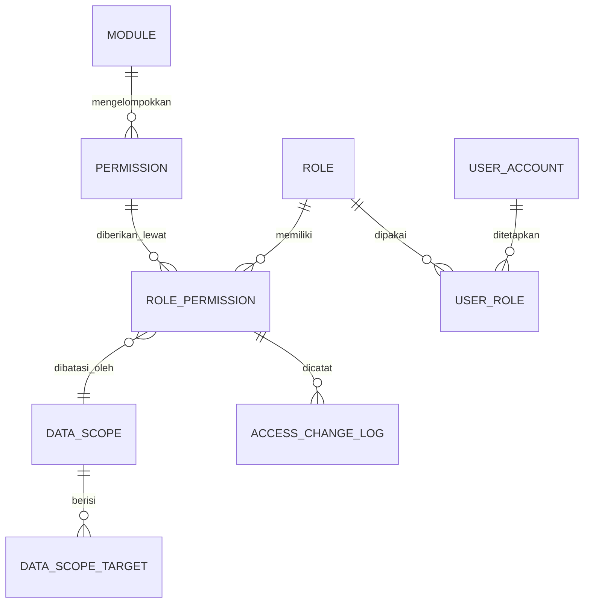
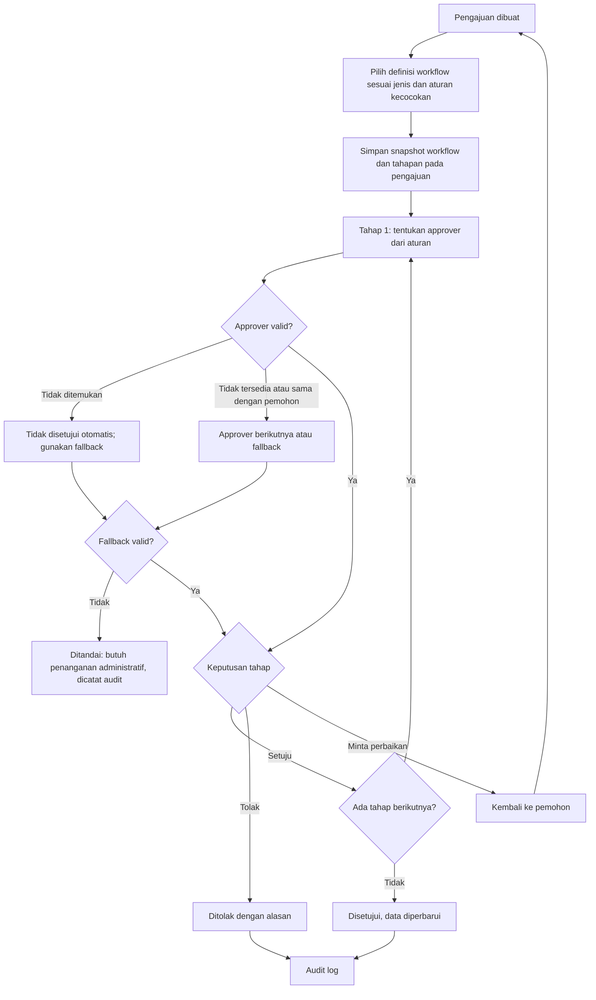
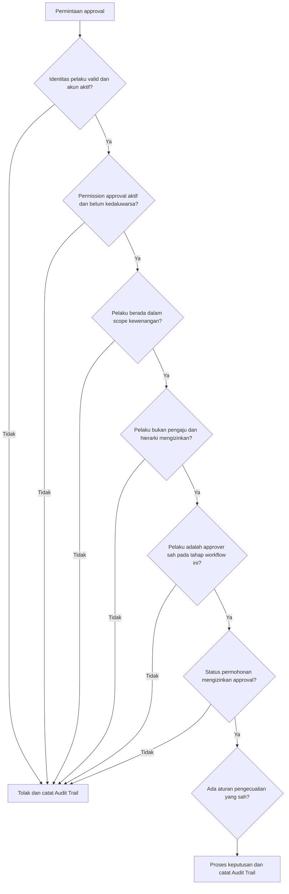

# Rancangan Konseptual Configurable RBAC dan Approval Workflow – J-Absen

**Status:** Dokumen Arsitektur & Rancangan Hak Akses FINAL (Revisi 5 / Baseline Final v1.0).
Seluruh keputusan desain (K-1 s.d. K-15) dan seluruh item arsitektural (P-1 s.d. P-19) telah disetujui resmi dan berstatus **FINAL**. Tidak ada item pending yang tersisa. Bukan desain teknis final, bukan skema database, bukan spesifikasi API. Belum ada yang diimplementasikan.
**Acuan:** PRD bagian 5.15 dan 5.16.

## 1. Model konseptual permission

| Konsep | Penjelasan |
|---|---|
| Module | Kelompok fitur (Karyawan, Enrollment, Absensi, Jadwal, Cuti, Koreksi, Laporan, Audit, Pengaturan, dst.). Dapat ditambah. |
| Permission | Pasangan **resource + action** (contoh: `leave_request.approve`). Resource dapat berupa modul, menu, halaman, data, atau button/action. Katalog dapat bertambah tanpa mengubah logika otorisasi. |
| Role | Kumpulan permission dengan nama dan deskripsi. Role awal dari PRD; dapat dibuat, diubah, dinonaktifkan. |
| Role Permission | Menghubungkan role dengan permission beserta **data scope**. |
| User Role | Menghubungkan akun karyawan dengan satu atau lebih role. |
| Access Change Log | Riwayat perubahan (sebelum/sesudah, aktor, waktu, alasan). |

Jabatan, departemen, akun, role, dan permission adalah **konsep terpisah** (K-14). Pemetaan jabatan ke role adalah konfigurasi, bukan kode. Jabatan HRD tidak otomatis menjadi permission; karyawan HRD dapat dipetakan ke role HR/Admin HR melalui konfigurasi.

### Aturan evaluasi (keputusan K-1, K-4, K-5)
1. **Default DENY.** Permission yang belum dikonfigurasi, belum disetujui, atau bertanda ❓ dianggap tidak diberikan. Jabatan tidak memberi akses otomatis.
2. Backend memeriksa: (a) akun aktif, (b) permission untuk aksi, (c) cakupan data untuk objek yang diakses.
3. **Multi-role = union of permissions (Allow).** Bila tidak ada Allow yang berlaku, akses ditolak. Deny override tidak diterapkan pada tahap awal, kecuali diperlukan secara teknis dan telah didokumentasikan.
4. Kode tidak boleh bercabang berdasarkan nama role.

### Contoh tindakan standar (dapat diperluas)

| Tindakan | Contoh pemakaian |
|---|---|
| view/read | Lihat daftar dan detail |
| create | Tambah data |
| update | Ubah data |
| delete / archive | Hapus atau arsipkan (PRD mengutamakan arsip dan jejak histori) |
| approve / reject / request_revision | Persetujuan |
| export / import | Ekspor Excel, impor data |
| assign | Penugasan jadwal, role, supervisor |
| activate / deactivate | Akun, lokasi, role |
| configure | Pengaturan modul |
| manage_roles, manage_workflows | Pengelolaan role/permission dan workflow (permission khusus, lihat bagian 5) |
| tindakan lain | Ditambahkan melalui katalog |

## 2. Konsep matriks permission dinamis

Matriks berbentuk **Role × (Modul → Permission) × Cakupan data**, dengan status per sel:

| Status sel | Arti |
|---|---|
| Aktif + cakupan | Permission diberikan dengan cakupan tertentu |
| Nonaktif / DENY | Tidak diberikan (**default**) |
| Belum diputuskan (❓) | Diperlakukan sebagai DENY, ditampilkan dengan penanda, bukan permission final |

Fungsi matriks (K-12):
- **Baseline konservatif:** konfigurasi awal diambil dari [Draft_Matriks_Hak_Akses.md](file:///C:/Users/EKA%20JACX/Documents/J-absen/Draft_Matriks_Hak_Akses.md); permission yang belum ditetapkan tetap DENY.
- **Seed konfigurasi,** bukan permission yang ditanam di kode, dan bukan aturan permanen.
- **Template role:** dapat disalin ke role baru.
- **Dasar UI:** satu sel = satu pengaturan yang dapat diubah; semua permission dapat dikonfigurasi sesuai kemampuan sistem.

## 3. Konsep data scope dinamis (K-6)

Setiap cakupan dapat dikonfigurasi **terpisah**:

| Cakupan | Penentuan | Sumber data |
|---|---|---|
| Own | Karyawan = pengguna | Akun-karyawan |
| Direct Subordinates | Karyawan yang `reports_to` pengguna | Hierarki pelaporan |
| Descendants | Seluruh bawahan bertingkat | Hierarki pelaporan (rekursif) |
| Team | Anggota tim | Hanya jika Team digunakan (PRD 4.3.2) |
| Department | Karyawan di departemen yang sama | Penempatan departemen |
| Selected Departments | Daftar departemen yang dikonfigurasi | Konfigurasi scope |
| Organization | Semua data perusahaan | – |
| Custom scope | Cakupan khusus (misal per lokasi atau unit) yang dapat dikembangkan | Perluasan |

Aturan:
- Cakupan melekat pada role-permission (misalnya read absensi: Department; approve cuti: Direct Subordinates).
- Dihitung di backend dari struktur organisasi dan penempatan karyawan, bukan dari nama role.
- Berlaku di semua jalur: daftar, detail, pencarian, dashboard, laporan, ekspor.
- Perubahan jabatan atau penempatan memengaruhi cakupan otomatis.
- Pemberian cakupan oleh pengelola dibatasi oleh cakupan yang dimilikinya (K-3).

## 4. Konsep approval workflow yang configurable

### 4.1 Komponen konfigurasi
- **Definisi workflow** per jenis pengajuan (cuti, koreksi, jenis lain yang ditambahkan).
- **Aturan kecocokan** (opsional): kapan workflow dipakai (misal departemen, jenis cuti, durasi).
- **Tahapan:** urutan, nama, jumlah.
- **Aturan penentuan approver (K-7)**, dapat dikembangkan: role, jabatan, struktur organisasi, atasan langsung, atasan bertingkat, pengguna tertentu, dan aturan khusus lain yang nantinya disetujui. Tidak ada approver yang dikunci pada jabatan CEO, GM, Supervisor, atau HR.
- **Mode persetujuan (K-8):** single approval, sequential approval, dan parallel approval; mode dan tahapan dikonfigurasi. Parallel approval mendukung **unanimous** atau **quorum** yang dapat dikonfigurasi per workflow. Default: semua approver yang ditetapkan wajib setuju; satu penolakan menolak pengajuan, kecuali workflow secara eksplisit menetapkan mekanisme lain. Nilai quorum ditetapkan per workflow.
- **Fallback** yang dikonfigurasi untuk approver tidak tersedia.

### 4.2 Kondisi khusus (K-9, prinsip awal)
1. Approver tidak ditemukan: pengajuan **tidak** otomatis disetujui.
2. Approver tidak tersedia: gunakan fallback yang dikonfigurasi.
3. Self-approval tidak diperbolehkan secara default.
4. Pemohon = approver pada tahap yang sama: gunakan approver berikutnya atau fallback yang dikonfigurasi.
5. Tidak ada fallback valid: pengajuan ditandai membutuhkan penanganan administratif.
6. Kondisi khusus yang melibatkan perubahan atau tindakan administratif dicatat di audit log.

### 4.3 Perubahan workflow dan pengajuan berjalan (K-10)
- Perubahan konfigurasi berlaku untuk pengajuan **baru**.
- Pengajuan berjalan menyimpan **snapshot** workflow dan tahapan saat dibuat; tidak diubah otomatis.
- Perubahan pada pengajuan berjalan hanya melalui mekanisme administratif yang jelas, terkontrol, dan tercatat.

### 4.4 Pengelolaan workflow (K-13)
- Dapat diberikan kepada role atau pengguna dengan permission khusus (`manage_workflows`).
- Admin IT tidak otomatis berwenang kecuali permission tersebut diberikan.
- Permission ini dapat dikonfigurasi.

**Penting:** workflow final untuk setiap jenis pengajuan belum ditetapkan dan memerlukan persetujuan. Tidak ada contoh alur yang dianggap keputusan.

## 5. Keamanan

| Prinsip | Rancangan |
|---|---|
| Least privilege / default DENY | Role baru dimulai tanpa permission (K-1) |
| Backend authorization | Setiap endpoint atau aksi sensitif memeriksa permission dan cakupan data |
| UI bukan kontrol | Menu/button hanya mengikuti hasil otorisasi backend |
| Pengelolaan role/permission (K-2, P-2) | Permission khusus (`manage_roles`) tetap dapat dikonfigurasi; pada tahap awal dipegang penuh oleh Admin IT dan dapat diberikan ke pengguna lain hanya secara eksplisit oleh Admin IT. Seluruh tindakan tercatat di audit log; Admin IT tidak dapat menghapus atau memanipulasi audit trail aktivitasnya sendiri |
| Batas delegasi (K-3) | Pengelola tidak dapat memberi permission, cakupan data, atau kewenangan delegasi melebihi miliknya; pencegahan privilege escalation divalidasi di backend, termasuk saat mengedit role milik sendiri |
| Penerapan perubahan (K-4) | Berlaku secepat mungkin setelah disimpan; pemberian dan pencabutan memperbarui otorisasi; cache permission diperbarui atau diinvalidasi; backend konsisten dengan permission terbaru; bukan hanya tampilan menu |
| Re-authentication (K-4) | Perubahan hak akses kritis dapat mensyaratkan re-authentication |
| Anti-lockout | Selalu ada minimal satu akun aktif dengan permission pengelolaan hak akses; perubahan yang melanggar ditolak |
| Permission kritis | Ditandai (kelola role/permission, kelola workflow, kelola akun, ekspor data massal, lihat audit log, konfigurasi sistem) |
| Pratinjau dampak | Sebelum menyimpan, tampilkan permission yang ditambah/dicabut dan cakupan yang melebar |
| Audit | Perubahan role, permission, cakupan, hubungan akun-role, workflow, dan tindakan administratif approval dicatat |

## 6. Konsep UI pengelolaan hak akses

| Area | Isi |
|---|---|
| Daftar role | Nama, deskripsi, status, jumlah akun terhubung, tambah/nonaktifkan |
| Editor permission | Pilih role → pilih modul → daftar permission dengan toggle/checkbox dan selektor cakupan data |
| Penanda | Aktif, nonaktif/DENY, belum diputuskan, permission kritis, permission di atas batas kewenangan pengelola (dinonaktifkan di UI) |
| Bantuan matriks besar | Pencarian, filter modul dan status, pengelompokan per modul, pilih semua per kelompok, bandingkan dua role |
| Simpan | Dialog konfirmasi berisi ringkasan dampak, re-authentication bila kritis, toast hasil |
| Riwayat | Timeline perubahan per role dengan filter tanggal dan aktor |
| Akun-role | Menetapkan atau mencabut role akun; pemetaan jabatan ke role sebagai konfigurasi (K-14) |
| Workflow | Daftar definisi, editor tahapan/mode/aturan approver/fallback, riwayat versi, daftar pengajuan yang membutuhkan penanganan administratif |

## 7. Rekomendasi desain untuk implementasi selanjutnya

1. **Satu titik otorisasi** (policy layer) yang menerima (pengguna, permission, objek) dan mengembalikan izin atau tolak; tanpa pengecekan nama role.
2. **Katalog permission sebagai data** (seed berversi); modul baru cukup menambah entri.
3. **Scope resolver** terpusat yang menerjemahkan semua jenis cakupan (termasuk Descendants) menjadi filter data untuk daftar, detail, dashboard, laporan, dan ekspor.
4. **Seed dari matriks baseline konservatif**; sel ❓ dibuat DENY.
5. **Guard privilege escalation dan anti-lockout** di backend pada penyimpanan perubahan.
6. **Invalidasi cache permission** saat perubahan disimpan, dan pemeriksaan versi permission pada setiap permintaan atau sesi.
7. **Workflow engine sederhana:** definisi, tahapan, aturan approver, mode, snapshot per pengajuan, riwayat keputusan, penanganan kondisi khusus.
8. **Audit log terstruktur** (sebelum/sesudah) untuk hak akses, workflow, dan tindakan administratif.
9. **Uji otorisasi otomatis** per permission dan cakupan, termasuk akses di luar cakupan lewat API langsung, escalation, dan lockout.
10. **Urutan tahap yang disarankan:** (a) selesaikan keputusan tertunda; (b) desain teknis dan skema; (c) policy layer dan katalog; (d) UI pengelolaan; (e) workflow engine; (f) integrasi ke modul.

## 8. Daftar keputusan

### 8.1 Telah diterapkan (disetujui)

| ID | Keputusan | Ringkasan |
|---|---|---|
| K-1 | Default permission | Belum dikonfigurasi/belum disetujui/❓ = DENY; jabatan tidak memberi akses otomatis |
| K-2 | Pengelolaan role dan permission | Dapat diberikan ke Admin IT atau pengguna lain dengan permission khusus; tidak otomatis; permission-nya dapat dikonfigurasi |
| K-3 | Batas delegasi | Tidak boleh melebihi kewenangan sendiri; mencegah privilege escalation |
| K-4 | Penerapan perubahan | Berlaku secepat mungkin; cache diinvalidasi; backend konsisten; re-auth untuk hak kritis |
| K-5 | Multi-role | Union of permissions (Allow); tanpa Allow = tolak; tanpa Deny override kompleks |
| K-6 | Data scope | Own, Direct Subordinates, Descendants, Team (jika digunakan), Department, Selected Departments, Organization, Custom |
| K-7 | Penentuan approver | Role, jabatan, struktur organisasi, atasan langsung/bertingkat, pengguna tertentu, aturan khusus lain; tidak dikunci pada jabatan |
| K-8 | Mode persetujuan | Single, sequential, parallel; dapat dikonfigurasi |
| K-9 | Kondisi khusus | Enam prinsip pada bagian 4.2 |
| K-10 | Workflow dan pengajuan berjalan | Berlaku untuk pengajuan baru; snapshot untuk yang berjalan |
| K-12 | Matriks permission awal | Baseline konservatif, DENY bila belum ditetapkan, bukan hardcoded |
| K-13 | Pengelolaan workflow | Role/pengguna dengan permission khusus; Admin IT tidak otomatis |
| K-14 | Pemetaan HRD ke role | Jabatan bukan permission; pemetaan ke role adalah konfigurasi |

### 8.2 Keputusan final tambahan (Revisi 4)

| ID | Keputusan | Rancangan |
|---|---|---|
| K-11 | Scope permission: global, lokasi, unit/departemen, penugasan khusus; configurable, tidak otomatis memberi akses | Dimensi scope tambahan pada role-permission (lihat 10.1) |
| K-15 | Role terikat data, assignment, atau histori dinonaktifkan; hapus permanen hanya jika belum pernah digunakan dan tanpa keterikatan | Penonaktifan sebagai jalur normal (lihat 10.2) |
| – | Parallel approval: unanimous atau quorum per workflow; default semua wajib setuju; satu penolakan menolak, kecuali workflow menetapkan lain | Bagian 4.1 |
| – | Permission kritis eksplisit; tindakan kritis wajib re-authentication | Lihat 10.3 |
| – | Revocation efektif paling lambat 60 detik; invalidasi cache/session; tindakan kritis memvalidasi akses terbaru | Lihat 10.4 |
| – | Fallback fail-safe: tidak ada persetujuan otomatis; exception dicatat, notifikasi dikirim, ada mekanisme penanganan oleh pihak berwenang | Lihat 10.5 |
| – | Matriks: least privilege, deny-by-default, scope-based; final harus disetujui sebelum implementasi permission final | Bagian 2 |
| – | Workflow cuti: configurable, bertingkat atau parallel, validasi saldo per jenis cuti, audit trail, tanpa self-approval default; workflow dan approver final ditetapkan sebelum implementasi | Lihat 10.6 |
| – | Koreksi absensi: pengajuan, alasan, approval, audit trail; record asli tidak dihapus; nilai sebelum dan sesudah disimpan; koreksi manual wajib permission dan audit log | Lihat 10.7 |
| P-2 | FINAL: Admin IT pemegang penuh kewenangan administratif sistem pada tahap awal; permission HRD, CEO, GM, Supervisor, Staff ditentukan eksplisit oleh Admin IT melalui matriks; jabatan atau nama role tidak memberi permission otomatis | Lihat 10.8 |
| – | FINAL: approval bisnis DENY default termasuk Admin IT; permission approval hanya eksplisit; pembatasan hierarki (self-approval dilarang; Supervisor tidak menyetujui GM/CEO; GM tidak menyetujui CEO; Staff tidak menyetujui atasan); pengecualian hierarki hanya lewat mekanisme eksplisit; validasi dan Audit Trail | Lihat 10.9 |
| P-16 | FINAL: CEO memegang permission khusus memberi approval kepada Admin IT; Admin IT tidak dapat memberi approval kepada dirinya sendiri; kritis, re-authentication, Audit Trail | Lihat 10.9 |
| P-17 | FINAL: approver di luar garis pelaporan boleh bila permission, scope, workflow mengizinkan, bukan bawahan pengaju, dan bukan pengaju; approver untuk pengaju CEO ditetapkan eksplisit di workflow | Lihat 10.9 |
| P-18 | FINAL: pengecualian hierarki ditunda | Lihat 10.9 |
| P-19 | FINAL: review enrollment wajah dan persetujuan serupa = approval bisnis, DENY default | Lihat 10.9 |

### 8.3 Register Item Pending

> **Status: BERSIH (0 item pending).**  
> Seluruh item pertimbangan bisnis (P-1 s.d. P-19) telah tuntas diputuskan dan ditetapkan secara resmi sebagai **FINAL**.
## 9. Daftar perubahan pada dokumen (Revisi 4)

| Dokumen | Perubahan |
|---|---|
| [PRD_Final_v1.0_Sistem_Absensi.md](file:///C:/Users/EKA%20JACX/Documents/J-absen/PRD_Final_v1.0_Sistem_Absensi.md) | 5.10, 5.11, 5.15.9–5.15.13 (baru), 5.16.1, 5.16.4 (baru), 6 (aturan 18–21), 13.9, 18 (Revisi 4), 19 (baru: register keputusan dan pending) |
| Rancangan_Configurable_RBAC.md | Status, parallel approval, bagian 8 dan 10 diperbarui |
| Draft_Matriks_Hak_Akses.md | Catatan Revisi 4 |
| (Revisi 5-6) PRD, Rancangan, Matriks | Revisi 5: keputusan P-2 (Admin IT). Revisi 6: default DENY approval bisnis dan pembatasan hierarki (PRD 5.16.5; rancangan 10.9) |

## 10. Rancangan keputusan tambahan (konseptual)

### 10.1 Scope permission (K-11)
Role-permission memiliki dua dimensi pembatas yang bekerja bersama:
1. **Cakupan data hierarkis** (bagian 3): Own sampai Organization.
2. **Scope permission:** global, lokasi (daftar lokasi), unit/departemen (daftar unit), penugasan khusus.

Akses terjadi hanya jika permission Allow ada **dan** objek berada dalam scope. Scope tanpa permission tidak memberi akses. Detail penugasan khusus dan acuan lokasi masih pending (P-8, P-9).

### 10.2 Siklus hidup role (K-15)
- Role baru → aktif → nonaktif. Nonaktif tetap menyimpan histori dan assignment.
- Role nonaktif tidak dapat diberikan ke akun baru dan tidak memberi permission (diperlakukan DENY) setelah penonaktifan; akun yang masih terhubung ditangani sesuai 5.15.3.
- Hapus permanen hanya jika role belum pernah dipakai (tanpa assignment, histori, atau keterikatan data); tindakan ini permission kritis dan tercatat.

### 10.3 Permission kritis dan re-authentication
- Kategori: perubahan permission kritis, pengelolaan role sensitif, konfigurasi keamanan, tindakan sensitif pada akun, konfigurasi audit yang memengaruhi integritas audit.
- Setiap permission ditandai atribut "kritis" secara eksplisit di katalog (bukan disimpulkan otomatis).
- Eksekusi tindakan kritis didahului re-authentication; hasil dan percobaan gagal dicatat di audit log.
- Daftar konkret menunggu P-1 dan masa berlaku re-authentication menunggu P-7.

### 10.4 Revocation 60 detik
- Setiap perubahan permission, role, scope, atau status akun menaikkan versi otorisasi pengguna terkait.
- Backend memeriksa versi tersebut pada setiap permintaan; cache atau sesi dengan versi lama ditolak atau diperbarui.
- Batas maksimum 60 detik berlaku sebagai ketentuan terburuk; target teknis lebih cepat.
- Tindakan kritis selalu membaca otorisasi terbaru dari sumber utama, bukan dari cache.

### 10.5 Fallback fail-safe
- Kondisi pemicu exception: approver tidak ditemukan, tidak aktif, tidak merespons, atau gagal teknis.
- Hasil: pengajuan tetap berstatus menunggu atau ditandai membutuhkan penanganan administratif; **tidak** pernah disetujui otomatis.
- Sistem mencatat exception di audit log, mengirim notifikasi (saluran: P-5), dan menyediakan antrean penanganan bagi pihak berwenang (P-6).
- Penanganan oleh pihak berwenang (misalnya penugasan ulang approver) tercatat dengan alasan.

### 10.6 Workflow cuti
- Dikonfigurasi: tahapan, mode (single, sequential, parallel; unanimous atau quorum), approver, fallback.
- Validasi saldo sesuai jenis cuti sebelum pengajuan diterima (aturan per jenis cuti: P-10).
- Audit trail penuh, snapshot workflow per pengajuan, self-approval ditolak secara default.
- Workflow dan approver final ditetapkan sebelum implementasi (P-3).

### 10.7 Workflow koreksi absensi
- Alur: pengajuan (alasan, bukti bila perlu) → approval sesuai workflow → penerapan.
- Record asli tidak dihapus; perubahan menyimpan nilai sebelum dan sesudah, approver, alasan, dan waktu.
- Koreksi manual (oleh pihak berwenang) memerlukan permission khusus dan audit log.
- Pemohon sesuai PRD 5.11 (karyawan sendiri; HR atas nama; pihak lain hanya bila diberi kewenangan eksplisit).

### 10.8 Pemegang permission
- **Keputusan final P-2:** pada tahap awal, Admin IT adalah pemegang penuh kewenangan administratif: Role & Permission (buat, ubah, aktifkan, nonaktifkan, tetapkan role), pemberian dan pencabutan permission kepada seluruh user, scope permission, user dan akun, konfigurasi workflow dan approver, exception workflow, Employee/Attendance/Leave Management dan modul lain secara administratif, konfigurasi sistem dan keamanan, serta akses audit log (monitoring, investigasi, audit).
- Admin IT menentukan permission bagi HRD, CEO, GM, Supervisor, dan Staff melalui matriks yang dikelola di sistem. Jabatan atau nama role tidak otomatis memberi permission; permission diberikan eksplisit.
- Kontrol keamanan tetap berlaku: semua tindakan administratif tercatat di audit log; tindakan kritis wajib re-authentication; Admin IT tidak dapat menghapus, memanipulasi, atau menghilangkan audit trail aktivitas administratifnya sendiri (akses audit log hanya baca, log bersifat append-only).
- Model ini berlaku pada tahap awal; perubahan melalui review dan change request.
- **Dampak desain:** (a) permission tetap data konfigurasi, bukan hardcoded; Admin IT adalah pemegang yang ditetapkan pada seed awal, (b) anti-lockout dan perlindungan atas akun Admin IT (P-14), (c) pemisahan hak: kewenangan administratif tidak otomatis menjadi hak approver bisnis (keputusan final, lihat 10.9), (d) pengawasan atas aktivitas Admin IT (P-15).
- Matriks final tetap perlu disetujui sebelum implementasi permission dinyatakan final (P-12).

### 10.9 Approval bisnis: default DENY dan pembatasan hierarki (keputusan final)

**Prinsip**
- Permission approval bisnis DENY secara default bagi semua, termasuk Admin IT. Hak administrasi sistem tidak memberi hak approval.
- Permission approval hanya diberikan eksplisit melalui Permission Management dan workflow yang sah. CEO dan GM dapat diberi approval sesuai kebutuhan, workflow, scope, hierarki; Supervisor sesuai hierarki dan workflow; HRD hanya bila eksplisit.
- CEO dapat memberi permission approval kepada Admin IT, dengan pembatasan modul, scope, workflow, dan masa berlaku bila ditentukan. Pemberian, perubahan, pencabutan dicatat di Audit Trail.

**Larangan berdasarkan hierarki**

| Pengaju | Tidak boleh menyetujui |
|---|---|
| Siapa pun | Dirinya sendiri (self-approval) |
| GM atau CEO | Supervisor |
| CEO | GM |
| Atasan | Staff (bawahan) |
| Umum | Approver tidak boleh menyetujui permohonan atasannya bila aturan hierarki melarang |

**Keputusan lanjutan (final):**
- CEO memegang permission khusus untuk memberi permission approval kepada Admin IT; Admin IT tidak dapat memberi approval kepada dirinya sendiri; tindakan kritis (re-authentication) dan tercatat di Audit Trail (P-16). Ini pengecualian atas kewenangan Admin IT memberi permission.
- Approver di luar garis pelaporan (HRD, Admin IT yang diberi permission, lintas departemen) boleh bila permission, scope, dan workflow mengizinkan, dan approver bukan bawahan (descendant) pengaju serta bukan pengaju sendiri. Approver untuk pengaju CEO ditetapkan eksplisit pada workflow (P-17).
- Pengecualian hierarki ditunda; tidak ada pengecualian sampai ada rancangan dan change request (P-18).
- Review enrollment wajah dan persetujuan serupa diperlakukan sebagai approval bisnis: DENY default termasuk Admin IT, diberikan eksplisit; aturan hierarki pengaju-atasan tidak berlaku bila tidak ada relasi tersebut, validasi lain tetap berlaku (P-19).

**Urutan validasi sebelum approval diproses (konseptual, semuanya harus lolos)**

Daftar yang divalidasi: identitas pelaku; permission approval aktif; scope kewenangan; hierarki pengaju dan approver; workflow yang berlaku; status permohonan; larangan self-approval; pembatasan approval terhadap atasan; aturan pengecualian bila ada. Tindakan yang tidak memenuhi aturan ditolak dan dicatat di Audit Trail.

**Dampak desain**
- Authorization Engine memeriksa hierarki dan relasi pengaju-approver selain permission dan scope; tidak ada pengecualian implisit untuk role mana pun.
- Permission Matrix: semua sel approval DENY pada seed awal, termasuk Admin IT.
- Approval Workflow: penentuan approver tidak boleh menghasilkan approver yang melanggar larangan hierarki; bila tidak ada approver valid, berlaku fail-safe (5.16.4).
- Audit Trail mencatat juga penolakan approval.
### 10.10 Katalog Permission Kritis & Re-Authentication (FINAL P-1, P-7)
- **Flag Sistem**: Permission kritis ditandai eksplisit di database katalog dengan `is_critical = true`.
- **Daftar Baseline**:
  - `role.create`, `role.update`, `role.deactivate`, `role.assign_permissions`
  - `user_role.assign`, `user_role.revoke`
  - `admin_it.grant_approval` (eksklusif oleh CEO)
  - `security_config.update`, `geofence.update`
  - `user_account.deactivate`, `user_account.reset_credential`
  - `face_enrollment.reset`
  - `audit_log.export`, `employee.export_full`
- **Grace Period**: Masa berlaku verifikasi re-authentication adalah **10 menit**. Selama jendela 10 menit, eksekusi aksi kritis berikutnya tidak meminta password ulang. Setelah 10 menit idle atau logout, re-auth wajib diminta kembali.

### 10.11 Baseline Workflow Cuti & Koreksi Absensi (FINAL P-3)
- **Cuti (Leave Request)**:
  - Staff / Karyawan: 1 Tahap -> Direct Supervisor (`reports_to`). Approved -> Saldo terpotong -> Selesai.
  - Supervisor: 1 Tahap -> General Manager (GM).
  - General Manager (GM): 1 Tahap -> CEO.
  - CEO: Executive Notice (terekam di audit trail & kalender).
- **Koreksi Absensi (Attendance Correction)**:
  - Staff / Karyawan: 2 Tahap Sequential:
    - Tahap 1: Direct Supervisor (verifikasi alasan & bukti).
    - Tahap 2: HR/Admin HR (verifikasi data rekaman & update attendance record).
  - Supervisor: Tahap 1: GM -> Tahap 2: HR/Admin HR.
  - GM: Tahap 1: CEO -> Tahap 2: HR/Admin HR.

### 10.12 Timeout Approver 48 Jam & Notifikasi In-App (FINAL P-4, P-5)
- **SLA Respon**: 48 jam kerja per tahap (tidak menghitung hari libur/akhir pekan).
- **Fail-Safe Escalation**: Keterlambatan respon mengubah status menjadi `PENDING_ESCALATION` dan masuk antrean exception. Tidak pernah terjadi auto-approval.
- **Saluran Notifikasi**: In-App Notification (ikon lonceng & antrean aksi di web desktop/mobile) + banner peringatan pada dashboard Admin IT dan Approver.

### 10.13 Validasi Saldo Cuti (FINAL P-10)
- `LEAVE_TYPE.requires_quota`: `true` untuk Cuti Tahunan; `false` untuk cuti khusus/sakit.
- `LEAVE_TYPE.allow_negative_balance`: Default `false`. Form submit diblokir jika saldo kurang dari durasi yang diajukan.

### 10.14 Aturan Kuorum Parallel Approval (FINAL P-11)
- **Mode UNANIMOUS (Default)**: 100% persetujuan wajib. 1 penolakan langsung menolak permohonan.
- **Mode QUORUM**: Dikonfigurasi dengan persentase atau angka minimum. Jika jumlah penolakan telah melampaui batas matematis kuorum, pengajuan langsung otomatis ditolak (*early rejection*).

### 10.15 Proteksi Akun Admin IT & Integritas Audit Log WORM (FINAL P-14, P-15)
- **Anti-Lockout**: Minimal 2 akun Admin IT aktif wajib dipertahankan. Sistem menolak deaktivasi atau pencabutan role Admin IT pada akun aktif terakhir.
- **Larangan Self-Deactivation**: Akun Admin IT tidak dapat menonaktifkan akun sendiri atau mencabut role sendiri.
- **Integritas WORM**: Tabel `AUDIT_LOG` hanya mengizinkan `INSERT` dan `SELECT`. Operasi `UPDATE`, `DELETE`, `TRUNCATE`, `DROP` diblokir di database.
- **Pengawasan Independen**: CEO memegang permission `audit_log.view_all` untuk memantau aktivitas administratif Admin IT.

### 10.16 Acuan Scope Lokasi & Masa Berlaku Custom Scope (FINAL P-8, P-9)
- **Scope Lokasi**: Mengacu pada kantor penempatan resmi karyawan (`Employee.office_location_id`), bukan posisi GPS real-time.
- **Custom Scope**: Wajib memiliki `valid_from` dan `valid_to`. Akses otomatis gugur saat tanggal melewati `valid_to`.
